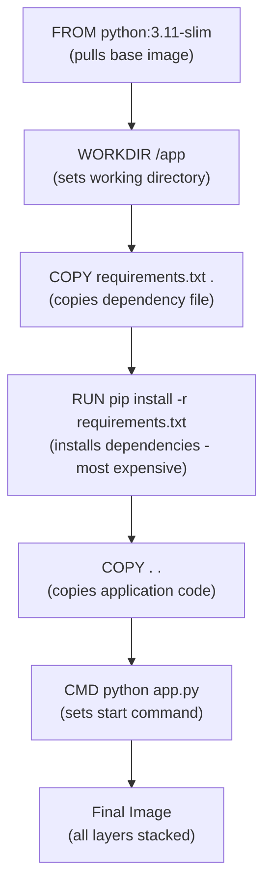

# Building Images

Building Docker images from code is one of the most powerful things you can automate. Instead of running `docker build` in a shell script, you can trigger builds directly from Python, stream the build output, and immediately use the resulting image — all inside the same script.

In this guide, we will learn how to build images from a Dockerfile, stream build output, and handle build errors cleanly.

---

## How a Build Works

When you tell Docker to build an image, it goes through the Dockerfile instruction by instruction. Each instruction creates a new read-only layer. Docker caches these layers, so if nothing changed in an instruction (and all layers before it), it reuses the cached layer — making rebuilds very fast.



---

## Build Context — What Gets Sent to the Daemon

One thing that trips people up: when you call `images.build()`, the entire directory you point it at is packaged into a `.tar` file called the **build context** and sent to the Docker daemon. The daemon then runs the Dockerfile against that context.

This means:
- Files in that directory are accessible via `COPY` in the Dockerfile.
- Large directories with `node_modules/` or `.git/` make the context huge and slow. Use a `.dockerignore` file to exclude them.

---

## Building From a Local Dockerfile

The most common case: you have a project directory with a `Dockerfile` in it, and you want to build an image programmatically.

```python
import docker
from docker.errors import BuildError, DockerException

def build_image(dockerfile_dir, image_tag):
    try:
        client = docker.from_env()
        
        print(f"Building image '{image_tag}' from '{dockerfile_dir}'...")
        print("This might take a few minutes on first build...\n")
        
        # images.build() returns (image, generator_of_logs)
        image, build_logs = client.images.build(
            path=dockerfile_dir,
            tag=image_tag,
            rm=True,        # Remove intermediate containers after a successful build
            forcerm=True    # Remove intermediate containers even after failed builds
        )
        
        # Print the build output
        for log_entry in build_logs:
            if 'stream' in log_entry:
                line = log_entry['stream'].strip()
                if line:
                    print(f"  {line}")
        
        size_mb = image.attrs['Size'] / (1024 * 1024)
        print(f"\nBuild successful!")
        print(f"  Tag:  {image_tag}")
        print(f"  ID:   {image.short_id}")
        print(f"  Size: {size_mb:.2f} MB")
        
        client.close()
        return image

    except BuildError as e:
        print(f"\nBuild FAILED:")
        for log_entry in e.build_log:
            if 'stream' in log_entry:
                line = log_entry['stream'].strip()
                if line:
                    print(f"  {line}")
            if 'error' in log_entry:
                print(f"  ERROR: {log_entry['error'].strip()}")
        return None
    except DockerException as e:
        print(f"Docker error: {e}")
        return None

# Build from a local project directory
build_image(
    dockerfile_dir="./my-flask-app",
    image_tag="my-flask-app:1.0.0"
)
```

### Expected Output
```text
Building image 'my-flask-app:1.0.0' from './my-flask-app'...
This might take a few minutes on first build...

  Step 1/6 : FROM python:3.11-slim
  Step 2/6 : WORKDIR /app
  Step 3/6 : COPY requirements.txt .
  Step 4/6 : RUN pip install -r requirements.txt
   ---> Running in a2b3c4d5e6f7
  Step 5/6 : COPY . .
  Step 6/6 : CMD python app.py
  Successfully built a2b3c4d5

Build successful!
  Tag:  my-flask-app:1.0.0
  ID:   sha256:a2b3c4
  Size: 138.44 MB
```

---

## Building With Build Arguments

Some Dockerfiles accept build-time variables (declared with `ARG`). You pass these as a dict using the `buildargs` parameter.

```python
import docker
from docker.errors import BuildError, DockerException

def build_with_args(dockerfile_dir, image_tag, build_args):
    try:
        client = docker.from_env()
        
        print(f"Building '{image_tag}' with args: {build_args}")
        
        image, build_logs = client.images.build(
            path=dockerfile_dir,
            tag=image_tag,
            buildargs=build_args,   # Dict passed to ARG declarations in Dockerfile
            rm=True
        )
        
        for log_entry in build_logs:
            if 'stream' in log_entry:
                line = log_entry['stream'].strip()
                if line:
                    print(f"  {line}")
        
        print(f"\nBuild done: {image.short_id}")
        client.close()
        return image

    except BuildError as e:
        for line in e.build_log:
            if 'error' in line:
                print(f"  ERROR: {line['error'].strip()}")
        return None

# Example: build with different app versions
build_with_args(
    dockerfile_dir="./worker-service",
    image_tag="worker-service:2.1.0",
    build_args={
        "APP_VERSION": "2.1.0",
        "ENVIRONMENT": "production"
    }
)
```

### Expected Output
```text
Building 'worker-service:2.1.0' with args: {'APP_VERSION': '2.1.0', 'ENVIRONMENT': 'production'}
  Step 1/5 : FROM python:3.11-slim
  Step 2/5 : ARG APP_VERSION
  Step 3/5 : ARG ENVIRONMENT
  Step 4/5 : ENV APP_VERSION=2.1.0 ENVIRONMENT=production
  Step 5/5 : COPY . /app

Build done: sha256:b3c4d5
```

---

## Real-World Script: Build, Tag, and Verify

In a CI pipeline, you typically build an image, tag it with both a version and `latest`, then verify the image exists before pushing. Here is a complete example of that flow.

```python
import docker
from docker.errors import BuildError, DockerException

def build_tag_verify(project_dir, app_name, version):
    client = docker.from_env()
    version_tag = f"{app_name}:{version}"
    latest_tag  = f"{app_name}:latest"
    
    try:
        print(f"Building {version_tag}...")
        
        image, build_logs = client.images.build(
            path=project_dir,
            tag=version_tag,
            rm=True
        )
        
        # Consume build logs to check for errors
        for log_entry in build_logs:
            pass  # In real use, you'd log these to a build log file
        
        print(f"Build done: {image.short_id}")
        
        # Tag it as latest too
        image.tag(app_name, tag="latest")
        print(f"Tagged as '{latest_tag}'")
        
        # Verify both tags exist locally
        v_img = client.images.get(version_tag)
        l_img = client.images.get(latest_tag)
        
        print(f"\nVerification:")
        print(f"  {version_tag} -> {v_img.short_id} ✓")
        print(f"  {latest_tag}  -> {l_img.short_id} ✓")
        
        client.close()
        return image

    except BuildError as e:
        print("Build failed.")
        for line in e.build_log:
            if 'error' in line:
                print(f"  {line['error'].strip()}")
        client.close()
        return None

build_tag_verify("./api-service", "my-registry/api-service", "3.2.1")
```

### Expected Output
```text
Building my-registry/api-service:3.2.1...
Build done: sha256:c4d5e6
Tagged as 'my-registry/api-service:latest'

Verification:
  my-registry/api-service:3.2.1 -> sha256:c4d5e6 ✓
  my-registry/api-service:latest  -> sha256:c4d5e6 ✓
```

---

## Common Mistakes

### 1. Ignoring the Build Log Generator
`images.build()` returns `(image, logs)`. If you never iterate the `logs` generator, you will not see build output AND the build may silently fail. Always consume the generator — even if you do not print every line — to surface errors.

### 2. Large Build Context Slowing Down Builds
If your project directory contains `node_modules/`, `.git/`, or large binary files, the entire directory gets sent to the Docker daemon as the build context. Always create a `.dockerignore` file to exclude unnecessary files.

### 3. Not Handling `BuildError` Separately From `DockerException`
`BuildError` is a subclass of `DockerException` with a `.build_log` attribute containing the detailed error from the Dockerfile. If you only catch `DockerException`, you lose this detail. Always catch `BuildError` first.

### 4. Forgetting `rm=True`
Every `RUN` instruction in a Dockerfile creates an intermediate container. Without `rm=True`, these containers accumulate on your host. Always pass `rm=True` (remove on success) and `forcerm=True` (remove on failure) to keep the system clean.

---

## Summary

* `client.images.build(path, tag)` builds an image from a directory containing a Dockerfile.
* `images.build()` returns a tuple `(Image, log_generator)` — always iterate the generator.
* Build log entries are dicts with keys like `stream`, `error`, `aux`, and `status`.
* Use `buildargs` dict to pass values to `ARG` declarations inside the Dockerfile.
* Use `rm=True` and `forcerm=True` to clean up intermediate containers after the build.
* `BuildError` contains a `build_log` attribute with the detailed Dockerfile error — catch it separately.
* After building, use `image.tag(repo, tag)` to add additional tags without rebuilding.
* Reduce build context size by creating a `.dockerignore` file to exclude `node_modules`, `.git`, and build artifacts.
* Verify both version and `latest` tags exist locally after building in CI pipelines.
* Layer caching is your friend — put the most stable instructions (`FROM`, `RUN pip install`) early in the Dockerfile for faster rebuilds.
