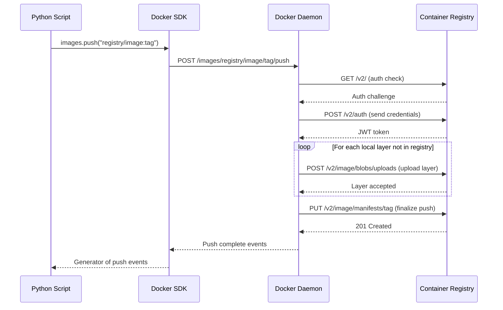

# Pushing Images

Once you have built an image, you need to push it to a registry so other machines (your production servers, CI/CD agents, Kubernetes nodes) can pull it. The Python Docker SDK makes it possible to push images directly from your automation scripts — after building and tagging, you can push in the same run without switching to the terminal.

In this guide, we will learn how to push images to Docker Hub and private registries, stream push progress, and handle authentication.

---

## Registry Types and When to Use Them

| Registry | Host | Best For | Auth Method |
| :--- | :--- | :--- | :--- |
| **Docker Hub** | `hub.docker.com` | Public images, open source projects | Docker Hub username + password/token |
| **AWS ECR** | `<account>.dkr.ecr.<region>.amazonaws.com` | Private images on AWS | IAM credentials + `aws ecr get-login-password` |
| **GitHub Container Registry** | `ghcr.io` | Projects on GitHub | GitHub personal access token |
| **Self-hosted** | Your own domain | Enterprises with strict data policies | Username + password |

---

## How Image Pushing Works



---

## Pushing to Docker Hub

To push to Docker Hub, your image must be tagged as `username/image-name:tag`.

```python
import docker
from docker.errors import APIError, DockerException

def push_to_dockerhub(username, image_name, tag, password):
    try:
        client = docker.from_env()
        full_tag = f"{username}/{image_name}:{tag}"
        
        print(f"Pushing '{full_tag}' to Docker Hub...")
        
        # images.push() returns a generator of JSON event strings
        push_output = client.images.push(
            repository=f"{username}/{image_name}",
            tag=tag,
            auth_config={"username": username, "password": password},
            stream=True,
            decode=True
        )
        
        for event in push_output:
            if 'status' in event:
                layer = event.get('id', '')
                status = event['status']
                if layer:
                    print(f"  [{layer[:12]}] {status}")
                else:
                    print(f"  {status}")
            if 'error' in event:
                raise DockerException(f"Push failed: {event['error']}")
        
        print(f"\nPush complete: '{full_tag}' is now on Docker Hub.")
        client.close()
        return True

    except APIError as e:
        print(f"API error during push: {e}")
        return False
    except DockerException as e:
        print(f"Push error: {e}")
        return False

push_to_dockerhub(
    username="myusername",
    image_name="my-flask-app",
    tag="1.0.0",
    password="my-docker-hub-token"
)
```

### Expected Output
```text
Pushing 'myusername/my-flask-app:1.0.0' to Docker Hub...
  [a1b2c3d4e5f6] Preparing
  [a1b2c3d4e5f6] Pushing
  [a1b2c3d4e5f6] Pushed
  [b2c3d4e5f6a1] Layer already exists
  [c3d4e5f6a1b2] Layer already exists
  Digest: sha256:abc123...
  latest: digest: sha256:abc123... size: 1234

Push complete: 'myusername/my-flask-app:1.0.0' is now on Docker Hub.
```

---

## Pushing to a Private Registry (No Auth Configured)

For private registries (e.g., your company's self-hosted registry), pass the registry URL as part of the image tag.

```python
import docker
from docker.errors import APIError, DockerException

def push_to_private_registry(registry_url, image_name, tag, username, password):
    try:
        client = docker.from_env()
        repository = f"{registry_url}/{image_name}"
        full_tag   = f"{repository}:{tag}"
        
        print(f"Pushing '{full_tag}' to private registry...")
        
        push_output = client.images.push(
            repository=repository,
            tag=tag,
            auth_config={"username": username, "password": password},
            stream=True,
            decode=True
        )
        
        for event in push_output:
            if 'status' in event and event.get('id'):
                print(f"  [{event['id'][:12]}] {event['status']}")
            if 'aux' in event:
                # aux contains the final digest and size
                digest = event['aux'].get('Digest', 'unknown')
                size   = event['aux'].get('Size', 0)
                print(f"\n  Digest: {digest}")
                print(f"  Size:   {size} bytes")
            if 'error' in event:
                raise DockerException(event['error'])
        
        print(f"Push complete.")
        client.close()
        return True

    except DockerException as e:
        print(f"Error: {e}")
        return False

push_to_private_registry(
    registry_url="registry.mycompany.com",
    image_name="api-service",
    tag="2.1.0",
    username="deploy-bot",
    password="registry-password"
)
```

### Expected Output
```text
Pushing 'registry.mycompany.com/api-service:2.1.0' to private registry...
  [a1b2c3d4e5f6] Pushed
  [b2c3d4e5f6a1] Layer already exists

  Digest: sha256:d4e5f6...
  Size:   52428800 bytes
Push complete.
```

---

## Real-World Script: Build, Tag, and Push in One Flow

This is the complete CI pipeline build step: build locally, add version and latest tags, then push both.

```python
import docker
from docker.errors import BuildError, APIError, DockerException

def build_and_push(project_dir, registry, image_name, version, username, password):
    client = docker.from_env()
    auth = {"username": username, "password": password}
    repo = f"{registry}/{image_name}"
    
    try:
        # Step 1: Build
        print(f"Step 1: Building {repo}:{version}...")
        image, logs = client.images.build(
            path=project_dir,
            tag=f"{repo}:{version}",
            rm=True
        )
        for log in logs:
            pass  # Consume generator
        print(f"  Built: {image.short_id}")
        
        # Step 2: Tag as latest
        image.tag(repo, "latest")
        print(f"  Tagged as latest")
        
        # Step 3: Push version tag
        print(f"Step 2: Pushing {repo}:{version}...")
        for event in client.images.push(repo, version, auth_config=auth, stream=True, decode=True):
            if 'error' in event:
                raise DockerException(event['error'])
        print(f"  Pushed version tag.")
        
        # Step 4: Push latest tag
        print(f"Step 3: Pushing {repo}:latest...")
        for event in client.images.push(repo, "latest", auth_config=auth, stream=True, decode=True):
            if 'error' in event:
                raise DockerException(event['error'])
        print(f"  Pushed latest tag.")
        
        print(f"\nAll done! {repo}:{version} and {repo}:latest are in the registry.")
        client.close()
        return True

    except (BuildError, APIError, DockerException) as e:
        print(f"Pipeline failed: {e}")
        client.close()
        return False

build_and_push(
    project_dir="./api-service",
    registry="registry.mycompany.com",
    image_name="api-service",
    version="3.2.1",
    username="deploy-bot",
    password="registry-password"
)
```

### Expected Output
```text
Step 1: Building registry.mycompany.com/api-service:3.2.1...
  Built: sha256:c4d5e6
  Tagged as latest
Step 2: Pushing registry.mycompany.com/api-service:3.2.1...
  Pushed version tag.
Step 3: Pushing registry.mycompany.com/api-service:latest...
  Pushed latest tag.

All done! registry.mycompany.com/api-service:3.2.1 and registry.mycompany.com/api-service:latest are in the registry.
```

---

## Common Mistakes

### 1. Storing Credentials in Plain Text in Your Script
Never hardcode passwords or tokens directly in scripts. Use environment variables (`os.environ.get("REGISTRY_PASSWORD")`) or a secrets manager. Committing credentials to Git is a serious security incident.

### 2. Pushing Without First Tagging With the Registry URL
If your image is tagged `my-flask-app:1.0.0` but your registry is `registry.mycompany.com`, Docker does not know where to push it. The full image tag must start with the registry URL: `registry.mycompany.com/my-flask-app:1.0.0`.

### 3. Not Checking Push Events for Errors
`images.push()` streams events but does not always raise an exception on failure — it puts the error inside an event dict with key `error`. Always check for `'error' in event` while iterating and raise explicitly if found.

### 4. Pushing a `latest` Tag Without Also Pushing the Version Tag
If you only push `latest`, other systems cannot pin to a specific version. CI pipelines should always push both the version tag and `latest` so that reproducible deployments remain possible.

---

## Summary

* `client.images.push(repository, tag)` pushes an image to a registry and returns a generator of events.
* Always stream and iterate the push events to surface errors — pushing does not always raise exceptions.
* Check each event for an `error` key and raise explicitly when found.
* The image tag must include the full registry URL for private registries.
* Pass `auth_config={"username": "...", "password": "..."}` for registries that need credentials.
* Never hardcode credentials — use environment variables or secrets managers.
* Always push both the version tag and the `latest` tag in CI pipelines.
* The `aux` event at the end of the stream contains the final digest and size of the pushed image.
* For AWS ECR, get a temporary password with `aws ecr get-login-password` and use it as the Docker password.
* Combine build, tag, and push into a single pipeline function for clean, repeatable CI steps.
