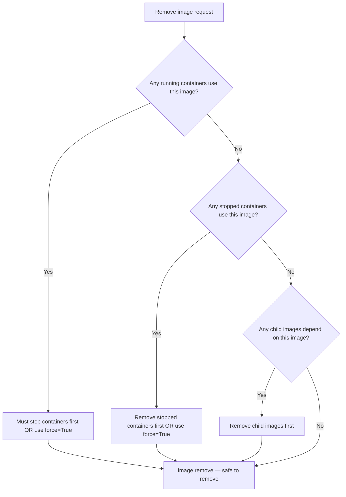

# Removing Images

Images pile up fast. Every build run, every pull, every intermediate layer adds to your disk usage. If you are running CI/CD on a shared server that builds images daily, you will eventually run out of disk space — unless you have a cleanup process. Automating image removal is a critical part of keeping your Docker host healthy.

In this guide, we will learn how to remove individual images, remove images by age or name pattern, and prune all dangling images in one shot.

---

## Why Images Are Harder to Remove Than Containers

Containers are easy to remove — just call `container.remove()`. Images are trickier because they have dependencies:

| Scenario | Can Remove? | Error If You Try |
| :--- | :--- | :--- |
| Image not used by any container | ✅ Yes | None |
| Image used by a stopped container | ❌ No | `image is being used by stopped container` |
| Image used by a running container | ❌ No | `image is being used by running container` |
| Image has child images (is a base for another image) | ❌ No | `image has dependent child images` |
| Dangling image (no tag, nothing using it) | ✅ Yes | None |

To force-remove an image that has containers, pass `force=True`. But this can break those containers — so always check for dependents first.

---

## The Remove Decision Flow



---

## Removing a Single Image

The safest approach — remove a specific image by tag, only if nothing is using it.

```python
import docker
from docker.errors import ImageNotFound, APIError, DockerException

def remove_image(image_tag):
    try:
        client = docker.from_env()
        
        # Check that the image exists first
        try:
            image = client.images.get(image_tag)
        except ImageNotFound:
            print(f"Image '{image_tag}' not found locally. Nothing to remove.")
            client.close()
            return False
        
        size_mb = image.attrs['Size'] / (1024 * 1024)
        print(f"Removing image '{image_tag}' ({size_mb:.2f} MB)...")
        
        # noprune=False means also remove untagged parent layers
        client.images.remove(image=image_tag, force=False, noprune=False)
        
        print(f"Image '{image_tag}' removed successfully. Freed ~{size_mb:.2f} MB.")
        client.close()
        return True

    except APIError as e:
        print(f"Cannot remove '{image_tag}': {e.explanation}")
        return False
    except DockerException as e:
        print(f"Error: {e}")
        return False

remove_image("my-flask-app:1.0.0")
```

### Expected Output
```text
Removing image 'my-flask-app:1.0.0' (138.44 MB)...
Image 'my-flask-app:1.0.0' removed successfully. Freed ~138.44 MB.
```

---

## Removing Images Older Than N Days

This is the most useful automation pattern for CI servers. Build images accumulate rapidly — but you probably only need the last few days of images.

```python
import docker
from docker.errors import APIError, DockerException
from datetime import datetime, timezone, timedelta

def remove_old_images(days_old=7, dry_run=True):
    try:
        client = docker.from_env()
        images = client.images.list(all=False)  # Exclude dangling for now
        
        cutoff = datetime.now(timezone.utc) - timedelta(days=days_old)
        
        candidates = []
        for image in images:
            # Docker returns timestamps in RFC3339 format
            created_str = image.attrs['Created'][:19]
            created_dt  = datetime.strptime(created_str, '%Y-%m-%dT%H:%M:%S')
            created_dt  = created_dt.replace(tzinfo=timezone.utc)
            
            if created_dt < cutoff:
                size_mb = image.attrs['Size'] / (1024 * 1024)
                for tag in (image.tags or ['<none>:<none>']):
                    candidates.append((tag, size_mb, image.id, image.short_id))
        
        if not candidates:
            print(f"No images older than {days_old} days found.")
            client.close()
            return
        
        total_mb = sum(s for _, s, _, _ in candidates)
        print(f"Found {len(candidates)} image(s) older than {days_old} days "
              f"(total: {total_mb:.2f} MB):")
        
        for tag, size, img_id, short_id in candidates:
            print(f"  {tag:<40} {size:>8.2f} MB  [{short_id}]")
        
        if dry_run:
            print("\nDry-run mode — no images were removed.")
            client.close()
            return
        
        removed = 0
        failed  = 0
        for tag, size, img_id, short_id in candidates:
            try:
                client.images.remove(image=img_id, force=False)
                print(f"  Removed: {tag}")
                removed += 1
            except APIError as e:
                print(f"  Skipped: {tag} ({e.explanation})")
                failed += 1
        
        print(f"\nDone — Removed: {removed}, Skipped: {failed}")
        client.close()

    except DockerException as e:
        print(f"Error: {e}")

# Preview first
remove_old_images(days_old=7, dry_run=True)
```

### Expected Output
```text
Found 2 image(s) older than 7 days (total: 263.91 MB):
  my-flask-app:0.9.0                        138.44 MB  [sha256:a2b3]
  worker-service:1.8.0                      125.47 MB  [sha256:b3c4]

Dry-run mode — no images were removed.
```

---

## Real-World Script: Prune All Dangling Images

Dangling images are the untagged leftovers from builds. Every time you rebuild an image with the same tag, the old image becomes dangling. They waste disk space and you never need them.

```python
import docker
from docker.errors import DockerException

def prune_dangling_images():
    try:
        client = docker.from_env()
        
        # Count dangling images before prune
        dangling = client.images.list(filters={"dangling": True})
        count = len(dangling)
        
        if count == 0:
            print("No dangling images found. Nothing to prune.")
            client.close()
            return
        
        print(f"Found {count} dangling image(s). Pruning...")
        
        result = client.images.prune(filters={"dangling": True})
        removed = result.get('ImagesDeleted') or []
        freed   = result.get('SpaceReclaimed', 0) / (1024 * 1024)
        
        print(f"Pruned {len(removed)} image layer(s).")
        print(f"Disk space freed: {freed:.2f} MB")
        
        client.close()

    except DockerException as e:
        print(f"Error pruning images: {e}")

prune_dangling_images()
```

### Expected Output
```text
Found 3 dangling image(s). Pruning...
Pruned 5 image layer(s).
Disk space freed: 247.33 MB
```

---

## Common Mistakes

### 1. Calling `image.remove()` When Containers Still Use the Image
Docker will raise an `APIError` explaining which container is using the image. If you force-remove with `force=True`, Docker untags the image and marks it for deletion, but the running container still works — until it stops and restarts. At that point it cannot find the image anymore. This is dangerous in production.

### 2. Confusing `noprune` Behaviour
`noprune=False` (the default) means Docker also removes untagged parent layers that are no longer needed after removing this image. `noprune=True` keeps those parent layers. For cleanup scripts, leave `noprune=False` to maximise disk space freed.

### 3. Removing by Short ID Instead of Full ID
`client.images.remove(image="sha256:a3b4")` works with the short form, but only if there is no ambiguity. If two images share the same first characters in their ID, use the full 64-character digest to be precise.

### 4. Removing Images Without Checking Age or Usage
A bulk remove script without filters can accidentally delete images that are still in use by running production containers. Always filter by age, tag pattern, or check container dependencies before removing.

---

## Summary

* `client.images.remove(image)` removes an image by tag or full ID.
* Removal fails if any container (running or stopped) uses the image — remove containers first.
* Pass `force=True` to force-remove even if containers depend on it — use this carefully in production.
* Pass `noprune=False` (the default) to also free untagged parent layers and maximise disk savings.
* Dangling images (no tag) are safe to prune anytime with `client.images.prune(filters={"dangling": True})`.
* Filter images by creation date using `image.attrs['Created']` to build age-based cleanup scripts.
* Always add a `dry_run` mode to preview what would be deleted before committing to removal.
* `images.prune()` returns a dict with `ImagesDeleted` (list) and `SpaceReclaimed` (bytes).
* Wrap per-image removal in `try/except APIError` so one failure does not stop the entire cleanup loop.
* Schedule image cleanup scripts as nightly cron jobs on shared CI/CD servers to prevent disk-full alerts.
