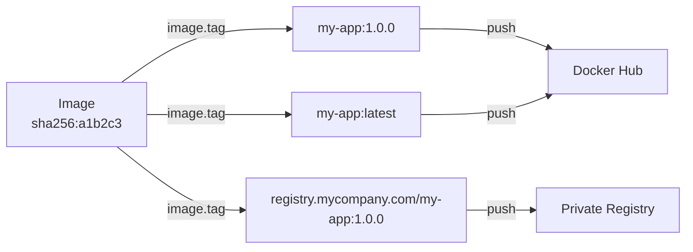

# Image Tagging

Tagging is how Docker identifies which version of an image to use. A tag like `my-app:1.0.0` tells Docker exactly which image to pull. Tagging correctly is especially important in deployment pipelines — if you push an image without proper tags, there is no way to roll back to a specific version later.

In this guide, we will learn how to tag images, manage multiple tags, and follow real-world tagging strategies.

---

## What a Tag Actually Is

A Docker image tag is just a human-readable pointer to an image ID. Multiple tags can point to the same image. The image itself does not change when you add or remove tags.

```
my-app:1.0.0     ──┐
my-app:latest    ──┤──▶ Image ID: sha256:a1b2c3d4e5f6...
my-app:stable    ──┘
```

All three tags point to the same image bytes. Removing one tag does not delete the image — it just removes that pointer. The image is only truly deleted when no tags and no containers reference it.

---

## Tagging Strategies in Real Teams

| Strategy | Example Tags | Best For |
| :--- | :--- | :--- |
| **Semantic versioning** | `my-app:1.0.0`, `my-app:1.1.0` | Stable releases that need rollback |
| **Git commit hash** | `my-app:abc1234` | Tracing exactly which code is deployed |
| **Branch name** | `my-app:main`, `my-app:feature-login` | Multi-branch CI/CD pipelines |
| **Environment** | `my-app:staging`, `my-app:production` | Environment-specific promotions |
| **Latest** | `my-app:latest` | Default pull for development; never use alone in production |

---

## How Tagging Works in the SDK



---

## Adding a Tag to an Existing Image

```python
import docker
from docker.errors import ImageNotFound, DockerException

def tag_image(source_tag, target_repo, target_tag):
    try:
        client = docker.from_env()
        
        # Get the source image
        image = client.images.get(source_tag)
        
        print(f"Source image: {source_tag} ({image.short_id})")
        print(f"Adding tag:   {target_repo}:{target_tag}")
        
        # image.tag(repository, tag) adds the new tag
        # Returns True on success
        success = image.tag(target_repo, tag=target_tag)
        
        if success:
            # Verify the new tag exists
            tagged_image = client.images.get(f"{target_repo}:{target_tag}")
            print(f"Tag added successfully. Verified: {tagged_image.short_id}")
            print(f"All tags on this image: {tagged_image.tags}")
        else:
            print("Tagging returned False — check your input.")
        
        client.close()
        return success

    except ImageNotFound:
        print(f"Source image '{source_tag}' not found locally.")
        return False
    except DockerException as e:
        print(f"Error: {e}")
        return False

# Tag a built image with the registry URL for pushing
tag_image(
    source_tag="my-flask-app:1.0.0",
    target_repo="registry.mycompany.com/my-flask-app",
    target_tag="1.0.0"
)
```

### Expected Output
```text
Source image: my-flask-app:1.0.0 (sha256:a2b3c4)
Adding tag:   registry.mycompany.com/my-flask-app:1.0.0
Tag added successfully. Verified: sha256:a2b3c4
All tags on this image: ['my-flask-app:1.0.0', 'registry.mycompany.com/my-flask-app:1.0.0']
```

---

## Adding Multiple Tags at Once

In CI pipelines you often want to add several tags after a build — the version tag, latest, and a git hash tag all at once.

```python
import docker
from docker.errors import ImageNotFound, DockerException

def tag_image_multiple(source_tag, tag_definitions):
    """
    tag_definitions: list of (repo, tag) tuples to apply
    """
    try:
        client = docker.from_env()
        image = client.images.get(source_tag)
        
        print(f"Adding {len(tag_definitions)} tag(s) to '{source_tag}' ({image.short_id}):")
        
        results = []
        for repo, tag in tag_definitions:
            full_tag = f"{repo}:{tag}"
            try:
                image.tag(repo, tag=tag)
                print(f"  Added: {full_tag}")
                results.append((full_tag, True))
            except DockerException as e:
                print(f"  Failed: {full_tag} — {e}")
                results.append((full_tag, False))
        
        succeeded = sum(1 for _, ok in results if ok)
        print(f"\n{succeeded}/{len(tag_definitions)} tags added successfully.")
        
        client.close()
        return results

    except ImageNotFound:
        print(f"Source image '{source_tag}' not found.")
        return []

# After building my-flask-app:1.0.0, add all deployment tags
tag_image_multiple(
    source_tag="my-flask-app:1.0.0",
    tag_definitions=[
        ("registry.mycompany.com/my-flask-app", "1.0.0"),
        ("registry.mycompany.com/my-flask-app", "latest"),
        ("registry.mycompany.com/my-flask-app", "abc1234"),   # git commit hash
    ]
)
```

### Expected Output
```text
Adding 3 tag(s) to 'my-flask-app:1.0.0' (sha256:a2b3c4):
  Added: registry.mycompany.com/my-flask-app:1.0.0
  Added: registry.mycompany.com/my-flask-app:latest
  Added: registry.mycompany.com/my-flask-app:abc1234

3/3 tags added successfully.
```

---

## Real-World Script: Promote an Image Between Environments

A common deployment pattern is image promotion: you build once, push to staging with the `staging` tag, run tests, and if tests pass, you re-tag the same image as `production` and push again. No rebuild needed — the exact same bytes get promoted.

```python
import docker
from docker.errors import ImageNotFound, APIError, DockerException

def promote_image(registry, image_name, source_tag, target_tag, auth_config):
    """
    Pulls the image tagged as source_tag, retags it as target_tag, and pushes.
    """
    client = docker.from_env()
    source_full = f"{registry}/{image_name}:{source_tag}"
    target_repo = f"{registry}/{image_name}"
    
    try:
        print(f"Promoting: {source_full} -> {target_repo}:{target_tag}")
        
        # Step 1: Pull the source image
        print(f"  Pulling '{source_full}'...")
        source_image = client.images.pull(
            f"{registry}/{image_name}",
            tag=source_tag,
            auth_config=auth_config
        )
        print(f"  Pulled: {source_image.short_id}")
        
        # Step 2: Add the new tag
        source_image.tag(target_repo, tag=target_tag)
        print(f"  Tagged as '{target_repo}:{target_tag}'")
        
        # Step 3: Push with the new tag
        print(f"  Pushing '{target_repo}:{target_tag}'...")
        for event in client.images.push(
            target_repo, target_tag,
            auth_config=auth_config,
            stream=True, decode=True
        ):
            if 'error' in event:
                raise DockerException(event['error'])
        
        print(f"Promotion complete: {source_tag} -> {target_tag}")
        client.close()
        return True

    except (ImageNotFound, APIError, DockerException) as e:
        print(f"Promotion failed: {e}")
        client.close()
        return False

promote_image(
    registry="registry.mycompany.com",
    image_name="api-service",
    source_tag="staging",
    target_tag="production",
    auth_config={"username": "deploy-bot", "password": "registry-password"}
)
```

### Expected Output
```text
Promoting: registry.mycompany.com/api-service:staging -> registry.mycompany.com/api-service:production
  Pulling 'registry.mycompany.com/api-service:staging'...
  Pulled: sha256:c4d5e6
  Tagged as 'registry.mycompany.com/api-service:production'
  Pushing 'registry.mycompany.com/api-service:production'...
Promotion complete: staging -> production
```

---

## Common Mistakes

### 1. Trusting `latest` Tag for Production Deployments
`latest` is just a convention — it does not always mean the newest image. If someone pushes an older build without the `latest` tag, the `latest` pointer stays on the previous image. Always deploy with a specific version tag or git hash.

### 2. Removing a Tag and Thinking the Image Is Gone
`client.images.remove("my-app:1.0.0")` removes the tag but not the image if other tags still point to it. The image ID remains on disk. To actually delete the image data, all tags pointing to it must be removed.

### 3. Forgetting to Include the Registry URL in the Tag Before Pushing
A tag like `my-app:1.0.0` will push to Docker Hub by default. If your intention is a private registry, you must tag as `registry.mycompany.com/my-app:1.0.0` first. Always verify the full tag before pushing.

### 4. Not Using Git Commit Hashes for Traceability
Semantic version tags tell you the version, but not the exact code state. In a busy team, two different commits can produce `1.0.0` if the version number is not bumped correctly. Adding the Git commit hash as an additional tag gives you a precise, immutable reference to the code.

---

## Summary

* A Docker image tag is a pointer to an image ID — multiple tags can point to the same image.
* `image.tag(repository, tag)` adds a new tag without changing the underlying image.
* Removing a tag does not delete the image if other tags still reference it.
* Use semantic versioning (`1.0.0`), git hashes, and environment tags together for full traceability.
* Never rely on `latest` alone for production — always pin a version or commit tag.
* Add the full registry URL to the tag before pushing to a private registry.
* Image promotion (re-tagging `staging` as `production`) avoids rebuilds and ensures the exact same bytes go to production.
* Add multiple tags after a single build: version, latest, and git hash — without rebuilding.
* `image.tags` shows all current tags pointing to that image ID.
* Combine tagging with a push immediately after to keep the registry in sync with local tags.
