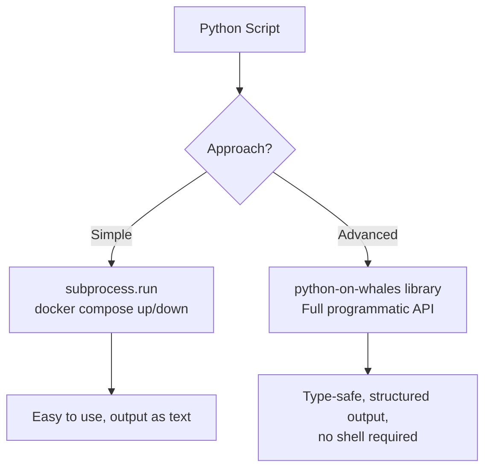

# Docker Compose with Python

Docker Compose is a tool for defining and running multi-container applications. Instead of starting each container separately with `docker run`, you describe your entire stack (web server, database, cache, queue) in a single `docker-compose.yml` file and start everything with one command.

When you add Python to this, you get full programmatic control over your Compose workflows — starting stacks in CI pipelines, waiting for services to be ready, scaling specific services, and tearing environments down when done.

In this guide, we will understand what Docker Compose is, how Python interacts with it, and what tools are available.

---

## Compose vs Standalone Containers

When should you use Compose instead of managing individual containers?

| Scenario | Standalone Containers | Docker Compose |
| :--- | :--- | :--- |
| Single service (e.g., just nginx) | ✅ Simple | Overkill |
| App + database | Manageable but verbose | ✅ Much cleaner |
| Full stack (web + db + cache + queue) | Very complex | ✅ Essential |
| Reproducible dev environments | Hard | ✅ Perfect fit |
| CI test environments with multiple services | Fragile | ✅ Reliable |

---

## What a docker-compose.yml Looks Like

Before automating Compose with Python, you need to understand what Compose files look like. Here is a realistic example for a web application with a database and cache:

```yaml
# docker-compose.yml
version: "3.9"

services:
  web:
    image: my-flask-app:latest
    ports:
      - "5000:5000"
    environment:
      - DATABASE_URL=postgresql://user:pass@db:5432/appdb
      - REDIS_URL=redis://cache:6379
    depends_on:
      - db
      - cache
    labels:
      environment: staging

  db:
    image: postgres:15-alpine
    environment:
      POSTGRES_USER:     user
      POSTGRES_PASSWORD: pass
      POSTGRES_DB:       appdb
    volumes:
      - pg_data:/var/lib/postgresql/data

  cache:
    image: redis:7-alpine
    ports:
      - "6379:6379"

volumes:
  pg_data:
```

---

## Two Ways to Control Compose From Python



### Approach 1: Using subprocess to Call the CLI

This is the quickest way to add Compose support to Python scripts. You call the `docker compose` command as a subprocess and capture the output.

```python
import subprocess
import sys

def compose_up(compose_file, project_name, detach=True):
    cmd = [
        "docker", "compose",
        "-f", compose_file,
        "-p", project_name,
        "up"
    ]
    
    if detach:
        cmd.append("--detach")
    
    print(f"Starting stack '{project_name}' from '{compose_file}'...")
    
    result = subprocess.run(
        cmd,
        capture_output=True,
        text=True
    )
    
    if result.returncode == 0:
        print("Stack started successfully.")
        if result.stdout:
            print(result.stdout.strip())
    else:
        print("Stack failed to start:")
        print(result.stderr.strip())
        sys.exit(1)

compose_up(
    compose_file="./docker-compose.yml",
    project_name="my-app-staging"
)
```

### Expected Output
```text
Starting stack 'my-app-staging' from './docker-compose.yml'...
Stack started successfully.
 Container my-app-staging-db-1    Started
 Container my-app-staging-cache-1 Started
 Container my-app-staging-web-1   Started
```

---

### Approach 2: Using python-on-whales (Recommended for Complex Automation)

`python-on-whales` is a modern Python library that wraps the Docker CLI (including Compose) with a clean, type-hinted API. It gives you structured Python objects instead of raw text output.

```bash
pip install python-on-whales
```

```python
from python_on_whales import DockerClient
from python_on_whales.exceptions import DockerException

def inspect_compose_stack(compose_file, project_name):
    try:
        docker = DockerClient(
            compose_files=[compose_file],
            compose_project_name=project_name
        )
        
        # List containers in this compose project
        containers = docker.compose.ps()
        
        print(f"Stack '{project_name}' — {len(containers)} service(s):")
        for c in containers:
            print(f"  {c.name:<30} Status: {c.state.status}")
        
        return containers
    
    except DockerException as e:
        print(f"Compose error: {e}")
        return []

inspect_compose_stack("./docker-compose.yml", "my-app-staging")
```

### Expected Output
```text
Stack 'my-app-staging' — 3 service(s):
  my-app-staging-web-1           Status: running
  my-app-staging-db-1            Status: running
  my-app-staging-cache-1         Status: running
```

---

## Comparison: subprocess vs python-on-whales

| Feature | subprocess | python-on-whales |
| :--- | :--- | :--- |
| Setup | None needed | `pip install python-on-whales` |
| Output format | Raw text string | Python objects |
| Type hints | No | Yes |
| Error handling | Check return codes | Catch `DockerException` |
| Full Compose API | Limited | Complete |
| Works with Docker SDK | Separately | Built on top of CLI |
| Best for | Simple up/down calls | Full lifecycle automation |

---

## Common Mistakes

### 1. Using `docker-compose` (Old V1) vs `docker compose` (V2)
The old `docker-compose` command is a separate Python package (V1) that is now deprecated. Modern Docker installs ship `docker compose` (with a space, V2) as a built-in plugin. Always use `docker compose` in subprocess calls and make sure your Docker installation is recent enough to have it.

### 2. Not Specifying a Project Name
Without `-p project_name`, Compose derives the project name from the directory name. If you run two compose stacks from directories with the same name on the same host, containers will conflict. Always pass an explicit project name.

### 3. Assuming Services Start in `depends_on` Order
`depends_on` controls start order, but it does not wait for a service to be ready — only for it to be started. A `web` service that depends on `db` will start after Docker starts the `db` container, but the database process inside may not be accepting connections yet. You need a health check or a wait loop for true readiness.

---

## Summary

* Docker Compose defines multi-container apps in a single `docker-compose.yml` file.
* Python can automate Compose through either `subprocess` calls or the `python-on-whales` library.
* `subprocess` is best for simple up/down operations where you do not need structured output.
* `python-on-whales` gives you a full Python API with typed objects and proper error handling.
* Always specify an explicit project name (`-p`) to avoid name collisions on shared hosts.
* `depends_on` controls start order, not service readiness — add health checks for robust pipelines.
* Compose is ideal for CI test environments that need multiple services (app + db + cache) running together.
* `docker compose up --detach` starts all services in the background and returns immediately.
* `docker compose ps` shows the status of all services in a named stack.
* Combine Python automation with Compose for complete environment lifecycle control.
