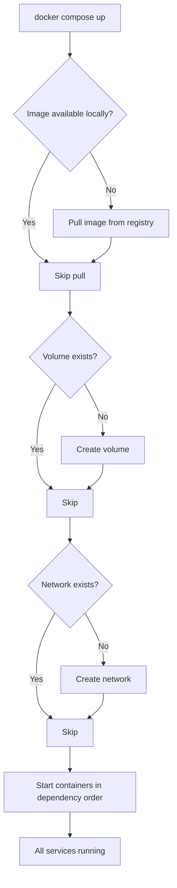

# Starting Compose Services

Starting a Compose stack with Python means you can make it part of a larger automation pipeline. Instead of manually running `docker compose up` in a terminal, your Python script can start the stack, wait for services to become ready, verify health, and then proceed with the next pipeline step — all without human involvement.

In this guide, we will learn how to start Compose services using both `subprocess` and `python-on-whales`, and how to verify services are ready before moving on.

---

## Start Modes Comparison

Docker Compose has a few ways to start services, each with different use cases:

| Command | What it does | Blocks? | Use When |
| :--- | :--- | :--- | :--- |
| `compose up` | Creates and starts all services | Yes (until Ctrl+C) | Local dev with logs in terminal |
| `compose up --detach` | Starts all services in background | No | CI/CD pipelines, automation |
| `compose up service_name` | Starts only specific service + its deps | Depends | Debugging one service at a time |
| `compose start` | Starts already-created (stopped) services | No | Resuming a stopped stack |
| `compose run service cmd` | One-off command in a new container | Yes | Running migrations, tests |

---

## How Compose Up Works



---

## Basic: Start Stack With subprocess

```python
import subprocess
import time
import sys

def start_compose_stack(compose_file, project_name, detach=True, build=False):
    cmd = [
        "docker", "compose",
        "-f", compose_file,
        "-p", project_name,
        "up"
    ]
    
    if detach:
        cmd.append("--detach")
    if build:
        cmd.append("--build")  # Rebuild images before starting
    
    print(f"Starting stack '{project_name}'...")
    
    result = subprocess.run(cmd, capture_output=True, text=True)
    
    if result.returncode != 0:
        print(f"Failed to start stack '{project_name}':")
        print(result.stderr.strip())
        sys.exit(1)
    
    print(f"Stack started successfully.")
    print(result.stdout.strip())
    return True

start_compose_stack(
    compose_file="./docker-compose.yml",
    project_name="my-app-test",
    detach=True,
    build=False
)
```

### Expected Output
```text
Starting stack 'my-app-test'...
Stack started successfully.
 Container my-app-test-db-1     Started
 Container my-app-test-cache-1  Started
 Container my-app-test-web-1    Started
```

---

## Starting Specific Services

Sometimes you only want to start a subset of services — for example, just the database for a migration step.

```python
import subprocess
import sys

def start_compose_service(compose_file, project_name, service_name, detach=True):
    cmd = [
        "docker", "compose",
        "-f", compose_file,
        "-p", project_name,
        "up", service_name   # Specify which service to start
    ]
    
    if detach:
        cmd.append("--detach")
    
    print(f"Starting service '{service_name}' in stack '{project_name}'...")
    
    result = subprocess.run(cmd, capture_output=True, text=True)
    
    if result.returncode != 0:
        print(f"Failed: {result.stderr.strip()}")
        sys.exit(1)
    
    print(f"Service '{service_name}' started.")
    return True

# Start only the database service first
start_compose_service(
    compose_file="./docker-compose.yml",
    project_name="my-app-test",
    service_name="db"
)
```

### Expected Output
```text
Starting service 'db' in stack 'my-app-test'...
Service 'db' started.
```

---

## Real-World Script: Start Stack and Wait for Readiness

Just because a container is "started" does not mean the service inside it is ready. A PostgreSQL container can be started but the database process is still initialising for several seconds. This script starts a Compose stack and polls a health check until all services are truly ready.

```python
import subprocess
import time
import sys

def get_stack_status(compose_file, project_name):
    result = subprocess.run(
        ["docker", "compose", "-f", compose_file, "-p", project_name, "ps", "--format", "json"],
        capture_output=True,
        text=True
    )
    return result.stdout.strip(), result.returncode

def start_and_wait(compose_file, project_name, expected_services, timeout=60):
    print(f"Starting stack '{project_name}'...")
    
    up_result = subprocess.run(
        ["docker", "compose", "-f", compose_file, "-p", project_name, "up", "--detach"],
        capture_output=True,
        text=True
    )
    
    if up_result.returncode != 0:
        print(f"Stack failed to start:\n{up_result.stderr.strip()}")
        sys.exit(1)
    
    print(f"Stack started. Waiting for {expected_services} service(s) to be running...")
    
    deadline = time.time() + timeout
    attempt  = 0
    
    while time.time() < deadline:
        attempt += 1
        
        ps_result = subprocess.run(
            ["docker", "compose", "-f", compose_file, "-p", project_name, "ps"],
            capture_output=True,
            text=True
        )
        
        running_count = ps_result.stdout.count("running")
        
        if running_count >= expected_services:
            print(f"All {expected_services} service(s) running after {attempt} check(s).")
            return True
        
        print(f"  [{attempt}] {running_count}/{expected_services} services running. Retrying in 3s...")
        time.sleep(3)
    
    print(f"Timeout after {timeout}s — not all services started.")
    return False

start_and_wait(
    compose_file="./docker-compose.yml",
    project_name="my-app-test",
    expected_services=3,
    timeout=60
)
```

### Expected Output
```text
Starting stack 'my-app-test'...
Stack started. Waiting for 3 service(s) to be running...
  [1] 1/3 services running. Retrying in 3s...
  [2] 2/3 services running. Retrying in 3s...
  [3] 3/3 services running. Retrying in 3s...
All 3 service(s) running after 4 check(s).
```

---

## Common Mistakes

### 1. Not Using `--detach` in Automation Scripts
Running `compose up` without `--detach` blocks your script until someone presses Ctrl+C. In a CI/CD pipeline, this will hang the job indefinitely. Always use `--detach` when running from automation.

### 2. Assuming "started" Means "ready"
Docker reports a container as "started" as soon as the container process is launched. The application inside (PostgreSQL, Redis, Elasticsearch) may still be initialising. Always add a readiness check after `compose up`.

### 3. Not Rebuilding Images When Code Changes
If you rebuilt your application image but forget to pass `--build` to `compose up`, Compose will use the old cached image. Your code changes will not take effect. Add `--build` to your CI pipeline's up command to always use the latest image.

### 4. Starting a Stack That Is Already Running
Running `compose up` on an already-running stack is usually safe — Compose detects which containers are already running and skips them. However, if you add `--build`, it will force-recreate containers with new images, which can cause brief downtime for those services.

---

## Summary

* `docker compose up --detach` starts all services in the background and returns control immediately.
* Use `-f` to specify the Compose file path and `-p` to specify the project name explicitly.
* Pass `--build` to rebuild images before starting when your application code has changed.
* Target a specific service by name (`compose up db`) to start only that service and its dependencies.
* "Started" does not mean "ready" — always add a readiness polling loop after `compose up`.
* Poll `compose ps` output for "running" status counts to verify all services came up correctly.
* `compose start` restarts already-created containers without recreating them.
* `compose run service command` creates a one-off container for running migrations or tests.
* Always use an explicit project name to avoid conflicts on shared hosts with multiple stacks.
* Set a timeout on your readiness loop to fail fast instead of waiting forever on a broken stack.
