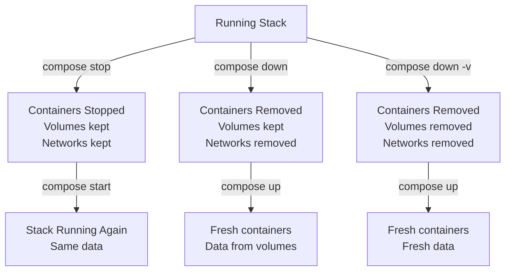

# Stopping Compose Services

Stopping a Compose stack cleanly is just as important as starting it. In CI/CD pipelines, you need to tear down test environments after tests complete. In staging environments, you might stop the stack at night and restart it in the morning to save server costs. Stopping Compose properly ensures containers clean up gracefully, volumes persist when needed, and no ghost containers are left behind.

In this guide, we will learn how to stop Compose stacks, remove containers, and control what data is kept vs. deleted.

---

## Stop Operations Comparison

Compose provides several ways to stop a stack. Each does something different:

| Command | Containers | Volumes | Networks | When to Use |
| :--- | :--- | :--- | :--- | :--- |
| `compose stop` | Stopped (not removed) | Kept | Kept | Pause — resume later with `compose start` |
| `compose down` | Stopped AND removed | Kept | Removed | Full teardown but keep data |
| `compose down -v` | Stopped AND removed | Removed | Removed | Full teardown including data wipe |
| `compose kill` | Force-killed | Kept | Kept | Emergency stop, stuck containers |
| `compose rm` | Removed (must be stopped first) | Kept | Kept | Clean up stopped containers only |

---

## Stop vs Down — The Key Difference



---

## Basic: Stop a Stack Without Removing

Use `compose stop` when you want to pause the stack but keep all state for a later restart.

```python
import subprocess
import sys

def stop_compose_stack(compose_file, project_name, timeout=30):
    cmd = [
        "docker", "compose",
        "-f", compose_file,
        "-p", project_name,
        "stop",
        "--timeout", str(timeout)   # Grace period before SIGKILL
    ]
    
    print(f"Stopping stack '{project_name}' (graceful timeout: {timeout}s)...")
    
    result = subprocess.run(cmd, capture_output=True, text=True)
    
    if result.returncode != 0:
        print(f"Stop failed:\n{result.stderr.strip()}")
        sys.exit(1)
    
    print(f"Stack '{project_name}' stopped successfully.")
    print("Containers are stopped but not removed. Run 'compose start' to resume.")
    return True

stop_compose_stack(
    compose_file="./docker-compose.yml",
    project_name="my-app-staging",
    timeout=30
)
```

### Expected Output
```text
Stopping stack 'my-app-staging' (graceful timeout: 30s)...
Stack 'my-app-staging' stopped successfully.
Containers are stopped but not removed. Run 'compose start' to resume.
```

---

## Full Teardown: compose down

Use `compose down` when you want to completely remove the stack — all containers and networks — but keep the volume data (so the next `compose up` picks up where it left off).

```python
import subprocess
import sys

def teardown_compose_stack(compose_file, project_name, remove_volumes=False, timeout=30):
    cmd = [
        "docker", "compose",
        "-f", compose_file,
        "-p", project_name,
        "down",
        "--timeout", str(timeout)
    ]
    
    if remove_volumes:
        cmd.append("--volumes")   # -v: also delete volumes
    
    vol_note = " (including volumes)" if remove_volumes else ""
    print(f"Tearing down stack '{project_name}'{vol_note}...")
    
    result = subprocess.run(cmd, capture_output=True, text=True)
    
    if result.returncode != 0:
        print(f"Teardown failed:\n{result.stderr.strip()}")
        sys.exit(1)
    
    print(result.stdout.strip())
    print(f"Stack '{project_name}' torn down successfully.")
    return True

# Keep volumes (data persists for next run)
teardown_compose_stack(
    compose_file="./docker-compose.yml",
    project_name="my-app-staging",
    remove_volumes=False
)
```

### Expected Output
```text
Tearing down stack 'my-app-staging'...
 Container my-app-staging-web-1    Stopping
 Container my-app-staging-web-1    Stopped
 Container my-app-staging-web-1    Removing
 Container my-app-staging-cache-1  Removing
 Container my-app-staging-db-1     Removing
 Network my-app-staging_default    Removing
Stack 'my-app-staging' torn down successfully.
```

---

## Real-World Script: Full CI Cleanup (Down + Volumes)

In CI/CD pipelines, you always want a completely clean environment. This means removing everything — containers, networks, and volumes — so the next test run starts with a fresh state.

```python
import subprocess
import sys
import time

def ci_teardown(compose_file, project_name, force=False):
    print(f"CI Teardown: '{project_name}'")
    
    if force:
        # Force kill all containers first in case graceful stop hangs
        kill_cmd = [
            "docker", "compose",
            "-f", compose_file,
            "-p", project_name,
            "kill"
        ]
        print("  Force-killing containers...")
        subprocess.run(kill_cmd, capture_output=True, text=True)
        time.sleep(2)
    
    # Full teardown including volumes and orphan containers
    down_cmd = [
        "docker", "compose",
        "-f", compose_file,
        "-p", project_name,
        "down",
        "--volumes",              # Remove named volumes
        "--remove-orphans",       # Remove containers not defined in compose file
        "--timeout", "15"
    ]
    
    print("  Running compose down (--volumes --remove-orphans)...")
    result = subprocess.run(down_cmd, capture_output=True, text=True)
    
    if result.returncode != 0:
        print(f"  Teardown error:\n{result.stderr.strip()}")
        sys.exit(1)
    
    print(f"  Stack '{project_name}' fully cleaned up.")
    
    # Verify no containers remain
    ps_result = subprocess.run(
        ["docker", "compose", "-f", compose_file, "-p", project_name, "ps", "-q"],
        capture_output=True,
        text=True
    )
    
    if ps_result.stdout.strip():
        print("  WARNING: Some containers still detected after teardown.")
    else:
        print("  Verified: No containers remaining. Environment is clean.")
    
    return True

ci_teardown(
    compose_file="./docker-compose.yml",
    project_name="my-app-ci-run-142"
)
```

### Expected Output
```text
CI Teardown: 'my-app-ci-run-142'
  Running compose down (--volumes --remove-orphans)...
  Stack 'my-app-ci-run-142' fully cleaned up.
  Verified: No containers remaining. Environment is clean.
```

---

## Common Mistakes

### 1. Using `compose stop` When You Need `compose down` in CI
`compose stop` leaves containers in the stopped state — they still consume disk space and can cause conflicts on the next `compose up` if the stack name matches. In CI pipelines, always use `compose down` so containers are fully removed.

### 2. Forgetting `--remove-orphans` When Compose Files Change
If you remove a service from your `docker-compose.yml` and run `compose down`, the old container for that service is not removed — it becomes an orphan. Always use `--remove-orphans` to clean these up automatically.

### 3. Deleting Volumes Accidentally in Staging
`--volumes` (`-v`) deletes all data including your database. In staging environments where data should persist between runs, never use `--volumes`. Reserve that flag for CI environments where you want a clean slate.

### 4. Not Setting a `--timeout` for Slow Services
Some services (database connections, long-running transactions) need more than the default 10-second timeout to shut down gracefully. Set `--timeout 30` or higher for stacks that include databases.

---

## Summary

* `compose stop` stops containers but does not remove them — use `compose start` to resume.
* `compose down` stops and removes containers and networks, but keeps volumes.
* `compose down --volumes` is the full wipe — containers, networks, and all volume data.
* `compose down --remove-orphans` cleans up containers that are no longer defined in the Compose file.
* Use `compose down` (not `compose stop`) in CI/CD pipelines to leave a clean state.
* Never use `--volumes` in staging/production unless you deliberately want to wipe the database.
* Set `--timeout` explicitly for stacks with databases or slow-stopping services.
* `compose kill` sends SIGKILL immediately — use only when graceful stop is stuck.
* Verify the teardown with `compose ps -q` — an empty result means all containers are gone.
* Combine `compose down --volumes --remove-orphans` as your standard CI cleanup command.
