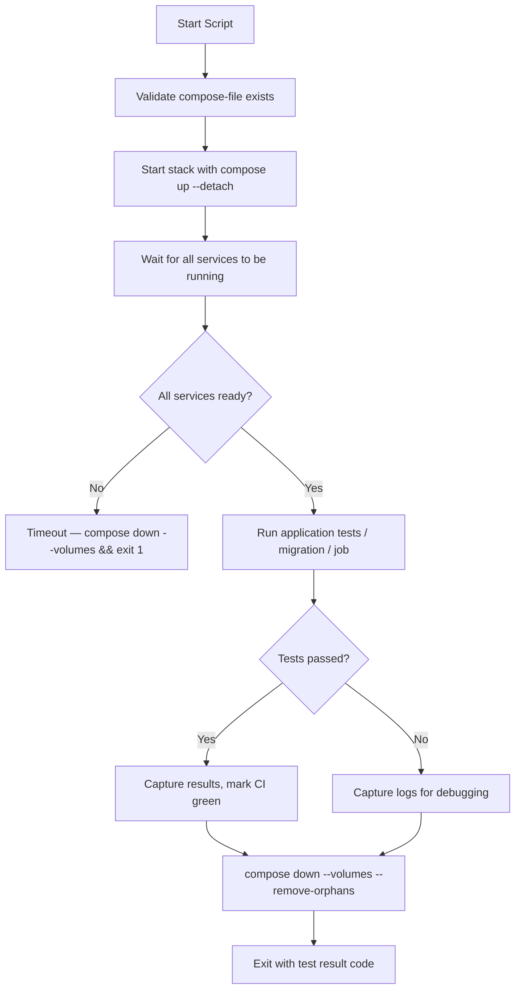

# Automating Compose Workflows

Now that you know how to start and stop Compose stacks, it is time to combine these skills into complete automation workflows. Real DevOps use cases are not just about running one command — they involve starting a stack, waiting for readiness, running tests, capturing results, and tearing everything down, all from a single Python script.

In this guide, we will build complete workflow patterns for CI test environments, environment promotion, and scheduled stack management.

---

## What a Complete Compose Automation Workflow Looks Like



---

## Complete CI Test Environment Script

This is the most common real-world pattern. Start a stack, run tests, collect logs on failure, and tear down — all in one atomic script.

```python
import subprocess
import time
import sys
import os

COMPOSE_FILE   = "./docker-compose.test.yml"
PROJECT_NAME   = f"ci-test-{os.getpid()}"   # Unique project name per CI run
MAX_WAIT_SEC   = 90

def run_cmd(cmd, capture=True):
    result = subprocess.run(cmd, capture_output=capture, text=True)
    return result.returncode, result.stdout, result.stderr

def start_stack():
    print(f"[1/4] Starting stack '{PROJECT_NAME}'...")
    code, out, err = run_cmd([
        "docker", "compose", "-f", COMPOSE_FILE, "-p", PROJECT_NAME,
        "up", "--detach", "--build"
    ])
    if code != 0:
        print(f"FAILED to start stack:\n{err}")
        sys.exit(1)
    print("      Stack started.")

def wait_for_readiness(expected_count, timeout=MAX_WAIT_SEC):
    print(f"[2/4] Waiting for {expected_count} service(s) to be healthy...")
    deadline = time.time() + timeout
    
    while time.time() < deadline:
        code, out, err = run_cmd([
            "docker", "compose", "-f", COMPOSE_FILE, "-p", PROJECT_NAME, "ps"
        ])
        running = out.count("running")
        
        if running >= expected_count:
            print(f"      All {expected_count} service(s) ready.")
            return True
        
        remaining = int(deadline - time.time())
        print(f"      {running}/{expected_count} running... ({remaining}s left)")
        time.sleep(5)
    
    print(f"TIMEOUT: Not all services started within {timeout}s.")
    return False

def run_tests():
    print(f"[3/4] Running test suite...")
    
    # Run tests inside the 'web' service container
    code, out, err = run_cmd([
        "docker", "compose", "-f", COMPOSE_FILE, "-p", PROJECT_NAME,
        "exec", "-T", "web",      # -T: no TTY (needed in CI)
        "python", "-m", "pytest", "tests/", "-v"
    ])
    
    print(out.strip())
    if err.strip():
        print(f"STDERR:\n{err.strip()}")
    
    return code == 0

def collect_logs_on_failure():
    print("      Collecting service logs for debugging...")
    code, out, _ = run_cmd([
        "docker", "compose", "-f", COMPOSE_FILE, "-p", PROJECT_NAME, "logs", "--no-color"
    ])
    log_file = f"ci-logs-{PROJECT_NAME}.txt"
    with open(log_file, 'w') as f:
        f.write(out)
    print(f"      Logs saved to '{log_file}'")

def teardown():
    print(f"[4/4] Tearing down stack '{PROJECT_NAME}'...")
    run_cmd([
        "docker", "compose", "-f", COMPOSE_FILE, "-p", PROJECT_NAME,
        "down", "--volumes", "--remove-orphans", "--timeout", "20"
    ])
    print("      Stack torn down. Environment clean.")

def main():
    start_stack()
    
    if not wait_for_readiness(expected_count=3):
        collect_logs_on_failure()
        teardown()
        sys.exit(1)
    
    tests_passed = run_tests()
    
    if not tests_passed:
        collect_logs_on_failure()
    
    teardown()
    
    if tests_passed:
        print("\nCI RESULT: PASSED ✓")
        sys.exit(0)
    else:
        print("\nCI RESULT: FAILED ✗")
        sys.exit(1)

main()
```

### Expected Output
```text
[1/4] Starting stack 'ci-test-12345'...
      Stack started.
[2/4] Waiting for 3 service(s) to be healthy...
      1/3 running... (85s left)
      2/3 running... (80s left)
      All 3 service(s) ready.
[3/4] Running test suite...
      ============================= test session starts ==============================
      tests/test_api.py::test_create_user PASSED
      tests/test_api.py::test_get_user PASSED
      tests/test_api.py::test_delete_user PASSED
      ============================== 3 passed in 2.31s ==============================
[4/4] Tearing down stack 'ci-test-12345'...
      Stack torn down. Environment clean.

CI RESULT: PASSED ✓
```

---

## Scaling a Service Programmatically

`compose up --scale` lets you run multiple replicas of a service. Useful for load testing or running parallel workers.

```python
import subprocess
import sys

def scale_service(compose_file, project_name, service_name, replicas):
    cmd = [
        "docker", "compose",
        "-f", compose_file,
        "-p", project_name,
        "up",
        "--detach",
        "--scale", f"{service_name}={replicas}",
        "--no-recreate"   # Don't restart services that are already running
    ]
    
    print(f"Scaling '{service_name}' to {replicas} replica(s) in '{project_name}'...")
    
    result = subprocess.run(cmd, capture_output=True, text=True)
    
    if result.returncode != 0:
        print(f"Scaling failed:\n{result.stderr.strip()}")
        sys.exit(1)
    
    # Verify
    ps_result = subprocess.run(
        ["docker", "compose", "-f", compose_file, "-p", project_name, "ps", service_name],
        capture_output=True, text=True
    )
    print(f"Current '{service_name}' instances:")
    print(ps_result.stdout.strip())

scale_service(
    compose_file="./docker-compose.yml",
    project_name="my-app-staging",
    service_name="worker",
    replicas=3
)
```

### Expected Output
```text
Scaling 'worker' to 3 replica(s) in 'my-app-staging'...
Current 'worker' instances:
NAME                          STATUS    PORTS
my-app-staging-worker-1       running
my-app-staging-worker-2       running
my-app-staging-worker-3       running
```

---

## Common Mistakes

### 1. Hardcoding Project Names in CI
If two CI pipeline runs start at the same time, they will use the same project name and conflict with each other. Always generate a unique project name per run (e.g., include the process ID or a timestamp).

### 2. Not Using `-T` in `compose exec` for CI
By default, `compose exec` tries to allocate a terminal (TTY). In CI environments there is no TTY available, and `exec` without `-T` will fail. Always pass `-T` when running `exec` from scripts.

### 3. Not Handling Teardown in the Error Path
If your script exits early (failed start, test crash, timeout), the stack is left running and consuming resources. Always wrap your script in a try/finally or use a context manager pattern to guarantee `compose down` is called even on failure.

### 4. Ignoring Exit Codes From Subprocess
`subprocess.run()` does not raise an exception when the command fails — it returns a non-zero `returncode`. If you do not check `result.returncode`, your script will silently continue after a failed `compose up`, then fail confusingly later.

---

## Summary

* Combine `compose up`, readiness polling, test execution, and `compose down` into a single Python workflow.
* Generate unique project names per CI run to avoid conflicts from parallel pipeline jobs.
* Use `--build` with `compose up` in CI to ensure the latest code is always in the image.
* Poll `compose ps` output to count running services and verify readiness before running tests.
* Use `compose exec -T` (no TTY) when running commands inside containers from CI scripts.
* Always call `compose down --volumes --remove-orphans` at the end — even if tests fail.
* Save logs to a file before teardown so failed builds are debuggable after the environment is gone.
* Use `--scale service=N` to run multiple replicas of a service for load testing or parallel workers.
* Check `subprocess.run(...).returncode` after every Compose call — never assume success.
* Wrap your full workflow in a try/finally block to guarantee teardown runs in all cases.
