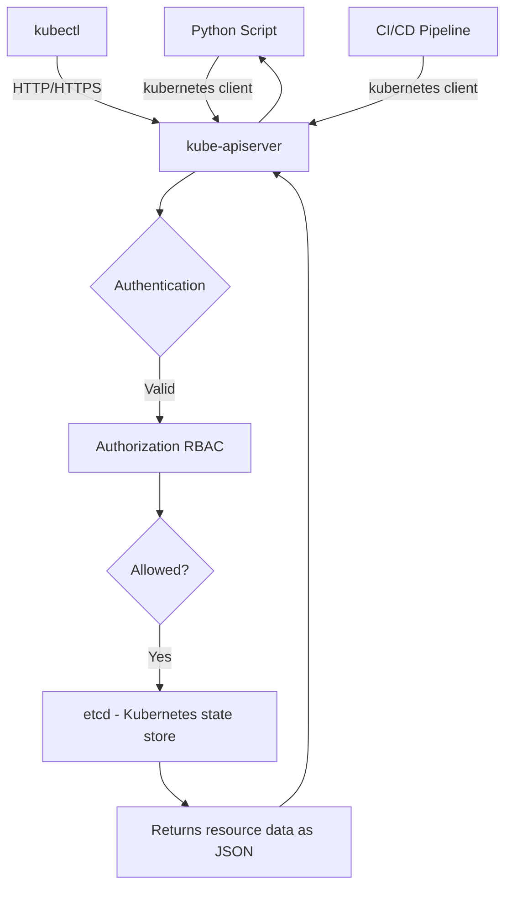

# Kubernetes Python Client Overview

Kubernetes is the standard platform for running containerised applications at scale. It handles container scheduling, service discovery, rolling deployments, auto-scaling, and self-healing. Most teams interact with Kubernetes using the `kubectl` command-line tool, but when you need to build automation — deployment scripts, monitoring tools, custom controllers — you need a proper API client.

The official **Kubernetes Python Client** (`kubernetes`) gives you a complete programmatic interface to the Kubernetes API. Anything you can do with `kubectl`, you can do from Python — listing pods, creating deployments, scaling services, reading secrets, and watching for real-time changes.

In this guide, we will understand the client architecture, how it maps to the Kubernetes API, and when to use it.

---

## The Kubernetes API Architecture

When you run `kubectl get pods`, kubectl is just making an HTTP request to the Kubernetes API server. The Python client does the same thing — it is a well-structured HTTP client for the Kubernetes REST API.



Everything goes through the API server. The Python client handles authentication, serialisation, and the TLS connection — you just call methods.

---

## API Groups and Resource Types

Kubernetes organises its resources into API groups. Understanding this helps you know which client class to use:

| API Group | Resources | Python Client Class |
| :--- | :--- | :--- |
| **Core (v1)** | Pods, Services, ConfigMaps, Secrets, Namespaces | `CoreV1Api` |
| **apps/v1** | Deployments, ReplicaSets, StatefulSets, DaemonSets | `AppsV1Api` |
| **batch/v1** | Jobs, CronJobs | `BatchV1Api` |
| **networking.k8s.io/v1** | Ingresses, NetworkPolicies | `NetworkingV1Api` |
| **rbac.authorization.k8s.io/v1** | Roles, ClusterRoles, RoleBindings | `RbacAuthorizationV1Api` |
| **autoscaling/v2** | HorizontalPodAutoscalers | `AutoscalingV2Api` |

---

## Quick Start: Your First Kubernetes API Call

Once the client is installed and configured (covered in the next guides), this is what working with it looks like:

```python
from kubernetes import client, config
from kubernetes.client.rest import ApiException

def list_cluster_pods():
    # Load credentials from your kubeconfig file
    config.load_kube_config()
    
    # Create an API client for core resources (pods, services, etc.)
    v1 = client.CoreV1Api()
    
    try:
        # List all pods across all namespaces
        pods = v1.list_pod_for_all_namespaces(watch=False)
        
        print(f"Total pods in cluster: {len(pods.items)}\n")
        print(f"{'NAMESPACE':<20} {'POD NAME':<45} {'STATUS'}")
        print("-" * 80)
        
        for pod in pods.items:
            namespace = pod.metadata.namespace
            name      = pod.metadata.name
            phase     = pod.status.phase
            print(f"{namespace:<20} {name:<45} {phase}")
    
    except ApiException as e:
        print(f"API error: {e.status} — {e.reason}")

list_cluster_pods()
```

### Expected Output
```text
Total pods in cluster: 8

NAMESPACE            POD NAME                                      STATUS
--------------------------------------------------------------------------------
default              web-app-deployment-5d9f8c-xk2q7              Running
default              redis-cache-6b4d7f-mn3p1                     Running
kube-system          coredns-79b9f5b9d-ql8z2                      Running
kube-system          kube-proxy-v8t4r                             Running
monitoring           prometheus-server-0                          Running
```

---

## SDK vs kubectl — When to Use Each

| Task | Use kubectl | Use Python Client |
| :--- | :--- | :--- |
| Quick one-off inspection | ✅ Faster | Overkill |
| Automated deployment script | Possible with subprocess | ✅ Proper way |
| Building a monitoring tool | No | ✅ |
| CI/CD pipeline automation | Possible with subprocess | ✅ Better |
| Custom controllers / operators | No | ✅ Only option |
| Debugging live issues | ✅ Interactive | No |
| Watching resource changes in real time | Limited | ✅ `watch` API |

---

## The Client Module Structure

The Python Kubernetes client is organised into API classes that mirror the Kubernetes API groups:

```python
from kubernetes import client, config, watch

# Configuration
config.load_kube_config()          # Load from ~/.kube/config
config.load_incluster_config()     # Load from service account (inside a pod)

# API clients — create one per API group you need
core_v1    = client.CoreV1Api()      # Pods, Services, ConfigMaps, Secrets
apps_v1    = client.AppsV1Api()      # Deployments, StatefulSets
batch_v1   = client.BatchV1Api()     # Jobs, CronJobs
networking = client.NetworkingV1Api() # Ingresses

# Watch — for real-time event streaming
w = watch.Watch()
```

---

## Common Mistakes

### 1. Not Loading Configuration Before Making API Calls
The Kubernetes client does not auto-detect your cluster. You must explicitly call `config.load_kube_config()` (for local/remote) or `config.load_incluster_config()` (from inside a pod) before creating any API client instance.

### 2. Using the Wrong API Class for a Resource
Every resource type belongs to a specific API group. Trying to list Deployments using `CoreV1Api` will not work — Deployments are in `apps/v1`, so you need `AppsV1Api`. Check the table above when you are unsure.

### 3. Not Catching `ApiException`
All Kubernetes API calls can raise `kubernetes.client.rest.ApiException` if the cluster returns a non-200 response (permission denied, resource not found, etc.). Always catch this exception and log `e.status` and `e.reason` for useful error messages.

### 4. Running Admin Operations Without Checking Permissions
The Python client runs with the credentials in your kubeconfig (or the pod's service account). If those credentials do not have permission to perform an operation, you get a `403 Forbidden` error. Always verify RBAC permissions before deploying automation scripts.

---

## Summary

* The Kubernetes Python client (`kubernetes`) is the official library for Kubernetes API automation.
* It makes HTTP calls to the Kubernetes API server — the same API that `kubectl` uses.
* Resources are organised into API groups; use the matching client class for each group.
* `CoreV1Api` handles Pods, Services, ConfigMaps, and Secrets.
* `AppsV1Api` handles Deployments, StatefulSets, ReplicaSets, and DaemonSets.
* Call `config.load_kube_config()` before making any API calls when running outside a cluster.
* Call `config.load_incluster_config()` when your script runs as a pod inside the cluster.
* All API responses are Python objects — access metadata via `.metadata.name`, `.metadata.namespace`.
* Always catch `ApiException` and log `.status` and `.reason` for useful error messages.
* The Python client can do anything `kubectl` can — plus real-time watching and building operators.
