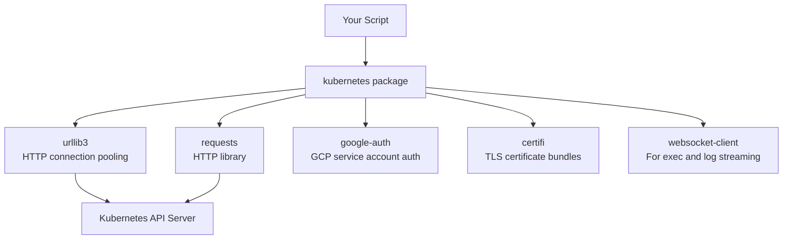

# Installing the Kubernetes Python Client

Before you can automate Kubernetes tasks with Python, you need the right library installed and your environment set up correctly. The official Kubernetes Python client has a specific version alignment with Kubernetes cluster versions, and skipping the setup properly will cause hard-to-debug errors later.

In this guide, we will install the Kubernetes Python client, verify it works, and understand version compatibility.

---

## Version Compatibility Table

The Kubernetes Python client version must match your cluster's Kubernetes version. Using a mismatched client can cause API calls to fail silently or return unexpected data.

| Kubernetes Cluster Version | Recommended Client Version | Install Command |
| :--- | :--- | :--- |
| 1.30.x | 30.x | `pip install kubernetes==30.*` |
| 1.29.x | 29.x | `pip install kubernetes==29.*` |
| 1.28.x | 28.x | `pip install kubernetes==28.*` |
| 1.27.x | 27.x | `pip install kubernetes==27.*` |
| Latest (unknown) | `>=28.0` | `pip install kubernetes` |

---

## Setting Up a Virtual Environment

Always install the Kubernetes client inside a virtual environment. This prevents conflicts with system Python packages and makes your project portable.

```bash
# Create a project directory
mkdir kube-automation
cd kube-automation

# Create a virtual environment
python -m venv venv

# Activate it
# On Linux/macOS:
source venv/bin/activate
# On Windows:
venv\Scripts\activate

# Install the kubernetes client
pip install kubernetes

# Optional: pin the version for production projects
pip install "kubernetes>=28.0,<31.0"

# Save dependencies for reproducibility
pip freeze > requirements.txt
```

### Checking What Got Installed

```bash
pip show kubernetes
```

### Expected Output
```text
Name: kubernetes
Version: 30.1.0
Summary: Kubernetes python client
Home-page: https://github.com/kubernetes-client/python
Author: Kubernetes
Location: /path/to/venv/lib/python3.11/site-packages
Requires: certifi, google-auth, python-dateutil, requests, urllib3, websocket-client
```

---

## Verifying the Installation

After installing, verify that the client can be imported and that you can access a cluster.

```python
import kubernetes
from kubernetes import client, config
from kubernetes.client.rest import ApiException

def verify_installation():
    print(f"Kubernetes client version: {kubernetes.__version__}")
    
    # Attempt to load kubeconfig
    try:
        config.load_kube_config()
        print("Kubeconfig loaded successfully.")
    except config.ConfigException as e:
        print(f"Could not load kubeconfig: {e}")
        print("Make sure kubectl is configured and your cluster is reachable.")
        return False
    
    # Test a basic API call — list namespaces
    v1 = client.CoreV1Api()
    
    try:
        namespaces = v1.list_namespace()
        print(f"\nConnected to cluster. Namespaces found: {len(namespaces.items)}")
        for ns in namespaces.items:
            print(f"  - {ns.metadata.name}")
        return True
    except ApiException as e:
        print(f"API call failed: {e.status} — {e.reason}")
        return False

verify_installation()
```

### Expected Output
```text
Kubernetes client version: 30.1.0
Kubeconfig loaded successfully.

Connected to cluster. Namespaces found: 5
  - default
  - kube-node-lease
  - kube-public
  - kube-system
  - monitoring
```

---

## Understanding What Gets Installed

The `kubernetes` package has several dependencies that handle different parts of the communication:



---

## Installing Additional Useful Libraries

For production Kubernetes automation, a few extra libraries make things significantly easier:

```bash
# YAML parsing — for reading and writing Kubernetes YAML manifests
pip install pyyaml

# Progress bars and rich output in terminal
pip install rich

# Type checking support for IDEs
pip install kubernetes-stubs

# For watching Kubernetes events in async scripts
pip install asyncio

# Final requirements.txt example
pip freeze > requirements.txt
```

---

## Common Mistakes

### 1. Installing Into the Global Python Environment
Installing `pip install kubernetes` without activating a virtual environment adds it to your system Python. This can break other tools that depend on different package versions. Always create a venv first.

### 2. Ignoring Version Mismatches
The Kubernetes Python client uses the same major version number as the cluster version. Using `kubernetes==24.*` against a `1.30` cluster means newer API features will be missing, and older deprecated API calls might fail with `410 Gone` errors.

### 3. Not Pinning Versions in Production
`pip install kubernetes` installs the latest version, which could be `31.x`, `32.x`, etc. Weeks later, a `pip install -r requirements.txt` on a fresh server may install a different version. Always pin with `kubernetes==30.1.0` in your `requirements.txt`.

### 4. Confusing `kubernetes` With `kubectl`
`kubectl` is the CLI binary. `kubernetes` is the Python library. They both talk to the same API server, but they are separate tools. Installing the Python library does not give you the `kubectl` command, and vice versa.

---

## Quick Reference: What to Check Before Moving On

After completing this guide, verify these are all working:

```python
# Quick sanity check script
from kubernetes import client, config

config.load_kube_config()
v1 = client.CoreV1Api()

pods = v1.list_namespaced_pod(namespace="default")
print(f"Pods in default namespace: {len(pods.items)}")
# Should print a number, not throw an exception
```

### Expected Output
```text
Pods in default namespace: 3
```

---

## Summary

* Install with `pip install kubernetes` inside a virtual environment — never globally.
* The client major version should match your Kubernetes cluster version (e.g., `v29.x` for Kubernetes 1.29).
* Verify installation with `pip show kubernetes` to confirm the version.
* Test connectivity by calling `v1.list_namespace()` — it is a low-permission call that works on most clusters.
* The `kubernetes` package depends on `urllib3`, `requests`, `google-auth`, and `websocket-client`.
* Install `pyyaml` alongside the client for reading and writing Kubernetes YAML manifests.
* Pin your version in `requirements.txt` for reproducible deployments.
* The `config.ConfigException` is raised when kubeconfig cannot be found or is malformed.
* `kubernetes` is the Python library; `kubectl` is the CLI binary — they are different tools.
* Always test basic connectivity before building complex automation on top of the client.
