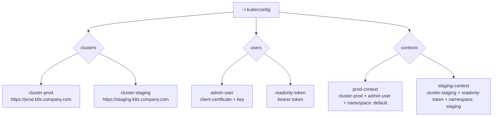

# Configuring the Kubernetes Client

Before making any API calls, the Kubernetes Python client needs to know which cluster to connect to and how to authenticate. This configuration step is what separates a working script from one that just throws `ApiException` errors.

In this guide, we will cover every way to configure the client — loading from kubeconfig, switching contexts, connecting to remote clusters, and configuring timeouts and TLS.

---

## Configuration Methods Overview

The Python client supports several configuration methods depending on where your script runs:

| Method | Where to Use | Auth Source |
| :--- | :--- | :--- |
| `config.load_kube_config()` | Local machine or CI/CD with kubeconfig | `~/.kube/config` file |
| `config.load_incluster_config()` | Inside a Kubernetes pod | ServiceAccount token + CA cert |
| Manual `Configuration` object | Remote cluster without kubeconfig file | Explicit URL + token/cert |
| Context switching | Multiple clusters from same script | Named context in kubeconfig |

---

## How Kubeconfig Works

The kubeconfig file is the standard way to store cluster credentials. It can hold multiple clusters, multiple users, and multiple contexts (a context is a cluster + user + namespace combination).



---

## Loading From the Default Kubeconfig

This is the standard approach when running scripts on a developer machine or a CI server that has `kubectl` already configured.

```python
from kubernetes import client, config
from kubernetes.client.rest import ApiException

def load_default_config():
    try:
        # Loads from ~/.kube/config by default
        config.load_kube_config()
        
        v1 = client.CoreV1Api()
        
        # Quick test: list namespaces
        namespaces = v1.list_namespace()
        
        current_context = config.list_kube_config_contexts()[1]
        print(f"Connected to cluster.")
        print(f"  Current context: {current_context['name']}")
        print(f"  Cluster:         {current_context['context']['cluster']}")
        print(f"  Namespace:       {current_context['context'].get('namespace', 'default')}")
        print(f"  Namespaces found:{len(namespaces.items)}")
        
        return True

    except config.ConfigException as e:
        print(f"Configuration error: {e}")
        return False
    except ApiException as e:
        print(f"API error: {e.status} — {e.reason}")
        return False

load_default_config()
```

### Expected Output
```text
Connected to cluster.
  Current context: prod-context
  Cluster:         cluster-prod
  Namespace:       default
  Namespaces found:5
```

---

## Switching Between Contexts (Multiple Clusters)

When your kubeconfig has multiple contexts, you can switch between them programmatically — useful for scripts that need to compare state across staging and production.

```python
from kubernetes import client, config
from kubernetes.client.rest import ApiException

def get_pods_from_context(context_name, namespace="default"):
    try:
        # Load config for a specific context
        config.load_kube_config(context=context_name)
        
        v1 = client.CoreV1Api()
        pods = v1.list_namespaced_pod(namespace=namespace)
        
        print(f"Context '{context_name}' — {len(pods.items)} pod(s) in '{namespace}':")
        for pod in pods.items:
            print(f"  {pod.metadata.name:<50} {pod.status.phase}")
        
        return pods.items

    except config.ConfigException as e:
        print(f"Context '{context_name}' not found: {e}")
        return []
    except ApiException as e:
        print(f"API error on context '{context_name}': {e.status}")
        return []

# Compare pods across two environments
staging_pods    = get_pods_from_context("staging-context")
production_pods = get_pods_from_context("prod-context")

print(f"\nPod count comparison:")
print(f"  Staging:    {len(staging_pods)}")
print(f"  Production: {len(production_pods)}")
```

### Expected Output
```text
Context 'staging-context' — 3 pod(s) in 'default':
  web-app-deployment-5d9f8c-xk2q7               Running
  redis-cache-6b4d7f-mn3p1                      Running
  postgres-0                                     Running
Context 'prod-context' — 6 pod(s) in 'default':
  web-app-deployment-7f2a1b-pq3r8               Running
  web-app-deployment-7f2a1b-yz9m4               Running
  redis-cache-9d1e2a-kl5n7                      Running
  postgres-0                                     Running

Pod count comparison:
  Staging:    3
  Production: 6
```

---

## Manually Configuring the Client (No Kubeconfig)

For scripts that run without a kubeconfig file — for example, in a Docker container that receives a token via environment variable — you can configure the client manually.

```python
import os
from kubernetes import client
from kubernetes.client.rest import ApiException

def connect_with_token(api_server_url, bearer_token, ca_cert_path=None, verify_ssl=True):
    configuration = client.Configuration()
    
    configuration.host             = api_server_url
    configuration.verify_ssl       = verify_ssl
    configuration.api_key["authorization"] = f"Bearer {bearer_token}"
    
    if ca_cert_path:
        configuration.ssl_ca_cert = ca_cert_path
    
    # Create API client with this specific configuration
    api_client = client.ApiClient(configuration)
    v1 = client.CoreV1Api(api_client)
    
    try:
        namespaces = v1.list_namespace()
        print(f"Connected to {api_server_url}")
        print(f"Namespaces: {[ns.metadata.name for ns in namespaces.items]}")
        return v1
    except ApiException as e:
        print(f"Connection failed: {e.status} — {e.reason}")
        return None

# Load credentials from environment variables (safe, no hardcoding)
api_url = os.environ.get("KUBE_API_URL", "https://your-cluster.k8s.example.com")
token   = os.environ.get("KUBE_TOKEN", "")

connect_with_token(
    api_server_url=api_url,
    bearer_token=token,
    verify_ssl=True
)
```

### Expected Output
```text
Connected to https://your-cluster.k8s.example.com
Namespaces: ['default', 'kube-system', 'monitoring']
```

---

## Setting Timeouts

For automation scripts, long-hanging API calls are dangerous. Set explicit timeouts on the client configuration.

```python
from kubernetes import client, config

config.load_kube_config()

# Set timeouts on the global configuration
client.Configuration().request_timeout = 30   # 30 second timeout

# Or set per-call timeout as a tuple: (connect_timeout, read_timeout)
v1 = client.CoreV1Api()
pods = v1.list_namespaced_pod(
    namespace="default",
    _request_timeout=(5, 30)   # 5s to connect, 30s to read
)

print(f"Pods with custom timeout: {len(pods.items)}")
```

---

## Common Mistakes

### 1. Calling Any API Method Before Loading Configuration
The client stores configuration in a global object. If you create an API instance before calling `load_kube_config()` or `load_incluster_config()`, it will use empty defaults and fail to connect. Always load configuration first.

### 2. Hardcoding Cluster URLs and Tokens in Scripts
Never write your cluster URL or bearer token as a string literal in your script. Store them in environment variables or a secrets manager. Anyone who can read your script file can then access your cluster.

### 3. Using `verify_ssl=False` in Production
Disabling SSL verification makes your script vulnerable to man-in-the-middle attacks. In production, always provide the CA certificate path instead of disabling verification.

### 4. Not Handling `ConfigException`
`config.load_kube_config()` raises `ConfigException` if the kubeconfig file does not exist, is empty, or contains an invalid context name. Always catch this and provide a helpful error message.

---

## Summary

* `config.load_kube_config()` loads credentials from `~/.kube/config` — the standard for local scripts.
* Pass `context="context-name"` to load a specific context when you have multiple clusters.
* `config.list_kube_config_contexts()` returns `(all_contexts, current_context)` as a tuple.
* For manual configuration, create a `client.Configuration()` object and pass it to `client.ApiClient()`.
* Always load bearer tokens and cluster URLs from environment variables, never hardcode them.
* Set `_request_timeout=(connect_sec, read_sec)` per API call to prevent scripts from hanging.
* `ConfigException` means the kubeconfig file is missing, malformed, or the context does not exist.
* `ApiException` means the cluster responded but with an error (4xx or 5xx HTTP status).
* In production, always provide a CA cert path instead of disabling SSL verification.
* Use context switching in scripts that compare or synchronise state across multiple clusters.
