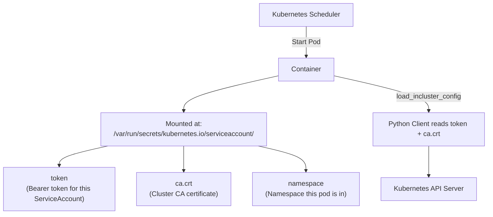

# In-Cluster vs Out-of-Cluster Configuration

One of the most confusing things for people getting started with the Kubernetes Python client is that there are two completely different ways to configure it — and you must choose the right one based on where your script is running. Picking the wrong one results in immediate `ConfigException` errors.

In this guide, we will clearly explain both approaches, when to use each, and how to write code that handles both automatically.

---

## The Core Difference

| Configuration | Where the Script Runs | Credentials Come From |
| :--- | :--- | :--- |
| **Out-of-cluster** | Your laptop, CI server, bastion host | `~/.kube/config` file |
| **In-cluster** | Inside a Kubernetes Pod | ServiceAccount token mounted by Kubernetes |

Kubernetes automatically mounts credentials into every pod. When your script runs inside a pod, it should use those mounted credentials instead of a kubeconfig file.

---

## How In-Cluster Authentication Works

When Kubernetes starts a pod, it automatically mounts a ServiceAccount token and the cluster's CA certificate at fixed paths inside every container. The Python client reads these automatically when you call `load_incluster_config()`.



The mounted token is automatically renewed by Kubernetes — you never need to manage token rotation.

---

## Out-of-Cluster Configuration (Running on Your Laptop or CI)

```python
from kubernetes import client, config
from kubernetes.client.rest import ApiException

def run_out_of_cluster():
    try:
        # Reads from ~/.kube/config
        config.load_kube_config()
        
        v1 = client.CoreV1Api()
        nodes = v1.list_node()
        
        print("Out-of-cluster connection successful.")
        print(f"Cluster nodes: {len(nodes.items)}")
        for node in nodes.items:
            status_conditions = node.status.conditions
            ready = next(
                (c.status for c in status_conditions if c.type == "Ready"),
                "Unknown"
            )
            print(f"  {node.metadata.name:<40} Ready={ready}")
    
    except config.ConfigException as e:
        print(f"Kubeconfig error: {e}")
    except ApiException as e:
        print(f"API error: {e.status} — {e.reason}")

run_out_of_cluster()
```

### Expected Output
```text
Out-of-cluster connection successful.
Cluster nodes: 3
  node-worker-01                           Ready=True
  node-worker-02                           Ready=True
  node-control-plane-01                    Ready=True
```

---

## In-Cluster Configuration (Running Inside a Pod)

When your script runs as a Kubernetes Job or Deployment, use `load_incluster_config()`. This reads the automatically mounted token and CA cert.

```python
from kubernetes import client, config
from kubernetes.client.rest import ApiException

def run_in_cluster():
    try:
        # Reads mounted ServiceAccount credentials
        config.load_incluster_config()
        
        v1 = client.CoreV1Api()
        
        # Read the current namespace from the mounted namespace file
        with open("/var/run/secrets/kubernetes.io/serviceaccount/namespace") as f:
            current_namespace = f.read().strip()
        
        print(f"Running inside cluster. Namespace: {current_namespace}")
        
        pods = v1.list_namespaced_pod(namespace=current_namespace)
        print(f"Pods in this namespace: {len(pods.items)}")
        for pod in pods.items:
            print(f"  {pod.metadata.name} — {pod.status.phase}")
    
    except config.ConfigException as e:
        # This error means we are NOT running inside a cluster
        print(f"Not running inside a cluster: {e}")
    except ApiException as e:
        print(f"API error: {e.status} — {e.reason}")

run_in_cluster()
```

### Expected Output (when running inside a pod)
```text
Running inside cluster. Namespace: monitoring
Pods in this namespace: 4
  prometheus-server-0 — Running
  alertmanager-0 — Running
  node-exporter-xk2q7 — Running
  grafana-5d9f8c-mn3p1 — Running
```

---

## Real-World Pattern: Auto-Detect the Environment

Rather than maintaining two versions of your script, write one that tries in-cluster first and falls back to kubeconfig. This is the pattern used in most production Kubernetes tooling.

```python
from kubernetes import client, config
from kubernetes.client.rest import ApiException

def load_config_auto():
    """
    Try in-cluster config first (running inside a pod).
    Fall back to kubeconfig (running on a developer machine or CI).
    """
    try:
        config.load_incluster_config()
        print("Configuration: in-cluster (ServiceAccount token)")
        return "in-cluster"
    except config.ConfigException:
        pass
    
    try:
        config.load_kube_config()
        contexts, current = config.list_kube_config_contexts()
        print(f"Configuration: out-of-cluster (context: {current['name']})")
        return "out-of-cluster"
    except config.ConfigException as e:
        raise RuntimeError(
            "Cannot configure Kubernetes client. "
            "Not running inside a cluster, and no kubeconfig found."
        ) from e

def get_cluster_pod_count():
    mode = load_config_auto()
    
    v1 = client.CoreV1Api()
    
    try:
        pods = v1.list_pod_for_all_namespaces()
        print(f"Total cluster pods ({mode}): {len(pods.items)}")
        return len(pods.items)
    except ApiException as e:
        print(f"Could not list pods: {e.status} — {e.reason}")
        return 0

get_cluster_pod_count()
```

### Expected Output (running on developer machine)
```text
Configuration: out-of-cluster (context: prod-context)
Total cluster pods (out-of-cluster): 42
```

### Expected Output (running inside a pod)
```text
Configuration: in-cluster (ServiceAccount token)
Total cluster pods (in-cluster): 42
```

---

## ServiceAccount Permissions (RBAC)

When running in-cluster, your pod's ServiceAccount must have the right RBAC permissions for the API calls it makes. Without permissions, you get `403 Forbidden` errors.

Here is what a minimal RBAC setup looks like for a pod that needs to list pods:

```yaml
# serviceaccount.yaml — create a dedicated ServiceAccount
apiVersion: v1
kind: ServiceAccount
metadata:
  name: pod-reader
  namespace: monitoring

---
# role.yaml — define what this account can do
apiVersion: rbac.authorization.k8s.io/v1
kind: Role
metadata:
  name: pod-reader-role
  namespace: monitoring
rules:
  - apiGroups: [""]
    resources: ["pods"]
    verbs: ["get", "list", "watch"]

---
# rolebinding.yaml — bind the role to the ServiceAccount
apiVersion: rbac.authorization.k8s.io/v1
kind: RoleBinding
metadata:
  name: pod-reader-binding
  namespace: monitoring
subjects:
  - kind: ServiceAccount
    name: pod-reader
    namespace: monitoring
roleRef:
  kind: Role
  name: pod-reader-role
  apiGroup: rbac.authorization.k8s.io
```

In your pod spec, reference the ServiceAccount:

```yaml
spec:
  serviceAccountName: pod-reader
  containers:
    - name: my-automation-script
      image: my-script:latest
```

---

## Common Mistakes

### 1. Calling `load_incluster_config()` Outside a Kubernetes Pod
This raises `ConfigException: Service host/port is not set`. It only works when the pod's ServiceAccount token is mounted at the expected path. If you see this error on your laptop, you meant to use `load_kube_config()`.

### 2. Calling `load_kube_config()` Inside a Pod
When running inside a pod, there is no `~/.kube/config` file. Calling `load_kube_config()` inside a pod will fail with a `ConfigException`. Use the auto-detect pattern instead.

### 3. Forgetting to Create an RBAC Role for In-Cluster Scripts
The default ServiceAccount has very limited permissions. If your script tries to list pods or create resources and gets `403 Forbidden`, you need to create a Role and RoleBinding granting the necessary verbs.

### 4. Reading Secrets from the Wrong Namespace
In-cluster scripts can only access secrets in namespaces permitted by their RBAC Role. A ClusterRole is needed for cross-namespace access. Always apply the principle of least privilege — only grant the namespaces your script actually needs.

---

## Summary

* **Out-of-cluster**: use `config.load_kube_config()` — reads from `~/.kube/config` on the host.
* **In-cluster**: use `config.load_incluster_config()` — reads the ServiceAccount token mounted by Kubernetes.
* The auto-detect pattern tries in-cluster first and falls back to kubeconfig — works everywhere.
* The mounted token is at `/var/run/secrets/kubernetes.io/serviceaccount/token` inside every pod.
* The current namespace is at `/var/run/secrets/kubernetes.io/serviceaccount/namespace`.
* In-cluster pods need an RBAC Role defining which resources and verbs they are allowed to use.
* `403 Forbidden` from an in-cluster script means missing RBAC permissions — not a code bug.
* `ConfigException: Service host/port is not set` means `load_incluster_config()` was called outside a pod.
* The default Kubernetes ServiceAccount has minimal permissions — always create a dedicated one.
* Kubernetes auto-renews the mounted token — you never need to manually rotate in-cluster credentials.
