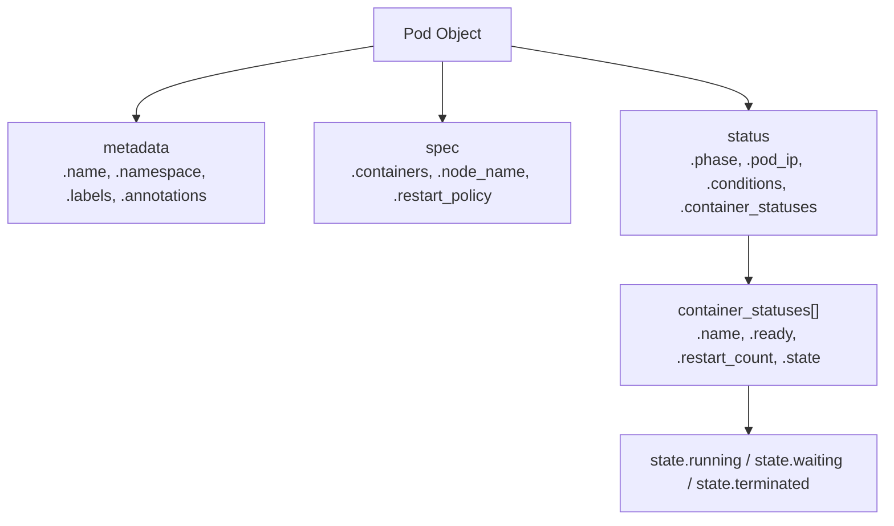

# Listing Pods

Pods are the smallest deployable unit in Kubernetes — every containerised workload runs inside a pod. When something goes wrong in your cluster (containers crashing, memory pressure, network failures), your first instinct is to look at the pods. The Python client gives you programmatic access to pod state, resource usage, restart counts, and container details.

In this guide, we will learn how to list pods, filter them, and extract the information that matters for monitoring and automation.

---

## Pod Phases — What They Mean

Every pod moves through a lifecycle of phases. Understanding these phases is essential for writing correct filters:

| Phase | Meaning | Action Needed? |
| :--- | :--- | :--- |
| **Pending** | Scheduled but containers not started yet | Monitor — may be pulling images or waiting for node resources |
| **Running** | At least one container is running | Normal — check container statuses within |
| **Succeeded** | All containers completed with exit code 0 | Normal for Jobs |
| **Failed** | All containers terminated, at least one with non-zero exit | Investigation needed |
| **Unknown** | Node communication lost | Urgent — node may be down |

---

## Pod Object Structure

When the client returns a pod, it is a rich Python object:



---

## Listing Pods in a Namespace

The most common operation — list all pods in a specific namespace.

```python
from kubernetes import client, config
from kubernetes.client.rest import ApiException

def list_pods(namespace="default"):
    config.load_kube_config()
    v1 = client.CoreV1Api()
    
    try:
        pods = v1.list_namespaced_pod(namespace=namespace)
        
        print(f"Pods in namespace '{namespace}': {len(pods.items)} found\n")
        print(f"{'POD NAME':<50} {'PHASE':<12} {'NODE':<25} {'RESTARTS'}")
        print("-" * 100)
        
        for pod in pods.items:
            name = pod.metadata.name
            phase = pod.status.phase or "Unknown"
            node  = pod.spec.node_name or "Unscheduled"
            
            # Sum restarts across all containers in the pod
            restarts = sum(
                cs.restart_count
                for cs in (pod.status.container_statuses or [])
            )
            
            print(f"{name:<50} {phase:<12} {node:<25} {restarts}")
        
        print("-" * 100)
        return pods.items
    
    except ApiException as e:
        print(f"API error: {e.status} — {e.reason}")
        return []

list_pods(namespace="default")
```

### Expected Output
```text
Pods in namespace 'default': 4 found

POD NAME                                           PHASE        NODE                      RESTARTS
----------------------------------------------------------------------------------------------------
web-app-deployment-5d9f8c-xk2q7                   Running      node-worker-01            0
web-app-deployment-5d9f8c-yz9m4                   Running      node-worker-02            0
redis-cache-6b4d7f-mn3p1                          Running      node-worker-01            1
postgres-statefulset-0                             Running      node-worker-02            0
----------------------------------------------------------------------------------------------------
```

---

## Listing Pods Across All Namespaces

For cluster-wide health checks, list pods in every namespace at once.

```python
from kubernetes import client, config
from kubernetes.client.rest import ApiException

def cluster_pod_summary():
    config.load_kube_config()
    v1 = client.CoreV1Api()
    
    try:
        all_pods = v1.list_pod_for_all_namespaces(watch=False)
        
        # Group by phase
        by_phase = {}
        for pod in all_pods.items:
            phase = pod.status.phase or "Unknown"
            by_phase.setdefault(phase, []).append(pod)
        
        print(f"Cluster Pod Summary — Total: {len(all_pods.items)}\n")
        for phase, pods in sorted(by_phase.items()):
            print(f"  {phase:<15}: {len(pods)} pod(s)")
        
        # Flag pods with high restart counts
        high_restarts = []
        for pod in all_pods.items:
            for cs in (pod.status.container_statuses or []):
                if cs.restart_count > 5:
                    high_restarts.append((
                        pod.metadata.namespace,
                        pod.metadata.name,
                        cs.name,
                        cs.restart_count
                    ))
        
        if high_restarts:
            print(f"\nWarning: Pods with >5 restarts:")
            for ns, pod_name, container, count in high_restarts:
                print(f"  [{ns}] {pod_name} / {container} — {count} restarts")
        else:
            print(f"\nNo pods with excessive restarts.")
        
        return all_pods.items
    
    except ApiException as e:
        print(f"API error: {e.status} — {e.reason}")
        return []

cluster_pod_summary()
```

### Expected Output
```text
Cluster Pod Summary — Total: 28

  Pending        : 0 pod(s)
  Running        : 26 pod(s)
  Succeeded      : 2 pod(s)

Warning: Pods with >5 restarts:
  [production] crash-prone-worker-7f2a1b-xk / worker — 12 restarts
```

---

## Real-World Script: Find Failed and CrashLooping Pods

This is the script you write when you get a 3am alert. It finds every pod that is either failed or stuck in a CrashLoopBackOff state across the whole cluster.

```python
from kubernetes import client, config
from kubernetes.client.rest import ApiException

def find_unhealthy_pods():
    config.load_kube_config()
    v1 = client.CoreV1Api()
    
    try:
        all_pods = v1.list_pod_for_all_namespaces(watch=False)
        
        failed_pods      = []
        crashloop_pods   = []
        
        for pod in all_pods.items:
            ns   = pod.metadata.namespace
            name = pod.metadata.name
            
            # Catch Failed phase
            if pod.status.phase == "Failed":
                failed_pods.append((ns, name))
            
            # Catch CrashLoopBackOff in container statuses
            for cs in (pod.status.container_statuses or []):
                if cs.state.waiting and cs.state.waiting.reason == "CrashLoopBackOff":
                    crashloop_pods.append((ns, name, cs.name, cs.restart_count))
        
        print("=== Unhealthy Pod Report ===\n")
        
        print(f"Failed pods ({len(failed_pods)}):")
        if failed_pods:
            for ns, name in failed_pods:
                print(f"  [{ns}] {name}")
        else:
            print("  None")
        
        print(f"\nCrashLoopBackOff pods ({len(crashloop_pods)}):")
        if crashloop_pods:
            for ns, pod_name, container, restarts in crashloop_pods:
                print(f"  [{ns}] {pod_name} / {container} — {restarts} restarts")
        else:
            print("  None")
        
        return failed_pods, crashloop_pods
    
    except ApiException as e:
        print(f"API error: {e.status} — {e.reason}")
        return [], []

find_unhealthy_pods()
```

### Expected Output
```text
=== Unhealthy Pod Report ===

Failed pods (1):
  [batch-jobs] old-migration-job-xk2q7

CrashLoopBackOff pods (1):
  [production] crash-prone-worker-7f2a1b-xk / worker — 12 restarts
```

---

## Common Mistakes

### 1. Checking `pod.status.phase` Without Handling `None`
Pods that are very recently created may have a `None` phase before Kubernetes assigns one. Always guard with `pod.status.phase or "Unknown"` when displaying or filtering by phase.

### 2. Forgetting That One Pod Can Have Multiple Containers
`pod.status.container_statuses` is a list. A pod with an init container and a main container will have at least two entries. When summing restarts or checking crash states, iterate all container statuses.

### 3. Using Label Selectors Without Matching the Exact Label Key
`list_namespaced_pod(label_selector="app=web-app")` filters by label. If your pods use the label key `app.kubernetes.io/name` instead of `app`, the selector will return an empty list silently. Always check your pod labels with `kubectl get pods --show-labels`.

### 4. Not Handling `pod.status.container_statuses` Being `None`
Pods in the `Pending` phase have not started any containers yet, so `container_statuses` is `None`. Direct access like `pod.status.container_statuses[0]` will throw `TypeError`. Always use `(pod.status.container_statuses or [])`.

---

## Summary

* `v1.list_namespaced_pod(namespace)` lists pods in a specific namespace.
* `v1.list_pod_for_all_namespaces()` lists pods across every namespace in the cluster.
* Pod phase can be: Pending, Running, Succeeded, Failed, or Unknown.
* `pod.metadata.name` is the pod name; `pod.metadata.namespace` is its namespace.
* `pod.spec.node_name` shows which node the pod is scheduled on.
* Restart counts are in `pod.status.container_statuses[].restart_count`.
* `CrashLoopBackOff` appears in `pod.status.container_statuses[].state.waiting.reason`.
* Always use `(pod.status.container_statuses or [])` to safely handle pods that have not started containers.
* Use `label_selector="key=value"` to filter pods by their labels.
* Use restart count and phase filtering to build automated health alerts.
