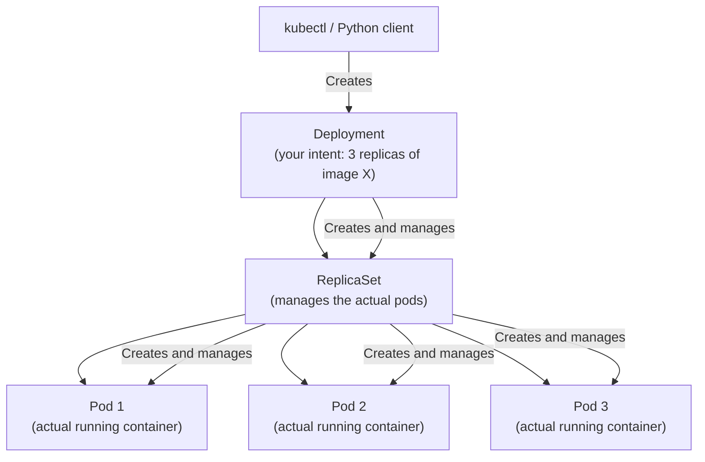

# Creating Deployments

A Kubernetes Deployment is the standard way to run stateless containerised applications. It manages ReplicaSets, handles rolling updates, and ensures your desired number of pods are always running. Creating deployments programmatically lets you build deployment pipelines, environment provisioning scripts, and GitOps tooling entirely in Python.

In this guide, we will learn how to create Deployments using the Python client, configure them correctly, and verify they become healthy.

---

## Deployment Architecture

When you create a Deployment, Kubernetes creates a chain of resources:



You never create ReplicaSets or individual pods directly. You define a Deployment and let Kubernetes manage everything below it.

---

## Key Deployment Fields

| Field | Where | What It Controls |
| :--- | :--- | :--- |
| `replicas` | `spec` | How many pod copies to run |
| `selector.matchLabels` | `spec` | Which pods this deployment owns |
| `template.metadata.labels` | `spec.template` | Labels on each created pod |
| `template.spec.containers` | `spec.template.spec` | Container image, name, ports, env, resources |
| `strategy.type` | `spec` | `RollingUpdate` (default) or `Recreate` |

---

## Creating a Basic Deployment

Let us create a simple nginx Deployment with 3 replicas:

```python
from kubernetes import client, config
from kubernetes.client.rest import ApiException

def create_deployment(namespace, name, image, replicas=1, container_port=80):
    config.load_kube_config()
    apps_v1 = client.AppsV1Api()
    
    # Define the Deployment object using the Python client models
    deployment = client.V1Deployment(
        metadata=client.V1ObjectMeta(
            name=name,
            namespace=namespace,
            labels={"app": name, "managed-by": "python-sdk"}
        ),
        spec=client.V1DeploymentSpec(
            replicas=replicas,
            selector=client.V1LabelSelector(
                match_labels={"app": name}
            ),
            template=client.V1PodTemplateSpec(
                metadata=client.V1ObjectMeta(
                    labels={"app": name}
                ),
                spec=client.V1PodSpec(
                    containers=[
                        client.V1Container(
                            name=name,
                            image=image,
                            ports=[client.V1ContainerPort(container_port=container_port)]
                        )
                    ]
                )
            )
        )
    )
    
    try:
        result = apps_v1.create_namespaced_deployment(
            namespace=namespace,
            body=deployment
        )
        print(f"Deployment '{name}' created in namespace '{namespace}'.")
        print(f"  Image:    {image}")
        print(f"  Replicas: {replicas}")
        print(f"  UID:      {result.metadata.uid}")
        return result
    
    except ApiException as e:
        if e.status == 409:
            print(f"Deployment '{name}' already exists in '{namespace}'.")
        else:
            print(f"API error: {e.status} — {e.reason}")
        return None

create_deployment(
    namespace="staging",
    name="web-app",
    image="nginx:alpine",
    replicas=3,
    container_port=80
)
```

### Expected Output
```text
Deployment 'web-app' created in namespace 'staging'.
  Image:    nginx:alpine
  Replicas: 3
  UID:      a1b2c3d4-e5f6-7890-abcd-ef1234567890
```

---

## Creating a Deployment With Resources and Environment Variables

Production deployments should always include resource requests/limits and environment configuration:

```python
from kubernetes import client, config
from kubernetes.client.rest import ApiException

def create_production_deployment(namespace, name, image, replicas, env_vars, port=8080):
    config.load_kube_config()
    apps_v1 = client.AppsV1Api()
    
    # Build environment variable list
    env_list = [
        client.V1EnvVar(name=k, value=v)
        for k, v in env_vars.items()
    ]
    
    container = client.V1Container(
        name=name,
        image=image,
        ports=[client.V1ContainerPort(container_port=port)],
        env=env_list,
        resources=client.V1ResourceRequirements(
            requests={"cpu": "100m", "memory": "128Mi"},
            limits={"cpu": "500m",   "memory": "512Mi"}
        ),
        readiness_probe=client.V1Probe(
            http_get=client.V1HTTPGetAction(path="/health", port=port),
            initial_delay_seconds=5,
            period_seconds=10
        ),
        liveness_probe=client.V1Probe(
            http_get=client.V1HTTPGetAction(path="/health", port=port),
            initial_delay_seconds=15,
            period_seconds=20
        )
    )
    
    deployment = client.V1Deployment(
        metadata=client.V1ObjectMeta(name=name, namespace=namespace),
        spec=client.V1DeploymentSpec(
            replicas=replicas,
            selector=client.V1LabelSelector(match_labels={"app": name}),
            template=client.V1PodTemplateSpec(
                metadata=client.V1ObjectMeta(labels={"app": name}),
                spec=client.V1PodSpec(containers=[container])
            ),
            strategy=client.V1DeploymentStrategy(
                type="RollingUpdate",
                rolling_update=client.V1RollingUpdateDeployment(
                    max_unavailable="25%",
                    max_surge="25%"
                )
            )
        )
    )
    
    try:
        result = apps_v1.create_namespaced_deployment(namespace=namespace, body=deployment)
        print(f"Production deployment '{name}' created.")
        return result
    except ApiException as e:
        print(f"Error: {e.status} — {e.reason}")
        return None

create_production_deployment(
    namespace="production",
    name="api-service",
    image="my-registry/api-service:3.2.1",
    replicas=3,
    env_vars={
        "DATABASE_URL": "postgresql://user:pass@db:5432/appdb",
        "LOG_LEVEL":    "INFO",
        "ENVIRONMENT":  "production"
    },
    port=8080
)
```

### Expected Output
```text
Production deployment 'api-service' created.
```

---

## Real-World Script: Wait for Deployment to Become Ready

Creating a Deployment is not enough — you need to wait for the pods to actually become available before continuing the pipeline.

```python
from kubernetes import client, config
from kubernetes.client.rest import ApiException
import time

def wait_for_deployment_ready(namespace, name, timeout=120):
    config.load_kube_config()
    apps_v1 = client.AppsV1Api()
    
    print(f"Waiting for deployment '{name}' to be ready (timeout: {timeout}s)...")
    deadline = time.time() + timeout
    
    while time.time() < deadline:
        try:
            deployment = apps_v1.read_namespaced_deployment(name=name, namespace=namespace)
            status = deployment.status
            
            desired   = deployment.spec.replicas or 0
            ready     = status.ready_replicas or 0
            available = status.available_replicas or 0
            
            print(f"  Desired: {desired}  Ready: {ready}  Available: {available}")
            
            if ready == desired and available == desired:
                print(f"Deployment '{name}' is fully ready!")
                return True
        
        except ApiException as e:
            print(f"  API error while polling: {e.status}")
        
        time.sleep(5)
    
    print(f"Timeout: deployment '{name}' not ready after {timeout}s.")
    return False

wait_for_deployment_ready("staging", "web-app", timeout=120)
```

### Expected Output
```text
Waiting for deployment 'web-app' to be ready (timeout: 120s)...
  Desired: 3  Ready: 0  Available: 0
  Desired: 3  Ready: 1  Available: 0
  Desired: 3  Ready: 2  Available: 1
  Desired: 3  Ready: 3  Available: 3
Deployment 'web-app' is fully ready!
```

---

## Common Mistakes

### 1. Mismatching `selector.matchLabels` and `template.metadata.labels`
The labels on pods (in `template.metadata.labels`) must match the selector (in `spec.selector.matchLabels`). If they do not match, Kubernetes rejects the Deployment with a validation error. They do not need to be identical but the selector must be a subset of the pod labels.

### 2. Forgetting Resource Requests in Production
Deployments without `resources.requests` can starve other pods on the same node. The Kubernetes scheduler cannot make good placement decisions without them. Always set CPU and memory requests for production workloads.

### 3. Not Adding Readiness Probes
Without a readiness probe, Kubernetes marks a pod as Ready immediately when the container starts. If your app takes 10 seconds to warm up, traffic will be sent to it before it can handle requests. Always add a readiness probe.

### 4. Creating Deployments Without Polling for Readiness
`apps_v1.create_namespaced_deployment()` returns immediately after the API accepts the manifest. The pods have not started yet. If your pipeline moves on immediately after this call (e.g., runs a smoke test), the pods will not be ready. Always poll for readiness.

---

## Summary

* Deployments are created using `client.AppsV1Api().create_namespaced_deployment(namespace, body)`.
* Build the deployment body using client model objects: `V1Deployment`, `V1DeploymentSpec`, etc.
* `selector.matchLabels` must match the labels in `template.metadata.labels`.
* Use `V1ResourceRequirements` to set CPU and memory requests and limits.
* Add `readiness_probe` and `liveness_probe` to tell Kubernetes when the app is ready and healthy.
* `RollingUpdate` strategy with `maxUnavailable` and `maxSurge` allows zero-downtime deployments.
* The create call returns immediately — always poll `read_namespaced_deployment` for actual readiness.
* Check `status.ready_replicas == spec.replicas` to confirm all pods are ready.
* A `409 Conflict` error means the Deployment already exists — handle it with an update instead.
* Pass environment variables as a list of `V1EnvVar(name, value)` objects.
