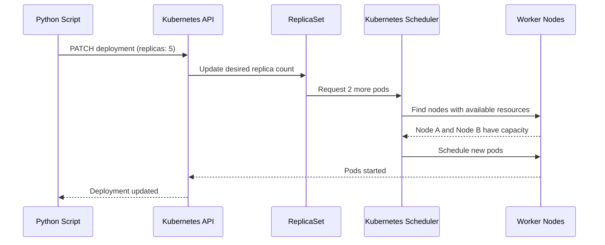

# Scaling Deployments

Scaling is one of Kubernetes' most powerful features. Instead of manually SSHing into servers to start more application processes, you just tell Kubernetes how many replicas you want and it handles placement, scheduling, and health checking automatically. With Python, you can scale deployments dynamically based on time of day, queue depth, or any other metric you can measure.

In this guide, we will learn how to scale Deployments up and down, watch the scaling happen in real time, and build intelligent auto-scaling triggers.

---

## How Kubernetes Scaling Works



---

## Simple Scaling With `patch_namespaced_deployment`

The cleanest way to scale a Deployment is to patch just the `replicas` field. A patch only changes the fields you specify, leaving everything else untouched.

```python
from kubernetes import client, config
from kubernetes.client.rest import ApiException
import time

def scale_deployment(namespace, name, replicas):
    config.load_kube_config()
    apps_v1 = client.AppsV1Api()
    
    try:
        # Get current state first
        deployment = apps_v1.read_namespaced_deployment(name=name, namespace=namespace)
        current_replicas = deployment.spec.replicas
        
        if current_replicas == replicas:
            print(f"Deployment '{name}' already has {replicas} replica(s). No change.")
            return True
        
        direction = "UP" if replicas > current_replicas else "DOWN"
        print(f"Scaling '{name}' {direction}: {current_replicas} -> {replicas} replica(s)...")
        
        # Patch only the replicas field
        patch_body = {"spec": {"replicas": replicas}}
        
        apps_v1.patch_namespaced_deployment(
            name=name,
            namespace=namespace,
            body=patch_body
        )
        
        print(f"Scale request accepted. Waiting for pods to adjust...")
        
        # Poll until the desired replica count is reached
        deadline = time.time() + 120
        while time.time() < deadline:
            dep = apps_v1.read_namespaced_deployment(name=name, namespace=namespace)
            ready = dep.status.ready_replicas or 0
            
            if ready == replicas:
                print(f"Done. {replicas} replica(s) are ready.")
                return True
            
            print(f"  Ready: {ready}/{replicas}...")
            time.sleep(5)
        
        print(f"Timeout: scaling did not complete within 120s.")
        return False
    
    except ApiException as e:
        print(f"Error scaling '{name}': {e.status} — {e.reason}")
        return False

# Scale up for peak traffic
scale_deployment("production", "api-service", replicas=6)
```

### Expected Output
```text
Scaling 'api-service' UP: 3 -> 6 replica(s)...
Scale request accepted. Waiting for pods to adjust...
  Ready: 3/6...
  Ready: 4/6...
  Ready: 5/6...
  Ready: 6/6...
Done. 6 replica(s) are ready.
```

---

## Scaling Down to Zero (Pausing a Deployment)

Scaling to 0 replicas is a useful trick to pause a deployment without deleting it. This preserves the Deployment manifest, ConfigMaps, Services, and all other resources — you just have no running pods.

```python
from kubernetes import client, config
from kubernetes.client.rest import ApiException

def pause_deployment(namespace, name):
    config.load_kube_config()
    apps_v1 = client.AppsV1Api()
    
    try:
        dep = apps_v1.read_namespaced_deployment(name=name, namespace=namespace)
        current = dep.spec.replicas
        
        if current == 0:
            print(f"Deployment '{name}' is already paused (0 replicas).")
            return True
        
        print(f"Pausing deployment '{name}' (scaling from {current} to 0)...")
        apps_v1.patch_namespaced_deployment(
            name=name,
            namespace=namespace,
            body={"spec": {"replicas": 0}}
        )
        print(f"Deployment '{name}' paused. No pods are running.")
        return True
    
    except ApiException as e:
        print(f"Error: {e.status} — {e.reason}")
        return False

pause_deployment("staging", "web-app")
```

### Expected Output
```text
Pausing deployment 'web-app' (scaling from 3 to 0)...
Deployment 'web-app' paused. No pods are running.
```

---

## Real-World Script: Time-Based Scaling

Many applications have predictable traffic patterns — high traffic during business hours, very low traffic at night. This script scales based on the current hour.

```python
from kubernetes import client, config
from kubernetes.client.rest import ApiException
from datetime import datetime

# Define replica counts per hour window (24h format)
SCALING_SCHEDULE = {
    "night":    {"hours": range(0, 7),   "replicas": 1},   # midnight to 7am
    "morning":  {"hours": range(7, 9),   "replicas": 3},   # 7am to 9am ramp up
    "peak":     {"hours": range(9, 18),  "replicas": 6},   # 9am to 6pm peak
    "evening":  {"hours": range(18, 22), "replicas": 3},   # 6pm to 10pm ramp down
    "late":     {"hours": range(22, 24), "replicas": 1},   # 10pm to midnight
}

def get_desired_replicas(current_hour):
    for window, config_data in SCALING_SCHEDULE.items():
        if current_hour in config_data["hours"]:
            return window, config_data["replicas"]
    return "default", 2

def time_based_scale(namespace, deployment_name):
    config.load_kube_config()
    apps_v1 = client.AppsV1Api()
    
    current_hour = datetime.now().hour
    window, desired_replicas = get_desired_replicas(current_hour)
    
    print(f"Current time: {datetime.now().strftime('%H:%M')} (window: {window})")
    print(f"Desired replicas for '{deployment_name}': {desired_replicas}")
    
    try:
        dep = apps_v1.read_namespaced_deployment(name=deployment_name, namespace=namespace)
        current_replicas = dep.spec.replicas
        
        if current_replicas == desired_replicas:
            print(f"Already at {desired_replicas} replica(s). No action needed.")
            return
        
        direction = "UP" if desired_replicas > current_replicas else "DOWN"
        print(f"Scaling {direction}: {current_replicas} -> {desired_replicas}...")
        
        apps_v1.patch_namespaced_deployment(
            name=deployment_name,
            namespace=namespace,
            body={"spec": {"replicas": desired_replicas}}
        )
        
        print(f"Scale complete. '{deployment_name}' now targeting {desired_replicas} replica(s).")
    
    except ApiException as e:
        print(f"Error: {e.status} — {e.reason}")

time_based_scale("production", "web-app")
```

### Expected Output
```text
Current time: 14:30 (window: peak)
Desired replicas for 'web-app': 6
Scaling UP: 2 -> 6...
Scale complete. 'web-app' now targeting 6 replica(s).
```

---

## Common Mistakes

### 1. Using `replace` Instead of `patch` for Scaling
`replace_namespaced_deployment()` replaces the entire Deployment manifest. If you only fetch and modify the `replicas` field, you will overwrite any changes made by Kubernetes (like annotations added by HPA) since you fetched the object. Use `patch_namespaced_deployment()` with only the fields you want to change.

### 2. Not Waiting for the Scale to Complete
`patch_namespaced_deployment()` returns as soon as the API accepts the request. Pods have not started or stopped yet. If you immediately run a smoke test after scaling, pods may not exist yet. Always poll for readiness.

### 3. Scaling to 0 on a Deployment That Has an HPA
If a HorizontalPodAutoscaler (HPA) is attached to your Deployment, it will immediately scale back up from 0 because the HPA's minimum replicas setting overrides your manual scale. To pause a deployment with an HPA, you must also suspend the HPA or remove it.

### 4. Forgetting That Scale-Down Does Not Wait for Pod Termination
When you scale down, Kubernetes sends SIGTERM to the pods being removed. They have a grace period to finish requests. `patch_namespaced_deployment()` does not wait for this — it just records the new desired count. Poll `status.ready_replicas` and also `status.replicas` to confirm the old pods are fully terminated.

---

## Summary

* Use `patch_namespaced_deployment(name, namespace, body={"spec": {"replicas": N}})` to scale.
* Patch only changes what you specify — it does not overwrite the entire manifest.
* Scale to 0 replicas to pause a Deployment without deleting it.
* Always poll `status.ready_replicas` after scaling to confirm pods actually came up or went away.
* Time-based scaling is a simple but effective way to reduce costs during off-peak hours.
* HPAs can override manual scaling — pause or remove the HPA before manually scaling a Deployment that has one.
* Scale-up polls until `ready_replicas == replicas`; scale-down should also verify `replicas == desired`.
* Set a timeout on your scaling poll loop to fail fast if something prevents pods from starting.
* Log the current replica count before and after every scaling action for auditing.
* Combine scaling with metrics (queue depth, CPU, custom signals) for event-driven autoscaling from Python.
