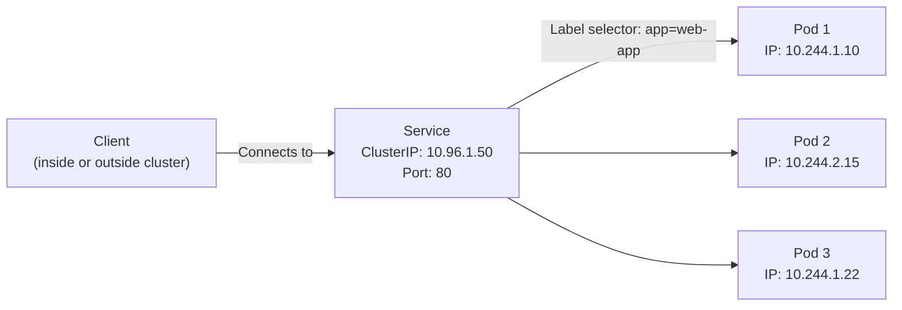

# Managing Services

A Kubernetes Service is what makes your pods reachable. Pods are ephemeral — they get created, deleted, and replaced constantly. A Service gives you a stable network address that always points to the currently healthy pods behind it. Without a Service, pod IP addresses change every time a pod restarts and nothing can reliably connect to your application.

In this guide, we will learn how to create, inspect, update, and delete Kubernetes Services using the Python client.

---

## Service Types Comparison

| Service Type | Reachable From | How It Works | Use Case |
| :--- | :--- | :--- | :--- |
| **ClusterIP** | Inside the cluster only | Assigns a cluster-internal IP | Internal microservice communication |
| **NodePort** | Outside the cluster via node IP | Opens a port on every node | Dev/test access without a load balancer |
| **LoadBalancer** | Outside the cluster via cloud LB | Provisions a cloud load balancer | Production external traffic |
| **ExternalName** | Inside the cluster | DNS CNAME to external hostname | Referencing external services by name |

---

## How a Service Finds Its Pods

A Service uses a label selector to find the pods it should route traffic to. Any pod in the namespace that has the matching labels will receive traffic from the Service.



If a pod is deleted and replaced, the new pod automatically gets the same label and the Service starts routing to it — no manual update needed.

---

## Creating a ClusterIP Service

A ClusterIP is the default and most common service type — internal traffic within the cluster.

```python
from kubernetes import client, config
from kubernetes.client.rest import ApiException

def create_clusterip_service(namespace, name, selector_label, port, target_port):
    config.load_kube_config()
    v1 = client.CoreV1Api()
    
    service = client.V1Service(
        metadata=client.V1ObjectMeta(
            name=name,
            namespace=namespace,
            labels={"app": name}
        ),
        spec=client.V1ServiceSpec(
            type="ClusterIP",
            selector=selector_label,       # Must match pod labels
            ports=[
                client.V1ServicePort(
                    port=port,             # Port clients connect to
                    target_port=target_port,  # Port on the pod
                    protocol="TCP"
                )
            ]
        )
    )
    
    try:
        result = v1.create_namespaced_service(namespace=namespace, body=service)
        print(f"ClusterIP service '{name}' created.")
        print(f"  Cluster IP:  {result.spec.cluster_ip}")
        print(f"  Port:        {port} -> {target_port}")
        print(f"  Selector:    {selector_label}")
        return result
    except ApiException as e:
        if e.status == 409:
            print(f"Service '{name}' already exists.")
        else:
            print(f"Error: {e.status} — {e.reason}")
        return None

create_clusterip_service(
    namespace="production",
    name="web-app-svc",
    selector_label={"app": "web-app"},
    port=80,
    target_port=8080
)
```

### Expected Output
```text
ClusterIP service 'web-app-svc' created.
  Cluster IP:  10.96.45.123
  Port:        80 -> 8080
  Selector:    {'app': 'web-app'}
```

---

## Creating a LoadBalancer Service

For external access (production traffic from the internet), use a LoadBalancer service. In cloud environments (AWS, GCP, Azure), this automatically provisions a cloud load balancer.

```python
from kubernetes import client, config
from kubernetes.client.rest import ApiException
import time

def create_loadbalancer_service(namespace, name, selector_label, port, target_port):
    config.load_kube_config()
    v1 = client.CoreV1Api()
    
    service = client.V1Service(
        metadata=client.V1ObjectMeta(name=name, namespace=namespace),
        spec=client.V1ServiceSpec(
            type="LoadBalancer",
            selector=selector_label,
            ports=[
                client.V1ServicePort(port=port, target_port=target_port, protocol="TCP")
            ]
        )
    )
    
    try:
        result = v1.create_namespaced_service(namespace=namespace, body=service)
        print(f"LoadBalancer service '{name}' created.")
        print("Waiting for external IP assignment (may take 30-60 seconds)...")
        
        # Poll until the load balancer IP is assigned
        deadline = time.time() + 120
        while time.time() < deadline:
            svc = v1.read_namespaced_service(name=name, namespace=namespace)
            ingress = svc.status.load_balancer.ingress
            
            if ingress:
                lb_ip = ingress[0].ip or ingress[0].hostname
                print(f"External address assigned: {lb_ip}")
                print(f"Service '{name}' is reachable at {lb_ip}:{port}")
                return svc
            
            print("  Still waiting for external IP...")
            time.sleep(10)
        
        print("Timeout: load balancer IP was not assigned within 120s.")
        return result
    
    except ApiException as e:
        print(f"Error: {e.status} — {e.reason}")
        return None

create_loadbalancer_service(
    namespace="production",
    name="web-app-lb",
    selector_label={"app": "web-app"},
    port=80,
    target_port=8080
)
```

### Expected Output
```text
LoadBalancer service 'web-app-lb' created.
Waiting for external IP assignment (may take 30-60 seconds)...
  Still waiting for external IP...
External address assigned: 34.123.45.67
Service 'web-app-lb' is reachable at 34.123.45.67:80
```

---

## Listing Services and Their Endpoints

This script lists all services in a namespace and shows which pods are currently backing each one.

```python
from kubernetes import client, config
from kubernetes.client.rest import ApiException

def list_services_with_endpoints(namespace="default"):
    config.load_kube_config()
    v1 = client.CoreV1Api()
    
    try:
        services  = v1.list_namespaced_service(namespace=namespace)
        endpoints = v1.list_namespaced_endpoints(namespace=namespace)
        
        # Build a quick lookup: service name -> list of endpoint IPs
        ep_map = {}
        for ep in endpoints.items:
            ips = []
            for subset in (ep.subsets or []):
                for addr in (subset.addresses or []):
                    ips.append(addr.ip)
            ep_map[ep.metadata.name] = ips
        
        print(f"Services in '{namespace}':\n")
        for svc in services.items:
            name      = svc.metadata.name
            svc_type  = svc.spec.type
            cluster_ip = svc.spec.cluster_ip
            ports     = ", ".join(
                f"{p.port}/{p.protocol}" for p in (svc.spec.ports or [])
            )
            backing_pods = ep_map.get(name, [])
            
            print(f"  {name}")
            print(f"    Type:       {svc_type}")
            print(f"    Cluster IP: {cluster_ip}")
            print(f"    Ports:      {ports}")
            print(f"    Backing IPs: {backing_pods or 'None (no ready pods)'}\n")
    
    except ApiException as e:
        print(f"Error: {e.status} — {e.reason}")

list_services_with_endpoints("production")
```

### Expected Output
```text
Services in 'production':

  web-app-svc
    Type:       ClusterIP
    Cluster IP: 10.96.45.123
    Ports:      80/TCP
    Backing IPs: ['10.244.1.10', '10.244.2.15', '10.244.1.22']

  web-app-lb
    Type:       LoadBalancer
    Cluster IP: 10.96.45.124
    Ports:      80/TCP
    Backing IPs: ['10.244.1.10', '10.244.2.15', '10.244.1.22']
```

---

## Common Mistakes

### 1. Selector Does Not Match Any Pod Labels
If `selector_label={"app": "webapp"}` but pods are labelled `app: web-app` (hyphen vs no hyphen), the Service will have no endpoints — it routes traffic to nothing and requests will time out. Always verify pod labels match the service selector exactly.

### 2. Confusing Service Port and Target Port
`port` is the port that other services use to connect to this service. `target_port` is the port your container is actually listening on. These are often different (e.g., service on 80, container on 8080). Getting them swapped will result in connection refused errors.

### 3. Deleting a Service Without Removing It From DNS
Kubernetes CoreDNS caches service DNS entries. After you delete a service, clients inside the cluster may still try to resolve its DNS name for a short time. Always add a graceful delay or re-test connectivity before moving on after a service deletion.

### 4. Using `LoadBalancer` Type in Local Clusters
On local clusters (Minikube, kind, k3d), `LoadBalancer` services will stay in `Pending` state forever because there is no cloud provider to provision a load balancer. Use `NodePort` or port-forwarding for local development.

---

## Summary

* A Service gives pods a stable network address even as pods are created and deleted.
* Services use label selectors to find which pods to route traffic to.
* `ClusterIP` is internal-only; `LoadBalancer` exposes a public IP via a cloud provider.
* `create_namespaced_service(namespace, body)` creates a service; `read_namespaced_service` fetches it.
* Poll `status.load_balancer.ingress` to wait for an external IP to be assigned on `LoadBalancer` services.
* `list_namespaced_endpoints` shows which pod IPs are currently backing each service.
* A service with no backing endpoints means the selector does not match any ready pods.
* Service port (`port`) and container port (`target_port`) are often different — do not confuse them.
* `delete_namespaced_service` removes the service but does not affect the pods it was pointing to.
* Use `NodePort` services (or `kubectl port-forward`) for accessing services in local development clusters.
