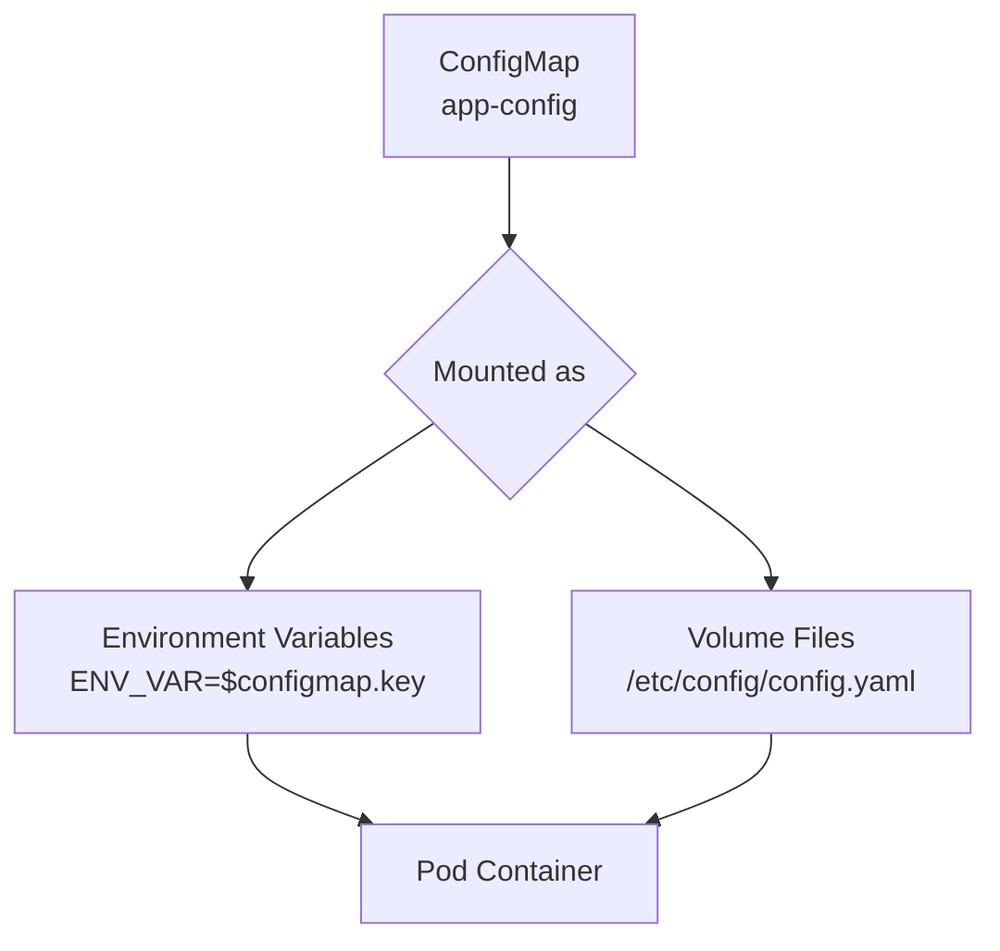

# Managing ConfigMaps

ConfigMaps are Kubernetes' way of storing non-sensitive configuration data. Instead of hardcoding configuration inside your container image, you store it in a ConfigMap and mount it into your pods as either environment variables or files. This means you can change configuration without rebuilding the image.

In this guide, we will learn how to create, read, update, and delete ConfigMaps using the Python client, and how to use them in deployment workflows.

---

## ConfigMap vs Secret — When to Use Which

| Data Type | Use ConfigMap | Use Secret |
| :--- | :--- | :--- |
| Application settings | ✅ `LOG_LEVEL=INFO` | |
| Feature flags | ✅ `FEATURE_X_ENABLED=true` | |
| Database connection strings | | ✅ Contains password |
| API keys and tokens | | ✅ Sensitive |
| Config file content (nginx.conf) | ✅ Not sensitive | |
| TLS certificates | | ✅ Sensitive |
| Cluster URLs | ✅ Not sensitive | |

---

## How ConfigMaps Are Mounted in Pods



ConfigMaps can contain both key-value pairs (for environment variables) and entire file contents (for config files).

---

## Creating a ConfigMap

```python
from kubernetes import client, config
from kubernetes.client.rest import ApiException

def create_configmap(namespace, name, data):
    """
    data: dict of key-value pairs to store in the ConfigMap
    """
    config.load_kube_config()
    v1 = client.CoreV1Api()
    
    configmap = client.V1ConfigMap(
        metadata=client.V1ObjectMeta(
            name=name,
            namespace=namespace,
            labels={"managed-by": "python-sdk"}
        ),
        data=data  # All values must be strings
    )
    
    try:
        result = v1.create_namespaced_config_map(namespace=namespace, body=configmap)
        print(f"ConfigMap '{name}' created in namespace '{namespace}'.")
        print(f"  Keys: {list(result.data.keys())}")
        return result
    except ApiException as e:
        if e.status == 409:
            print(f"ConfigMap '{name}' already exists. Use update instead.")
        else:
            print(f"Error: {e.status} — {e.reason}")
        return None

# Create an app configuration ConfigMap
create_configmap(
    namespace="production",
    name="app-config",
    data={
        "LOG_LEVEL":          "INFO",
        "MAX_CONNECTIONS":    "100",
        "CACHE_TTL_SECONDS":  "300",
        "FEATURE_NEW_UI":     "true",
        "nginx.conf": """
server {
    listen 80;
    server_name localhost;
    location / {
        proxy_pass http://backend:8080;
    }
}
"""
    }
)
```

### Expected Output
```text
ConfigMap 'app-config' created in namespace 'production'.
  Keys: ['LOG_LEVEL', 'MAX_CONNECTIONS', 'CACHE_TTL_SECONDS', 'FEATURE_NEW_UI', 'nginx.conf']
```

---

## Reading a ConfigMap

```python
from kubernetes import client, config
from kubernetes.client.rest import ApiException

def read_configmap(namespace, name):
    config.load_kube_config()
    v1 = client.CoreV1Api()
    
    try:
        cm = v1.read_namespaced_config_map(name=name, namespace=namespace)
        
        print(f"ConfigMap '{name}' in namespace '{namespace}':")
        print(f"  Labels:  {cm.metadata.labels}")
        print(f"  Created: {cm.metadata.creation_timestamp}")
        print(f"\n  Data:")
        
        for key, value in (cm.data or {}).items():
            # Truncate long values (like file contents) for display
            display_val = value.strip().replace('\n', '\\n')
            if len(display_val) > 60:
                display_val = display_val[:57] + "..."
            print(f"    {key}: {display_val}")
        
        return cm.data
    
    except ApiException as e:
        if e.status == 404:
            print(f"ConfigMap '{name}' not found in '{namespace}'.")
        else:
            print(f"Error: {e.status} — {e.reason}")
        return None

read_configmap("production", "app-config")
```

### Expected Output
```text
ConfigMap 'app-config' in namespace 'production':
  Labels:  {'managed-by': 'python-sdk'}
  Created: 2026-06-25 04:00:00+00:00

  Data:
    LOG_LEVEL: INFO
    MAX_CONNECTIONS: 100
    CACHE_TTL_SECONDS: 300
    FEATURE_NEW_UI: true
    nginx.conf: \nserver {\n    listen 80;\n    server_name localhost;...
```

---

## Updating a ConfigMap

To update specific keys, use `patch_namespaced_config_map`. This merges your changes with the existing data — keys not mentioned are left untouched.

```python
from kubernetes import client, config
from kubernetes.client.rest import ApiException

def update_configmap(namespace, name, updated_data):
    config.load_kube_config()
    v1 = client.CoreV1Api()
    
    try:
        # Patch merges the new data with existing keys
        patch_body = client.V1ConfigMap(data=updated_data)
        
        result = v1.patch_namespaced_config_map(
            name=name,
            namespace=namespace,
            body=patch_body
        )
        
        print(f"ConfigMap '{name}' updated.")
        print(f"  Updated keys: {list(updated_data.keys())}")
        print(f"  All keys now: {list(result.data.keys())}")
        return result
    
    except ApiException as e:
        if e.status == 404:
            print(f"ConfigMap '{name}' not found.")
        else:
            print(f"Error: {e.status} — {e.reason}")
        return None

# Update feature flag without touching other keys
update_configmap(
    namespace="production",
    name="app-config",
    updated_data={
        "FEATURE_NEW_UI": "false",
        "LOG_LEVEL":      "DEBUG"
    }
)
```

### Expected Output
```text
ConfigMap 'app-config' updated.
  Updated keys: ['FEATURE_NEW_UI', 'LOG_LEVEL']
  All keys now: ['LOG_LEVEL', 'MAX_CONNECTIONS', 'CACHE_TTL_SECONDS', 'FEATURE_NEW_UI', 'nginx.conf']
```

---

## Real-World Script: List All ConfigMaps Across a Namespace

Useful for auditing — shows all ConfigMaps and their key counts.

```python
from kubernetes import client, config
from kubernetes.client.rest import ApiException

def audit_configmaps(namespace="default"):
    config.load_kube_config()
    v1 = client.CoreV1Api()
    
    try:
        cms = v1.list_namespaced_config_map(namespace=namespace)
        
        # Filter out system ConfigMaps (kube-* prefix)
        app_cms = [cm for cm in cms.items if not cm.metadata.name.startswith("kube")]
        
        print(f"ConfigMaps in '{namespace}' (app-level): {len(app_cms)}\n")
        for cm in app_cms:
            keys = list((cm.data or {}).keys())
            age  = cm.metadata.creation_timestamp.strftime('%Y-%m-%d') if cm.metadata.creation_timestamp else "unknown"
            print(f"  {cm.metadata.name:<30} Keys: {len(keys):<5} Created: {age}")
            if keys:
                print(f"    Keys: {', '.join(keys)}")
    
    except ApiException as e:
        print(f"Error: {e.status} — {e.reason}")

audit_configmaps("production")
```

### Expected Output
```text
ConfigMaps in 'production' (app-level): 2

  app-config                     Keys: 5     Created: 2026-06-25
    Keys: LOG_LEVEL, MAX_CONNECTIONS, CACHE_TTL_SECONDS, FEATURE_NEW_UI, nginx.conf
  redis-config                   Keys: 2     Created: 2026-06-24
    Keys: REDIS_MAX_MEMORY, REDIS_POLICY
```

---

## Common Mistakes

### 1. Storing Sensitive Data in ConfigMaps
ConfigMaps are stored in `etcd` unencrypted and are visible to anyone with read access to the namespace. Never store passwords, tokens, or private keys in a ConfigMap — use a Secret instead.

### 2. Expecting ConfigMap Changes to Auto-Update Running Pods
If you update a ConfigMap that is mounted as environment variables, running pods do NOT see the change automatically — they only pick it up after a restart. If the ConfigMap is mounted as a volume file, pods eventually see the updated file (Kubernetes sync period is ~60 seconds).

### 3. Using Non-String Values in ConfigMap Data
ConfigMap `data` values must be strings. Trying to store an integer (`MAX_CONNECTIONS: 100`) as a Python int will fail. Always convert values to strings before building the `data` dict.

### 4. Deleting a ConfigMap That Pods Depend On
If you delete a ConfigMap that is mounted into running pods, those pods continue to work (they already have the data in memory or on their volume). But if a pod restarts, it cannot start because the ConfigMap reference no longer exists. Always verify what depends on a ConfigMap before deleting it.

---

## Summary

* ConfigMaps store non-sensitive configuration data as key-value pairs or file contents.
* Use `create_namespaced_config_map(namespace, body)` to create a ConfigMap.
* Use `patch_namespaced_config_map(name, namespace, body)` to update specific keys without overwriting others.
* Use `read_namespaced_config_map(name, namespace)` to fetch a ConfigMap and read its data.
* All values in `data` must be strings — convert integers, booleans, and other types before storing.
* ConfigMap changes to environment variables only take effect after a pod restart.
* ConfigMap changes mounted as volume files eventually propagate to running pods (within ~60 seconds).
* Never store sensitive data in ConfigMaps — use Kubernetes Secrets instead.
* Audit ConfigMaps regularly to find stale configurations that are no longer referenced.
* Deleting a ConfigMap that pods depend on will break those pods on next restart.
