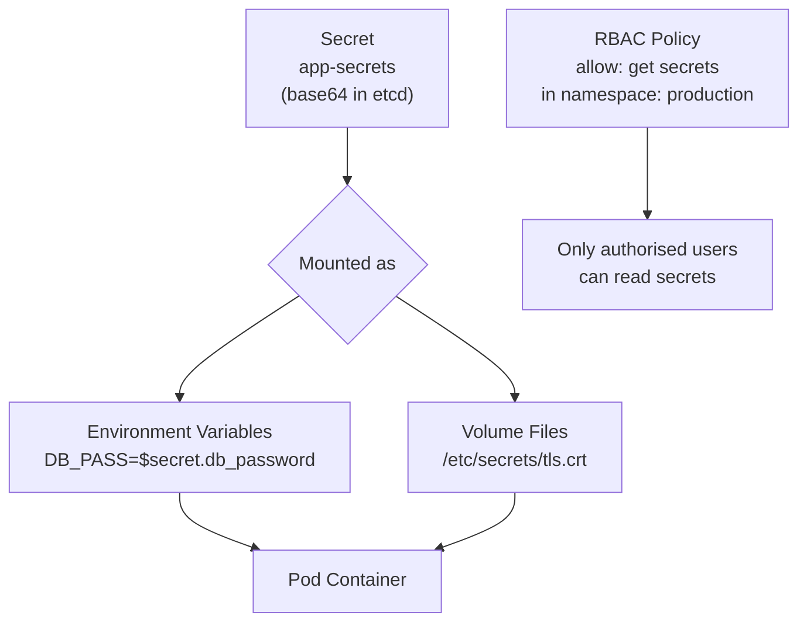

# Managing Secrets

Kubernetes Secrets store sensitive data — passwords, API tokens, TLS certificates, SSH keys. They work similarly to ConfigMaps but with an important distinction: Secret values are base64-encoded, and clusters can be configured with encryption at rest, RBAC access controls, and audit logging specifically for Secret reads.

In this guide, we will learn how to create, read, update, and safely handle Kubernetes Secrets using the Python client — without leaking sensitive data in logs or output.

---

## Secret Types

Kubernetes has several built-in Secret types, each for a specific purpose:

| Secret Type | `type` Field Value | Used For |
| :--- | :--- | :--- |
| **Generic** | `Opaque` | Arbitrary key-value data (API keys, passwords) |
| **Docker Registry** | `kubernetes.io/dockerconfigjson` | Pulling images from private registries |
| **TLS** | `kubernetes.io/tls` | Storing TLS certificates and private keys |
| **Service Account** | `kubernetes.io/service-account-token` | Pod-to-API authentication (managed by Kubernetes) |
| **Basic Auth** | `kubernetes.io/basic-auth` | Username + password for basic authentication |

---

## How Secrets Are Stored and Accessed



---

## Creating a Generic (Opaque) Secret

Secret values must be base64-encoded when stored. The Python client handles encoding automatically when you pass a `string_data` dict — but when you use the `data` field you must encode manually.

```python
import base64
from kubernetes import client, config
from kubernetes.client.rest import ApiException

def create_secret(namespace, name, secret_dict):
    """
    secret_dict: plain text key-value pairs — the client will encode them.
    We use string_data so the client handles base64 encoding.
    """
    config.load_kube_config()
    v1 = client.CoreV1Api()
    
    secret = client.V1Secret(
        metadata=client.V1ObjectMeta(
            name=name,
            namespace=namespace,
            labels={"managed-by": "python-sdk"}
        ),
        type="Opaque",
        string_data=secret_dict  # Plain text — client base64-encodes automatically
    )
    
    try:
        result = v1.create_namespaced_secret(namespace=namespace, body=secret)
        print(f"Secret '{name}' created in namespace '{namespace}'.")
        print(f"  Keys: {list(result.data.keys())}")
        print("  Values: [REDACTED — never log secret values]")
        return result
    except ApiException as e:
        if e.status == 409:
            print(f"Secret '{name}' already exists. Use update instead.")
        else:
            print(f"Error: {e.status} — {e.reason}")
        return None

create_secret(
    namespace="production",
    name="app-secrets",
    secret_dict={
        "DATABASE_PASSWORD": "super-secret-db-password",
        "API_KEY":           "sk-prod-abc123def456",
        "JWT_SECRET":        "very-long-jwt-signing-secret"
    }
)
```

### Expected Output
```text
Secret 'app-secrets' created in namespace 'production'.
  Keys: ['DATABASE_PASSWORD', 'API_KEY', 'JWT_SECRET']
  Values: [REDACTED — never log secret values]
```

---

## Reading a Secret

When you read a Secret, values come back as base64-encoded bytes. You must decode them to get the original plain text.

```python
import base64
from kubernetes import client, config
from kubernetes.client.rest import ApiException

def read_secret_keys(namespace, name):
    """
    Read and list the keys in a Secret.
    Values are shown only as '[REDACTED]' — never print actual values.
    """
    config.load_kube_config()
    v1 = client.CoreV1Api()
    
    try:
        secret = v1.read_namespaced_secret(name=name, namespace=namespace)
        
        print(f"Secret '{name}' in namespace '{namespace}':")
        print(f"  Type:    {secret.type}")
        print(f"  Created: {secret.metadata.creation_timestamp}")
        print(f"  Keys:    {list((secret.data or {}).keys())}")
        
        # Never print actual values in a script — only return them to callers
        # that explicitly need them
        return secret.data
    
    except ApiException as e:
        if e.status == 404:
            print(f"Secret '{name}' not found in '{namespace}'.")
        elif e.status == 403:
            print(f"Access denied — check your RBAC permissions for Secrets.")
        else:
            print(f"Error: {e.status} — {e.reason}")
        return None

def get_secret_value(namespace, name, key):
    """
    Return the decoded value of one specific key from a Secret.
    Only call this when you actually need to use the value.
    """
    config.load_kube_config()
    v1 = client.CoreV1Api()
    
    try:
        secret = v1.read_namespaced_secret(name=name, namespace=namespace)
        raw = (secret.data or {}).get(key)
        
        if raw is None:
            print(f"Key '{key}' not found in secret '{name}'.")
            return None
        
        # base64 decode to get the original string
        return base64.b64decode(raw).decode('utf-8')
    
    except ApiException as e:
        print(f"Error reading secret: {e.status} — {e.reason}")
        return None

# List keys safely
read_secret_keys("production", "app-secrets")

# Get a value when you actually need it (pass to a client, not to print)
db_password = get_secret_value("production", "app-secrets", "DATABASE_PASSWORD")
# Use db_password — do NOT print it
```

### Expected Output
```text
Secret 'app-secrets' in namespace 'production':
  Type:    Opaque
  Created: 2026-06-25 04:00:00+00:00
  Keys:    ['DATABASE_PASSWORD', 'API_KEY', 'JWT_SECRET']
```

---

## Real-World Script: Rotate a Secret Value

When an API key or password changes, you need to update the Secret and then trigger a pod restart so pods pick up the new value.

```python
import base64
from kubernetes import client, config
from kubernetes.client.rest import ApiException

def rotate_secret_key(namespace, secret_name, key, new_value, deployment_to_restart=None):
    config.load_kube_config()
    v1       = client.CoreV1Api()
    apps_v1  = client.AppsV1Api()
    
    try:
        # Patch only the specific key in the secret
        # The data field requires base64-encoded values
        encoded_value = base64.b64encode(new_value.encode('utf-8')).decode('utf-8')
        
        patch_body = client.V1Secret(
            data={key: encoded_value}
        )
        
        v1.patch_namespaced_secret(
            name=secret_name,
            namespace=namespace,
            body=patch_body
        )
        
        print(f"Secret '{secret_name}' key '{key}' rotated successfully.")
        
        # Trigger a rolling restart of the deployment to pick up the new value
        if deployment_to_restart:
            import datetime
            restart_annotation = {
                "spec": {
                    "template": {
                        "metadata": {
                            "annotations": {
                                "kubectl.kubernetes.io/restartedAt":
                                    datetime.datetime.utcnow().isoformat() + "Z"
                            }
                        }
                    }
                }
            }
            apps_v1.patch_namespaced_deployment(
                name=deployment_to_restart,
                namespace=namespace,
                body=restart_annotation
            )
            print(f"Deployment '{deployment_to_restart}' rolling restart triggered.")
    
    except ApiException as e:
        print(f"Error: {e.status} — {e.reason}")

rotate_secret_key(
    namespace="production",
    secret_name="app-secrets",
    key="API_KEY",
    new_value="sk-prod-new-key-xyz789",
    deployment_to_restart="api-service"
)
```

### Expected Output
```text
Secret 'app-secrets' key 'API_KEY' rotated successfully.
Deployment 'api-service' rolling restart triggered.
```

---

## Common Mistakes

### 1. Printing or Logging Secret Values
The most dangerous mistake. Once a secret value appears in logs, it can end up in log aggregation systems, CI build outputs, Slack notifications, or error tracking tools. Never print a decoded secret value. If you must debug, log only the key name, not the value.

### 2. Using `data` Instead of `string_data` Without Encoding
The `data` field in a Secret requires base64-encoded bytes. If you pass plain text to `data`, the API will accept it but decode to garbage. Use `string_data` when creating Secrets from Python — the client handles encoding.

### 3. Reading a Secret to Pass It as an Environment Variable in Code
If your Python script reads a Secret to pass it to a subprocess or another system, you are creating an additional attack surface. Instead, mount the Secret directly into the pod that needs it and let Kubernetes inject it as an environment variable.

### 4. Giving Scripts Read-All-Secrets RBAC Permission
Granting `get, list` on all Secrets in a namespace means any script (or compromised script) can read every secret. Always use fine-grained RBAC — grant access only to the specific Secret names a script needs.

---

## Summary

* Kubernetes Secrets store sensitive data; values are base64-encoded in etcd.
* Use `string_data` (plain text) when creating Secrets from Python — the client encodes automatically.
* Use `data` (base64-encoded) when reading Secrets — always decode with `base64.b64decode(value)`.
* Never print, log, or display decoded secret values in scripts or CI output.
* `read_namespaced_secret` returns the full Secret object including encoded data.
* Patch a specific key with `patch_namespaced_secret` using the `data` field with a base64-encoded value.
* After rotating a Secret, trigger a rolling restart on dependent Deployments using a pod annotation patch.
* Use fine-grained RBAC to limit which secrets a ServiceAccount or user can access.
* `403 Forbidden` on a Secret read means missing RBAC permissions — this is a security feature, not a bug.
* Mount Secrets as volumes or environment variables into pods instead of reading them in code when possible.
