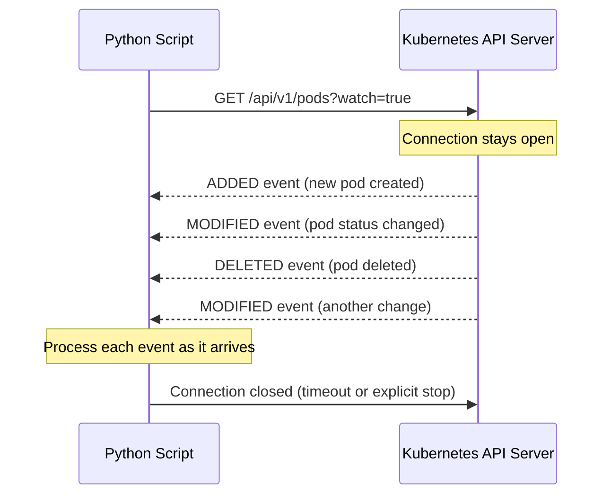

# Watching Resources

Polling is simple — you ask for state every N seconds and act on what you find. But watching is more powerful — you subscribe to changes and get notified the instant something happens. The Kubernetes Python client has a `Watch` API that lets you stream resource events in real time, which is the foundation of automation tools, custom controllers, and monitoring scripts.

In this guide, we will learn how to watch Kubernetes resources for changes and build event-driven automation.

---

## Polling vs Watching — The Core Difference

| Approach | How it works | Latency | CPU Usage | Use When |
| :--- | :--- | :--- | :--- | :--- |
| **Polling** | Call API every N seconds | Up to N seconds | Constant | Simple scripts, small clusters |
| **Watching** | Long-lived connection, server pushes events | Near-zero | Very low (idle) | Real-time automation, controllers |

Watching is more efficient because the Kubernetes API server only sends data when something actually changes. Your script sits idle with an open connection until an event arrives.

---

## How Watch Works



Each event you receive has a `type` (`ADDED`, `MODIFIED`, or `DELETED`) and an `object` (the full resource object at that point in time).

---

## Watching Pods in a Namespace

```python
from kubernetes import client, config, watch
from kubernetes.client.rest import ApiException
from datetime import datetime

def watch_pods(namespace="default", timeout=60):
    config.load_kube_config()
    v1 = client.CoreV1Api()
    w  = watch.Watch()
    
    print(f"Watching pods in namespace '{namespace}' for {timeout}s...")
    print(f"{'TIME':<10} {'EVENT':<10} {'POD NAME':<50} {'PHASE'}")
    print("-" * 90)
    
    try:
        for event in w.stream(
            v1.list_namespaced_pod,
            namespace=namespace,
            timeout_seconds=timeout
        ):
            event_type = event['type']           # ADDED, MODIFIED, DELETED
            pod        = event['object']         # V1Pod object
            pod_name   = pod.metadata.name
            phase      = pod.status.phase or "Pending"
            timestamp  = datetime.now().strftime("%H:%M:%S")
            
            print(f"{timestamp:<10} {event_type:<10} {pod_name:<50} {phase}")
            
            # Example: auto-respond to failed pods
            if event_type == "MODIFIED" and phase == "Failed":
                print(f"  *** ALERT: Pod '{pod_name}' entered Failed state! ***")
    
    except ApiException as e:
        print(f"Watch error: {e.status} — {e.reason}")
    except KeyboardInterrupt:
        print("\nWatch stopped by user.")
    finally:
        w.stop()
        print("Watch stream closed.")

watch_pods(namespace="production", timeout=120)
```

### Expected Output
```text
Watching pods in namespace 'production' for 120s...
TIME       EVENT      POD NAME                                           PHASE
------------------------------------------------------------------------------------------
10:05:03   ADDED      api-service-5d9f8c-xk2q7                         Pending
10:05:04   MODIFIED   api-service-5d9f8c-xk2q7                         Pending
10:05:07   MODIFIED   api-service-5d9f8c-xk2q7                         Running
10:05:45   ADDED      api-service-7a1b2c-mn3p1                         Pending
10:05:46   MODIFIED   api-service-7a1b2c-mn3p1                         Running
10:06:01   MODIFIED   api-service-5d9f8c-xk2q7                         Succeeded
10:06:01   DELETED    api-service-5d9f8c-xk2q7                         Succeeded
Watch stream closed.
```

---

## Watching Deployments for Changes

Watch deployments to detect rollout completion or unexpected scaling events.

```python
from kubernetes import client, config, watch
from kubernetes.client.rest import ApiException

def watch_deployments(namespace="default", timeout=300):
    config.load_kube_config()
    apps_v1 = client.AppsV1Api()
    w = watch.Watch()
    
    print(f"Watching deployments in '{namespace}'...")
    
    try:
        for event in w.stream(
            apps_v1.list_namespaced_deployment,
            namespace=namespace,
            timeout_seconds=timeout
        ):
            event_type = event['type']
            dep        = event['object']
            name       = dep.metadata.name
            desired    = dep.spec.replicas or 0
            ready      = dep.status.ready_replicas or 0
            updated    = dep.status.updated_replicas or 0
            
            status_str = f"ready={ready}/{desired}, updated={updated}"
            print(f"[{event_type}] {name}: {status_str}")
            
            # Detect when a rollout completes
            if event_type == "MODIFIED" and ready == desired and updated == desired:
                print(f"  Deployment '{name}' rollout complete — all {desired} replicas ready.")
    
    except ApiException as e:
        print(f"Error: {e.status} — {e.reason}")
    except KeyboardInterrupt:
        print("Watch stopped.")
    finally:
        w.stop()

watch_deployments("production", timeout=300)
```

### Expected Output
```text
Watching deployments in 'production'...
[MODIFIED] api-service: ready=2/3, updated=1
[MODIFIED] api-service: ready=2/3, updated=2
[MODIFIED] api-service: ready=3/3, updated=3
  Deployment 'api-service' rollout complete — all 3 replicas ready.
```

---

## Real-World Script: Alert on CrashLooping Pods

This script watches all pods cluster-wide and prints an alert the moment any pod enters a CrashLoopBackOff state — useful as a monitoring agent.

```python
from kubernetes import client, config, watch
from kubernetes.client.rest import ApiException
from datetime import datetime

def crash_alert_watcher():
    config.load_kube_config()
    v1 = client.CoreV1Api()
    w  = watch.Watch()
    
    print("CrashLoop Alert Watcher — monitoring all namespaces (Ctrl+C to stop)...")
    
    try:
        for event in w.stream(v1.list_pod_for_all_namespaces, timeout_seconds=0):
            # timeout_seconds=0 means watch forever
            if event['type'] != 'MODIFIED':
                continue
            
            pod = event['object']
            ns  = pod.metadata.namespace
            name = pod.metadata.name
            
            for cs in (pod.status.container_statuses or []):
                if cs.state.waiting and cs.state.waiting.reason == "CrashLoopBackOff":
                    ts = datetime.now().strftime('%H:%M:%S')
                    print(
                        f"[{ts}] CRASH ALERT: [{ns}] {name} / {cs.name} "
                        f"— {cs.restart_count} restarts"
                    )
    
    except KeyboardInterrupt:
        print("\nAlert watcher stopped.")
    except ApiException as e:
        print(f"API error: {e.status} — {e.reason}")
    finally:
        w.stop()

crash_alert_watcher()
```

### Expected Output
```text
CrashLoop Alert Watcher — monitoring all namespaces (Ctrl+C to stop)...
[10:08:33] CRASH ALERT: [production] crash-prone-worker-7f2a1b-xk / worker — 8 restarts
[10:09:47] CRASH ALERT: [production] crash-prone-worker-7f2a1b-xk / worker — 9 restarts
```

---

## Common Mistakes

### 1. Using `timeout_seconds=0` Without Error Handling
`timeout_seconds=0` means the watch runs forever. If the API server restarts or the connection drops, the `w.stream()` generator will raise an exception. Always wrap the watch in a try/except and restart the watch loop when errors occur.

### 2. Missing the `BOOKMARK` Event Type
The Kubernetes API also sends `BOOKMARK` events periodically. These are not resource changes — they are checkpoints that include the latest `resourceVersion`. If your code does `if event_type in ("ADDED", "MODIFIED", "DELETED"):`, it will simply skip bookmarks. But if you try to process them as resource objects, you will get attribute errors.

### 3. Starting a Watch Without a `resourceVersion`
When you start a watch without specifying a `resourceVersion`, you get a snapshot of all current resources followed by future changes. This is correct for most use cases. But if you restart a watch after a gap and want to replay missed events, you need to pass the last `resourceVersion` you processed.

### 4. Running Multiple Infinite Watches in the Main Thread
`w.stream()` blocks the current thread. If you want to watch multiple resource types simultaneously (pods AND deployments), run each watch in a separate thread or use async programming patterns.

---

## Summary

* The `watch.Watch()` class from the Kubernetes client enables event-driven resource monitoring.
* `w.stream(api_method, namespace, timeout_seconds)` streams events as they occur.
* Each event is a dict with `type` (`ADDED`, `MODIFIED`, `DELETED`, `BOOKMARK`) and `object` (the resource).
* `timeout_seconds=0` creates an infinite watch — always wrap in try/except for connection errors.
* Use watches instead of polling for low-latency event detection (pod failures, deployment rollouts).
* Call `w.stop()` in a `finally` block to cleanly close the watch connection.
* To watch multiple resource types, run each watch in a separate thread.
* `MODIFIED` events are the most frequent — they fire whenever any field on the resource changes.
* `ADDED` fires when a new resource is created; `DELETED` fires when it is removed.
* The `crash_alert_watcher` pattern is the foundation of custom monitoring agents and controllers.
