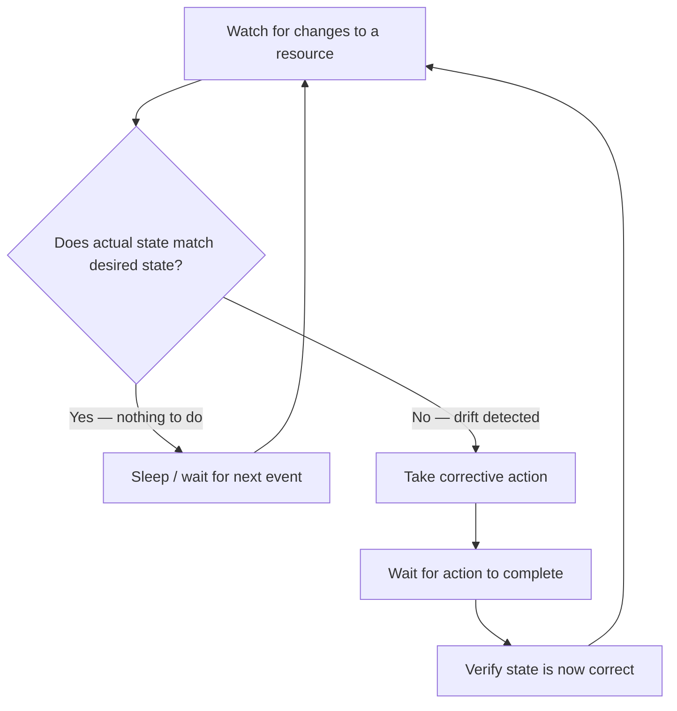

# Custom Controllers

A Kubernetes controller is a loop that watches resources and takes action to make the actual cluster state match the desired state. The built-in Kubernetes controllers (Deployment controller, ReplicaSet controller) use this exact pattern. You can write your own controllers in Python to automate anything that does not have a built-in Kubernetes solution.

In this guide, we will learn what a controller is, how to structure one in Python, and build a working example controller.

---

## The Reconcile Loop — Core Concept

Every Kubernetes controller follows the same core pattern, called the **reconcile loop**:



This is called **level-triggered** logic: it does not matter how many events fire — the controller always checks the current actual state and makes it match the desired state.

---

## What Makes a Controller Different From a Script

| Regular Script | Controller |
| :--- | :--- |
| Runs once and exits | Runs continuously |
| Reacts to triggers (cron, manual) | Reacts to Kubernetes events in real time |
| No retries on error | Retries with backoff on error |
| State managed externally | State managed by Kubernetes resources |

---

## Building a Simple Controller: Label Enforcer

This example controller watches Deployments in a namespace. If it finds a Deployment missing a required label (`team: unset`), it automatically adds the label. This is a real-world pattern for enforcing labelling policies across teams.

```python
from kubernetes import client, config, watch
from kubernetes.client.rest import ApiException
import time

REQUIRED_LABEL = "team"
DEFAULT_VALUE  = "unset"

def enforce_labels(namespace="default"):
    config.load_kube_config()
    apps_v1 = client.AppsV1Api()
    w = watch.Watch()
    
    print(f"Label Enforcer Controller starting...")
    print(f"Watching deployments in '{namespace}'.")
    print(f"Ensuring all deployments have label '{REQUIRED_LABEL}'.\n")
    
    while True:  # Restart watch on errors
        try:
            for event in w.stream(
                apps_v1.list_namespaced_deployment,
                namespace=namespace,
                timeout_seconds=60
            ):
                event_type = event['type']
                dep = event['object']
                name = dep.metadata.name
                labels = dep.metadata.labels or {}
                
                if event_type not in ('ADDED', 'MODIFIED'):
                    continue
                
                # Check if the required label is present
                if REQUIRED_LABEL not in labels:
                    print(f"[{event_type}] '{name}' missing label '{REQUIRED_LABEL}'. Applying fix...")
                    
                    # Patch: add the missing label
                    patch = {
                        "metadata": {
                            "labels": {REQUIRED_LABEL: DEFAULT_VALUE}
                        }
                    }
                    
                    try:
                        apps_v1.patch_namespaced_deployment(
                            name=name,
                            namespace=namespace,
                            body=patch
                        )
                        print(f"  Fixed: '{name}' now has label '{REQUIRED_LABEL}={DEFAULT_VALUE}'")
                    except ApiException as patch_err:
                        print(f"  Failed to patch '{name}': {patch_err.status}")
                else:
                    team_val = labels.get(REQUIRED_LABEL)
                    print(f"[{event_type}] '{name}' — label OK ({REQUIRED_LABEL}={team_val})")
        
        except ApiException as e:
            print(f"Watch error ({e.status}). Restarting in 5 seconds...")
            time.sleep(5)
        except KeyboardInterrupt:
            print("\nController stopped.")
            w.stop()
            break

enforce_labels(namespace="staging")
```

### Expected Output
```text
Label Enforcer Controller starting...
Watching deployments in 'staging'.
Ensuring all deployments have label 'team'.

[ADDED] 'web-app' — label OK (team=backend)
[ADDED] 'worker-service' missing label 'team'. Applying fix...
  Fixed: 'worker-service' now has label 'team=unset'
[MODIFIED] 'worker-service' — label OK (team=unset)
```

---

## Adding Exponential Backoff to the Reconcile Loop

A controller that crashes immediately on every API error will spam the API server and your logs. Add exponential backoff to retry gracefully.

```python
from kubernetes import client, config, watch
from kubernetes.client.rest import ApiException
import time
import math

def reconcile_with_backoff(namespace, reconcile_fn, max_retries=5):
    config.load_kube_config()
    w = watch.Watch()
    
    retries = 0
    
    while True:
        try:
            print(f"Controller starting (attempt {retries + 1})...")
            reconcile_fn(w, namespace)
            retries = 0  # Reset on success
        
        except ApiException as e:
            retries += 1
            
            if retries > max_retries:
                print(f"Max retries ({max_retries}) exceeded. Controller shutting down.")
                break
            
            # Exponential backoff: 1s, 2s, 4s, 8s, 16s
            wait = min(2 ** (retries - 1), 60)
            print(f"Error {e.status}. Retry {retries}/{max_retries} in {wait}s...")
            time.sleep(wait)
        
        except KeyboardInterrupt:
            print("Controller stopped by user.")
            w.stop()
            break
```

---

## Real-World Use Cases for Custom Controllers

| Use Case | What it watches | What action it takes |
| :--- | :--- | :--- |
| Label enforcer | Deployments | Add missing required labels |
| Resource quota enforcer | Pods | Delete pods over resource limits |
| Image tag enforcer | Deployments | Alert or reject `latest` tagged deployments |
| Auto-scaler | Custom metrics ConfigMap | Scale deployments based on external signal |
| Namespace cleaner | Namespaces | Delete old namespaces with no recent activity |

---

## Common Mistakes

### 1. Not Handling the Watch Restart
Watch connections timeout periodically (Kubernetes sends a `410 Gone` response). If you do not restart the watch loop on `ApiException`, your controller silently stops working. Always wrap the watch in a while loop.

### 2. Patching on Every MODIFIED Event
A `MODIFIED` event fires even when your controller makes the patch (because the patch triggers a change). If your condition check is not correct, you can create an infinite loop where the controller patches, gets a MODIFIED event, patches again, and so on. Always check if the desired state is already satisfied before patching.

### 3. Running Too Many Goroutines Without a Worker Queue
In Go-based controllers, work queues prevent concurrent reconcile calls for the same resource. In Python, if you process events too fast and make multiple patches to the same Deployment in parallel (via threads), you can create race conditions. Keep the reconcile loop single-threaded for simple controllers.

### 4. Not Setting Owner References on Created Resources
If your controller creates resources (e.g., creates a ConfigMap for each Deployment), those resources will outlive the Deployment if you do not set owner references. Set `metadata.owner_references` on created resources so Kubernetes garbage-collects them automatically.

---

## Summary

* A Kubernetes controller watches resources in a loop and reconciles actual state to desired state.
* The reconcile pattern: watch → compare → act → verify → repeat.
* Use `w.stream()` with a while loop to restart the watch on errors.
* Always check if the desired state is already satisfied before making API changes.
* Add exponential backoff to the restart loop to avoid hammering the API server on repeated errors.
* `ADDED` events fire for existing resources when the watch starts (current state snapshot).
* `MODIFIED` events fire on every change, including ones your controller makes — avoid infinite loops.
* Simple Python controllers work well for small-scale automation; for production operators, consider Kopf (a Python operator framework).
* Set owner references on resources your controller creates to enable automatic garbage collection.
* Test your controller logic against a local cluster (Minikube, kind) before deploying to production.
