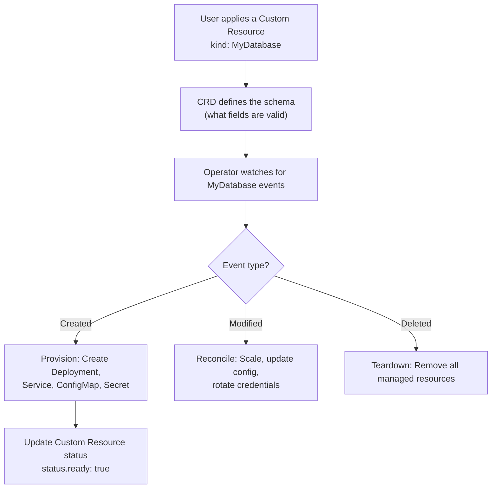

# Kubernetes Operator Basics

Operators are the next step up from custom controllers. An Operator extends Kubernetes with custom resource types and the logic to manage them. Instead of just watching built-in resources like Pods and Deployments, an Operator defines its own resource (called a Custom Resource Definition, or CRD) and manages the full lifecycle of a complex application using that resource.

Think of it this way: Kubernetes knows how to manage a Pod. An Operator teaches Kubernetes how to manage something much more complex — like a PostgreSQL cluster, a Kafka broker, or your own microservice platform.

In this guide, we will understand what Operators are, how they work, and build a basic Operator using the **Kopf** framework — the most approachable Python Operator framework.

---

## Operators vs Controllers — The Difference

| Concept | Custom Controller | Operator |
| :--- | :--- | :--- |
| Watches | Built-in resources (Pods, Deployments) | Custom resources (your own types) |
| Defines new API | No | Yes (via CRD) |
| Complexity | Simple to moderate | Moderate to complex |
| Tool | Raw Kubernetes Python client | Kopf, Metacontroller, or raw client |
| Example | Label enforcer, auto-scaler | PostgreSQL Operator, Redis Operator |

---

## The Operator Pattern



---

## Installing Kopf

Kopf (Kubernetes Operator Pythonic Framework) handles the event loop, retries, and error handling so you can focus on your business logic.

```bash
pip install kopf kubernetes
```

---

## Step 1: Define a Custom Resource Definition (CRD)

Before the Operator can watch your custom resource, you must register the CRD with Kubernetes. Apply this YAML to your cluster once:

```yaml
# myapp-crd.yaml
apiVersion: apiextensions.k8s.io/v1
kind: CustomResourceDefinition
metadata:
  name: myapps.example.com
spec:
  group: example.com
  versions:
    - name: v1
      served: true
      storage: true
      schema:
        openAPIV3Schema:
          type: object
          properties:
            spec:
              type: object
              properties:
                replicas:
                  type: integer
                  minimum: 1
                image:
                  type: string
                port:
                  type: integer
  scope: Namespaced
  names:
    plural:   myapps
    singular: myapp
    kind:     MyApp
```

Apply it with:
```bash
kubectl apply -f myapp-crd.yaml
```

---

## Step 2: Write the Operator With Kopf

```python
import kopf
import kubernetes
from kubernetes import client

# --- Operator Handlers ---

@kopf.on.create('example.com', 'v1', 'myapps')
def on_myapp_create(spec, name, namespace, logger, **kwargs):
    """
    Called when a MyApp custom resource is created.
    We provision a Deployment and Service to back it.
    """
    replicas = spec.get('replicas', 1)
    image    = spec.get('image', 'nginx:alpine')
    port     = spec.get('port', 80)
    
    logger.info(f"Creating MyApp '{name}' in '{namespace}' — {replicas} replica(s) of {image}")
    
    kubernetes.config.load_kube_config()
    apps_v1 = client.AppsV1Api()
    core_v1 = client.CoreV1Api()
    
    # Create the Deployment
    deployment = client.V1Deployment(
        metadata=client.V1ObjectMeta(
            name=name,
            namespace=namespace,
            labels={"app": name, "managed-by": "myapp-operator"}
        ),
        spec=client.V1DeploymentSpec(
            replicas=replicas,
            selector=client.V1LabelSelector(match_labels={"app": name}),
            template=client.V1PodTemplateSpec(
                metadata=client.V1ObjectMeta(labels={"app": name}),
                spec=client.V1PodSpec(
                    containers=[
                        client.V1Container(
                            name=name,
                            image=image,
                            ports=[client.V1ContainerPort(container_port=port)]
                        )
                    ]
                )
            )
        )
    )
    
    apps_v1.create_namespaced_deployment(namespace=namespace, body=deployment)
    logger.info(f"Deployment '{name}' created.")
    
    # Create the Service
    service = client.V1Service(
        metadata=client.V1ObjectMeta(name=name, namespace=namespace),
        spec=client.V1ServiceSpec(
            selector={"app": name},
            ports=[client.V1ServicePort(port=80, target_port=port)]
        )
    )
    core_v1.create_namespaced_service(namespace=namespace, body=service)
    logger.info(f"Service '{name}' created.")
    
    # Return status fields — Kopf stores these in the resource's .status
    return {"ready": True, "replicas": replicas, "image": image}


@kopf.on.update('example.com', 'v1', 'myapps')
def on_myapp_update(spec, name, namespace, logger, **kwargs):
    """
    Called when a MyApp resource is updated.
    We reconcile the Deployment to match the new spec.
    """
    new_replicas = spec.get('replicas', 1)
    new_image    = spec.get('image', 'nginx:alpine')
    
    logger.info(f"Updating MyApp '{name}' — replicas={new_replicas}, image={new_image}")
    
    kubernetes.config.load_kube_config()
    apps_v1 = client.AppsV1Api()
    
    patch = {
        "spec": {
            "replicas": new_replicas,
            "template": {
                "spec": {
                    "containers": [{"name": name, "image": new_image}]
                }
            }
        }
    }
    apps_v1.patch_namespaced_deployment(name=name, namespace=namespace, body=patch)
    logger.info(f"Deployment '{name}' updated.")
    
    return {"replicas": new_replicas, "image": new_image}


@kopf.on.delete('example.com', 'v1', 'myapps')
def on_myapp_delete(name, namespace, logger, **kwargs):
    """
    Called when a MyApp resource is deleted.
    We clean up the Deployment and Service.
    """
    logger.info(f"Deleting resources for MyApp '{name}' in '{namespace}'...")
    
    kubernetes.config.load_kube_config()
    apps_v1 = client.AppsV1Api()
    core_v1 = client.CoreV1Api()
    
    try:
        apps_v1.delete_namespaced_deployment(name=name, namespace=namespace)
        logger.info(f"Deployment '{name}' deleted.")
    except client.exceptions.ApiException as e:
        if e.status != 404:
            raise
    
    try:
        core_v1.delete_namespaced_service(name=name, namespace=namespace)
        logger.info(f"Service '{name}' deleted.")
    except client.exceptions.ApiException as e:
        if e.status != 404:
            raise
```

### Expected Output (when running `kopf run operator.py`)
```text
[2026-06-25 04:10:00] INFO  Operator started, now watching myapps.example.com/v1
[2026-06-25 04:10:12] INFO  Creating MyApp 'my-web' in 'default' — 3 replica(s) of nginx:alpine
[2026-06-25 04:10:12] INFO  Deployment 'my-web' created.
[2026-06-25 04:10:12] INFO  Service 'my-web' created.
[2026-06-25 04:11:00] INFO  Updating MyApp 'my-web' — replicas=5, image=nginx:alpine
[2026-06-25 04:11:00] INFO  Deployment 'my-web' updated.
```

---

## Step 3: Create a MyApp Resource

Once the Operator is running, users create MyApp resources like this:

```yaml
# my-web-app.yaml
apiVersion: example.com/v1
kind: MyApp
metadata:
  name: my-web
  namespace: default
spec:
  replicas: 3
  image: nginx:alpine
  port: 80
```

```bash
kubectl apply -f my-web-app.yaml
# The Operator immediately creates the Deployment and Service
```

---

## Common Mistakes

### 1. Not Applying the CRD Before Running the Operator
If you start your Operator before applying the CRD, Kopf will fail with `404 Not Found` when trying to register the watch. Always apply the CRD first.

### 2. Forgetting to Handle Deletion Correctly
When a custom resource is deleted, Kopf calls your `@kopf.on.delete` handler. If you do not clean up the resources your Operator created (Deployments, Services, etc.), they become orphans. Always clean up in the delete handler.

### 3. Raising Exceptions in Handlers Without Kopf Catching Them
Kopf retries handler calls on exceptions with exponential backoff. If your create handler fails halfway (Deployment created, Service fails), it will retry the entire handler. Make your handlers idempotent — they should be safe to run multiple times.

### 4. Running the Operator Without Proper RBAC
The Operator needs RBAC permissions to create, update, and delete Deployments, Services, and your custom resources. Without the right ClusterRole and ClusterRoleBinding, every API call in your handlers will fail with `403 Forbidden`.

---

## Summary

* Operators extend Kubernetes with custom resource types (defined by CRDs) and the logic to manage them.
* Kopf (`pip install kopf`) is the most approachable Python framework for writing Operators.
* Use `@kopf.on.create`, `@kopf.on.update`, and `@kopf.on.delete` decorators to handle resource lifecycle events.
* Apply the CRD to the cluster before starting the Operator.
* Always clean up all managed resources in the delete handler.
* Make handlers idempotent — they may be retried on failure.
* Return a dict from handlers to store status information in the custom resource's `.status` field.
* The Operator needs a ClusterRole with permissions to manage all resources it creates.
* Users interact with your Operator by creating, updating, and deleting custom resource manifests.
* Operators are the right tool when you need to manage complex, stateful applications on Kubernetes.
