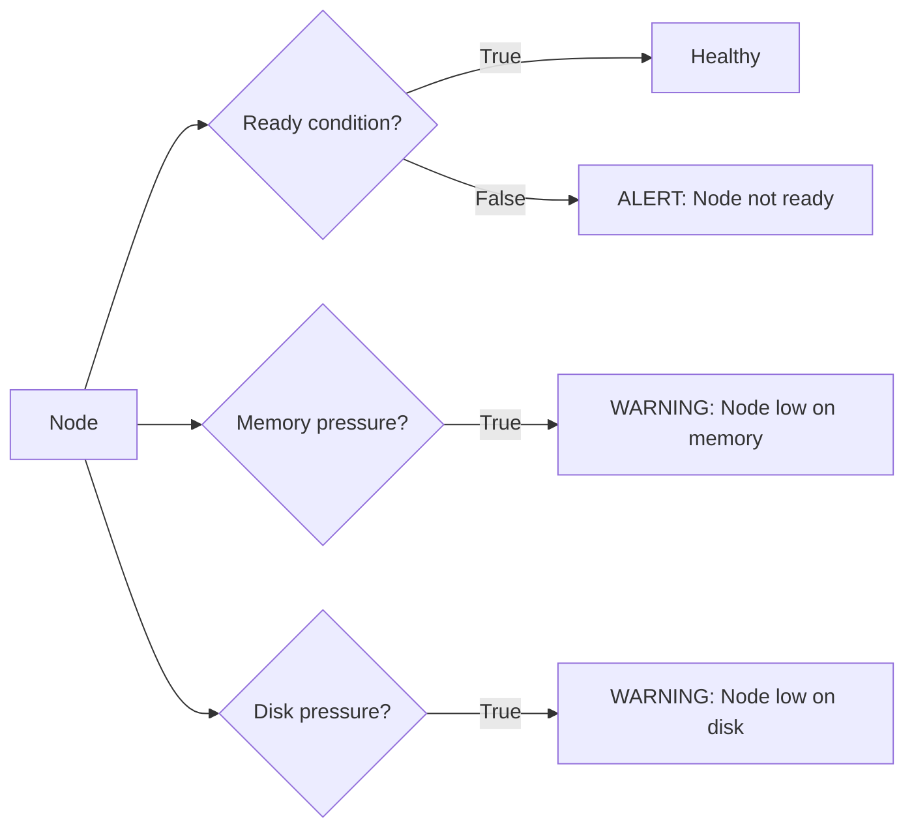

# Health Checking Clusters

Knowing your cluster is healthy is not optional — it is one of the most important parts of running production Kubernetes. Nodes can run out of memory, disks can fill up, pods can crash in loops, and your cluster can silently degrade while your users notice before you do. Automated health checks built in Python give you proactive visibility before things break.

In this guide, we will build a complete cluster health check script that covers nodes, pods, deployments, and persistent storage.

---

## What Makes a Cluster Unhealthy?

A cluster can look fine on the surface but have problems underneath. Here are the most important things to check:

| Area | What to Check | Signal of a Problem |
| :--- | :--- | :--- |
| **Nodes** | Ready condition | `Ready=False` or `Unknown` |
| **Node Resources** | Memory and disk pressure | `MemoryPressure=True`, `DiskPressure=True` |
| **Pods** | Phase and container status | `Failed`, `CrashLoopBackOff`, `OOMKilled` |
| **Deployments** | Desired vs ready replicas | `ready_replicas < replicas` |
| **PersistentVolumes** | Binding status | `status.phase != Bound` |
| **Services** | Endpoint presence | Services with 0 backing endpoints |

---

## Node Health Check



---

## Checking Node Health

```python
from kubernetes import client, config
from kubernetes.client.rest import ApiException

def check_node_health():
    config.load_kube_config()
    v1 = client.CoreV1Api()
    
    issues = []
    
    try:
        nodes = v1.list_node()
        print(f"Nodes: {len(nodes.items)} total\n")
        
        for node in nodes.items:
            name = node.metadata.name
            conditions = {c.type: c.status for c in node.status.conditions}
            
            ready   = conditions.get("Ready", "Unknown")
            mem_p   = conditions.get("MemoryPressure", "Unknown")
            disk_p  = conditions.get("DiskPressure", "Unknown")
            pid_p   = conditions.get("PIDPressure", "Unknown")
            
            status_icon = "✓" if ready == "True" else "✗"
            print(f"  {status_icon} {name}")
            print(f"    Ready:          {ready}")
            print(f"    MemoryPressure: {mem_p}")
            print(f"    DiskPressure:   {disk_p}")
            print(f"    PIDPressure:    {pid_p}")
            
            if ready != "True":
                issues.append(f"Node '{name}' is NOT Ready (status: {ready})")
            if mem_p == "True":
                issues.append(f"Node '{name}' has MemoryPressure")
            if disk_p == "True":
                issues.append(f"Node '{name}' has DiskPressure")
        
        return issues
    
    except ApiException as e:
        print(f"Error checking nodes: {e.status} — {e.reason}")
        return [f"Cannot reach API server: {e.status}"]

node_issues = check_node_health()
```

### Expected Output
```text
Nodes: 3 total

  ✓ node-worker-01
    Ready:          True
    MemoryPressure: False
    DiskPressure:   False
    PIDPressure:    False
  ✓ node-worker-02
    Ready:          True
    MemoryPressure: False
    DiskPressure:   False
    PIDPressure:    False
  ✗ node-worker-03
    Ready:          False
    MemoryPressure: True
    DiskPressure:   False
    PIDPressure:    False
```

---

## Checking Deployment Health

```python
from kubernetes import client, config
from kubernetes.client.rest import ApiException

def check_deployment_health(namespace="default"):
    config.load_kube_config()
    apps_v1 = client.AppsV1Api()
    
    issues = []
    
    try:
        deployments = apps_v1.list_namespaced_deployment(namespace=namespace)
        print(f"Deployments in '{namespace}': {len(deployments.items)} total\n")
        
        for dep in deployments.items:
            name      = dep.metadata.name
            desired   = dep.spec.replicas or 0
            ready     = dep.status.ready_replicas or 0
            available = dep.status.available_replicas or 0
            updated   = dep.status.updated_replicas or 0
            
            is_healthy = (ready == desired and available == desired)
            icon = "✓" if is_healthy else "✗"
            
            print(f"  {icon} {name}")
            print(f"    Desired: {desired}  Ready: {ready}  Available: {available}  Updated: {updated}")
            
            if not is_healthy:
                issues.append(
                    f"Deployment '{name}' degraded: {ready}/{desired} ready, "
                    f"{available}/{desired} available"
                )
        
        return issues
    
    except ApiException as e:
        print(f"Error: {e.status} — {e.reason}")
        return []

dep_issues = check_deployment_health("production")
```

### Expected Output
```text
Deployments in 'production': 3 total

  ✓ redis-cache
    Desired: 1  Ready: 1  Available: 1  Updated: 1
  ✓ api-service
    Desired: 3  Ready: 3  Available: 3  Updated: 3
  ✗ worker-service
    Desired: 5  Ready: 2  Available: 2  Updated: 5
```

---

## Real-World Script: Full Cluster Health Report

This script runs all health checks and prints a consolidated report — perfect for running on a schedule or as part of a CI/CD gate.

```python
from kubernetes import client, config
from kubernetes.client.rest import ApiException

def full_health_report(namespaces=None):
    config.load_kube_config()
    v1      = client.CoreV1Api()
    apps_v1 = client.AppsV1Api()
    
    all_issues = []
    
    # --- 1. Node Health ---
    print("=" * 60)
    print("NODE HEALTH")
    print("=" * 60)
    try:
        nodes = v1.list_node()
        for node in nodes.items:
            name = node.metadata.name
            conditions = {c.type: c.status for c in node.status.conditions}
            ready = conditions.get("Ready", "Unknown")
            
            if ready != "True":
                msg = f"Node '{name}' not ready"
                print(f"  ✗ {msg}")
                all_issues.append(msg)
            else:
                print(f"  ✓ {name} — Ready")
    except ApiException as e:
        all_issues.append(f"Cannot list nodes: {e.status}")
    
    # --- 2. CrashLooping Pods ---
    print("\n" + "=" * 60)
    print("CRASHLOOPING PODS (all namespaces)")
    print("=" * 60)
    try:
        all_pods = v1.list_pod_for_all_namespaces()
        crash_found = False
        
        for pod in all_pods.items:
            for cs in (pod.status.container_statuses or []):
                if cs.state.waiting and cs.state.waiting.reason == "CrashLoopBackOff":
                    crash_found = True
                    msg = (f"[{pod.metadata.namespace}] {pod.metadata.name}/{cs.name} "
                           f"— {cs.restart_count} restarts")
                    print(f"  ✗ {msg}")
                    all_issues.append(msg)
        
        if not crash_found:
            print("  ✓ No CrashLooping pods found")
    except ApiException as e:
        all_issues.append(f"Cannot list pods: {e.status}")
    
    # --- 3. Degraded Deployments ---
    target_namespaces = namespaces or ["default", "production", "staging"]
    
    print("\n" + "=" * 60)
    print(f"DEGRADED DEPLOYMENTS ({', '.join(target_namespaces)})")
    print("=" * 60)
    for ns in target_namespaces:
        try:
            deps = apps_v1.list_namespaced_deployment(namespace=ns)
            for dep in deps.items:
                desired = dep.spec.replicas or 0
                ready   = dep.status.ready_replicas or 0
                
                if ready < desired:
                    msg = f"[{ns}] {dep.metadata.name}: {ready}/{desired} ready"
                    print(f"  ✗ {msg}")
                    all_issues.append(msg)
                else:
                    print(f"  ✓ [{ns}] {dep.metadata.name}: {ready}/{desired}")
        except ApiException as e:
            if e.status != 404:
                all_issues.append(f"Cannot list deployments in {ns}: {e.status}")
    
    # --- Final Summary ---
    print("\n" + "=" * 60)
    print("HEALTH SUMMARY")
    print("=" * 60)
    if all_issues:
        print(f"  UNHEALTHY — {len(all_issues)} issue(s) found:\n")
        for i, issue in enumerate(all_issues, 1):
            print(f"  {i}. {issue}")
        return False
    else:
        print("  HEALTHY — No issues found across all checks.")
        return True

is_healthy = full_health_report(namespaces=["default", "production"])
```

### Expected Output
```text
============================================================
NODE HEALTH
============================================================
  ✓ node-worker-01 — Ready
  ✓ node-worker-02 — Ready
  ✗ Node 'node-worker-03' not ready

============================================================
CRASHLOOPING PODS (all namespaces)
============================================================
  ✗ [production] crash-prone-worker-7f2a1b-xk/worker — 12 restarts

============================================================
DEGRADED DEPLOYMENTS (default, production)
============================================================
  ✓ [default] redis-cache: 1/1
  ✓ [production] api-service: 3/3
  ✗ [production] worker-service: 2/5 ready

============================================================
HEALTH SUMMARY
============================================================
  UNHEALTHY — 3 issue(s) found:

  1. Node 'node-worker-03' not ready
  2. [production] crash-prone-worker-7f2a1b-xk/worker — 12 restarts
  3. [production] worker-service: 2/5 ready
```

---

## Common Mistakes

### 1. Only Checking Pod Phase, Not Container Statuses
A pod can be in `Running` phase but have a container inside that is in `CrashLoopBackOff`. The pod phase only reflects the pod-level state, not individual container states. Always check `container_statuses[].state.waiting.reason` for crash loops.

### 2. Only Checking One Namespace
Issues in `kube-system` (like CoreDNS crashing) will break cluster-wide DNS even if your application namespace looks healthy. Health checks should include `kube-system` at minimum.

### 3. Assuming `ready_replicas == None` Means Zero
The Kubernetes API returns `None` for these fields (not `0`) when no pods are ready yet. Always use `(dep.status.ready_replicas or 0)` to safely convert `None` to `0`.

### 4. Not Exiting With a Non-Zero Code on Failure
If your health check script is used as a CI/CD gate, it must exit with `sys.exit(1)` when issues are found. A script that prints errors but exits with code `0` will never block a bad deployment.

---

## Summary

* Check node `Ready` condition and pressure conditions (`MemoryPressure`, `DiskPressure`) for node health.
* Check pod container statuses for `CrashLoopBackOff`, `OOMKilled`, and `Failed` phase.
* Check `deployment.status.ready_replicas == deployment.spec.replicas` for deployment health.
* Always use `(field or 0)` when reading replica count fields — they return `None`, not `0`, when pods are absent.
* Consolidate all checks into one report function that returns a boolean for use in CI/CD pipelines.
* Exit with `sys.exit(1)` when issues are found so CI jobs fail and stop bad deployments.
* Include `kube-system` in your namespace checks — system pod failures affect the entire cluster.
* Schedule the health check script to run every few minutes for continuous monitoring.
* Log issue details (namespace, pod name, container name, restart count) not just "unhealthy" — details matter when you are debugging at 2am.
* Combine the health report with alerting (send results to Slack, PagerDuty, or a webhook) for proactive notification.
