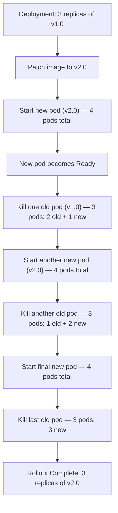

# Automating Rollouts

A rollout is how Kubernetes updates a running Deployment to a new version. Without automation, someone has to manually run `kubectl set image`, watch the pods, and decide whether to roll back if something goes wrong. With Python, you can build a complete deployment pipeline: update the image, monitor the rollout progress, run post-deploy smoke tests, and automatically roll back if anything fails.

In this guide, we will learn how to trigger rollouts, monitor their progress, and build a safe automated rollout with automatic rollback.

---

## How Rolling Updates Work

Kubernetes uses a rolling update strategy by default. It replaces old pods with new ones gradually, ensuring a minimum number of pods are always available during the transition.



The old pods are only removed after the new pods pass their readiness probes — so traffic is never dropped during the update.

---

## Triggering a New Rollout (Image Update)

The most common rollout trigger: update the container image to a new version.

```python
from kubernetes import client, config
from kubernetes.client.rest import ApiException

def update_deployment_image(namespace, deployment_name, container_name, new_image):
    config.load_kube_config()
    apps_v1 = client.AppsV1Api()
    
    try:
        # Read current deployment first
        dep = apps_v1.read_namespaced_deployment(
            name=deployment_name,
            namespace=namespace
        )
        
        # Find current image
        containers = dep.spec.template.spec.containers
        current_image = next(
            (c.image for c in containers if c.name == container_name),
            None
        )
        
        if current_image == new_image:
            print(f"Deployment '{deployment_name}' already running image '{new_image}'. No rollout needed.")
            return False
        
        print(f"Updating '{deployment_name}' in '{namespace}':")
        print(f"  Old image: {current_image}")
        print(f"  New image: {new_image}")
        
        # Patch only the container's image
        patch = {
            "spec": {
                "template": {
                    "spec": {
                        "containers": [
                            {"name": container_name, "image": new_image}
                        ]
                    }
                }
            }
        }
        
        apps_v1.patch_namespaced_deployment(
            name=deployment_name,
            namespace=namespace,
            body=patch
        )
        
        print("Rollout triggered.")
        return True
    
    except ApiException as e:
        print(f"Error: {e.status} — {e.reason}")
        return False

update_deployment_image(
    namespace="production",
    deployment_name="api-service",
    container_name="api-service",
    new_image="my-registry/api-service:3.3.0"
)
```

### Expected Output
```text
Updating 'api-service' in 'production':
  Old image: my-registry/api-service:3.2.1
  New image: my-registry/api-service:3.3.0
Rollout triggered.
```

---

## Monitoring Rollout Progress

After triggering a rollout, watch the Deployment status until it completes or times out.

```python
from kubernetes import client, config
from kubernetes.client.rest import ApiException
import time

def wait_for_rollout(namespace, deployment_name, timeout=300):
    config.load_kube_config()
    apps_v1 = client.AppsV1Api()
    
    print(f"Monitoring rollout of '{deployment_name}' (timeout: {timeout}s)...")
    deadline = time.time() + timeout
    
    while time.time() < deadline:
        try:
            dep = apps_v1.read_namespaced_deployment(
                name=deployment_name,
                namespace=namespace
            )
            status  = dep.status
            desired = dep.spec.replicas or 0
            
            updated     = status.updated_replicas or 0
            ready       = status.ready_replicas or 0
            available   = status.available_replicas or 0
            unavailable = status.unavailable_replicas or 0
            
            print(
                f"  desired={desired}  updated={updated}  "
                f"ready={ready}  available={available}  unavailable={unavailable}"
            )
            
            # Rollout is complete when all pods are updated, ready, and available
            if updated == desired and ready == desired and available == desired:
                elapsed = int(time.time() - (deadline - timeout))
                print(f"Rollout COMPLETE in ~{elapsed}s. All {desired} replicas running new version.")
                return True
        
        except ApiException as e:
            print(f"  API error: {e.status} — retrying...")
        
        time.sleep(5)
    
    print(f"Rollout TIMEOUT after {timeout}s. Deployment may still be progressing.")
    return False

wait_for_rollout("production", "api-service", timeout=300)
```

### Expected Output
```text
Monitoring rollout of 'api-service' (timeout: 300s)...
  desired=3  updated=1  ready=2  available=2  unavailable=1
  desired=3  updated=2  ready=2  available=2  unavailable=1
  desired=3  updated=3  ready=3  available=3  unavailable=0
Rollout COMPLETE in ~25s. All 3 replicas running new version.
```

---

## Triggering a Rollback

If something goes wrong, you can programmatically roll back to the previous revision.

```python
from kubernetes import client, config
from kubernetes.client.rest import ApiException
import datetime

def rollback_deployment(namespace, deployment_name):
    config.load_kube_config()
    apps_v1 = client.AppsV1Api()
    
    print(f"Rolling back '{deployment_name}' in '{namespace}'...")
    
    try:
        # Kubernetes rollback is triggered by patching the deployment with a
        # restart annotation. The actual rollback to previous ReplicaSet
        # is initiated via the rollout undo mechanism through annotations.
        # For a true undo (like kubectl rollout undo), use the raw API:
        
        api_client = client.ApiClient()
        
        # Use the apps/v1 API endpoint directly to trigger rollout undo
        # via a strategic merge patch that clears the pod-template hash
        # The cleanest Python approach: set the deprecated rollback spec
        now_iso = datetime.datetime.utcnow().isoformat() + "Z"
        
        patch = {
            "spec": {
                "template": {
                    "metadata": {
                        "annotations": {
                            "kubectl.kubernetes.io/restartedAt": now_iso
                        }
                    }
                }
            }
        }
        
        # Note: True kubectl rollout undo uses the extensions/v1beta1 rollback API
        # which is deprecated. For Python, the recommended approach is:
        # 1. Store the previous image tag yourself
        # 2. Patch back to it explicitly
        
        # Here we show the restart approach (re-pulls and restarts current pods):
        apps_v1.patch_namespaced_deployment(
            name=deployment_name,
            namespace=namespace,
            body=patch
        )
        
        print(f"Rollback/restart of '{deployment_name}' triggered.")
        print("Note: For true image rollback, store previous image tags and patch back explicitly.")
        return True
    
    except ApiException as e:
        print(f"Rollback failed: {e.status} — {e.reason}")
        return False

rollback_deployment("production", "api-service")
```

---

## Real-World Script: Full Safe Rollout With Auto-Rollback

This is the complete pipeline: update → watch → smoke test → roll back if anything fails.

```python
from kubernetes import client, config
from kubernetes.client.rest import ApiException
import time
import subprocess

def safe_rollout(namespace, deployment_name, container_name, new_image,
                 smoke_test_cmd=None, rollout_timeout=300):
    """
    Update image, wait for rollout, run smoke test.
    If smoke test fails, restore the previous image.
    """
    config.load_kube_config()
    apps_v1 = client.AppsV1Api()
    
    # Step 1: Remember current image for rollback
    dep = apps_v1.read_namespaced_deployment(name=deployment_name, namespace=namespace)
    containers = dep.spec.template.spec.containers
    previous_image = next(
        (c.image for c in containers if c.name == container_name), None
    )
    print(f"Previous image: {previous_image}")
    
    # Step 2: Update image
    print(f"Deploying new image: {new_image}")
    apps_v1.patch_namespaced_deployment(
        name=deployment_name,
        namespace=namespace,
        body={"spec": {"template": {"spec": {"containers": [
            {"name": container_name, "image": new_image}
        ]}}}}
    )
    
    # Step 3: Wait for rollout
    print("Waiting for rollout to complete...")
    deadline = time.time() + rollout_timeout
    rollout_ok = False
    
    while time.time() < deadline:
        dep = apps_v1.read_namespaced_deployment(name=deployment_name, namespace=namespace)
        s = dep.status
        desired = dep.spec.replicas or 0
        ready   = s.ready_replicas or 0
        updated = s.updated_replicas or 0
        
        if updated == desired and ready == desired:
            rollout_ok = True
            print(f"Rollout complete. {desired}/{desired} pods ready.")
            break
        
        print(f"  updated={updated}/{desired}  ready={ready}/{desired}")
        time.sleep(5)
    
    if not rollout_ok:
        print("Rollout timed out. Rolling back to previous image...")
        apps_v1.patch_namespaced_deployment(
            name=deployment_name, namespace=namespace,
            body={"spec": {"template": {"spec": {"containers": [
                {"name": container_name, "image": previous_image}
            ]}}}}
        )
        return False
    
    # Step 4: Smoke test
    if smoke_test_cmd:
        print(f"Running smoke test: {' '.join(smoke_test_cmd)}")
        result = subprocess.run(smoke_test_cmd, capture_output=True, text=True)
        
        if result.returncode != 0:
            print(f"Smoke test FAILED. Output:\n{result.stdout}\n{result.stderr}")
            print("Rolling back to previous image...")
            apps_v1.patch_namespaced_deployment(
                name=deployment_name, namespace=namespace,
                body={"spec": {"template": {"spec": {"containers": [
                    {"name": container_name, "image": previous_image}
                ]}}}}
            )
            return False
        
        print("Smoke test PASSED.")
    
    print(f"Deployment of '{new_image}' to '{deployment_name}' SUCCEEDED.")
    return True

safe_rollout(
    namespace="production",
    deployment_name="api-service",
    container_name="api-service",
    new_image="my-registry/api-service:3.3.0",
    smoke_test_cmd=["curl", "-f", "http://api-service.production.svc/health"],
    rollout_timeout=300
)
```

### Expected Output
```text
Previous image: my-registry/api-service:3.2.1
Deploying new image: my-registry/api-service:3.3.0
Waiting for rollout to complete...
  updated=1/3  ready=2/3
  updated=2/3  ready=2/3
  updated=3/3  ready=3/3
Rollout complete. 3/3 pods ready.
Running smoke test: curl -f http://api-service.production.svc/health
Smoke test PASSED.
Deployment of 'my-registry/api-service:3.3.0' to 'api-service' SUCCEEDED.
```

---

## Common Mistakes

### 1. Not Storing the Previous Image Before Updating
If you update the image and the rollout fails, you need to know what image to roll back to. If you did not store it beforehand, you have to go digging through Kubernetes events or your registry to find it. Always read and store the current image before patching.

### 2. Checking Only `ready_replicas` for Rollout Completion
A rollout is only truly complete when `updated_replicas == desired` AND `ready_replicas == desired`. Checking only `ready_replicas` can give a false positive — the old pods might be ready while the new ones are still starting up.

### 3. Running Smoke Tests From Outside the Cluster
If your smoke test calls an internal ClusterIP service URL and the test runs from outside the cluster, it will fail with a connection error — not because the service is broken but because ClusterIP addresses are only reachable inside the cluster. Use `kubectl port-forward` or a NodePort for external smoke tests.

### 4. Not Handling Rollout Timeout as a Failure
A rollout that times out is not necessarily a failure (Kubernetes might still be pulling a large image), but your pipeline should treat it as one and roll back. A deployment stuck in progress for 5 minutes is already impacting users.

---

## Summary

* Trigger a rollout by patching the container image in the Deployment spec.
* Always read the current image before patching so you can restore it if the rollout fails.
* Monitor rollout progress by polling `updated_replicas`, `ready_replicas`, and `available_replicas`.
* A rollout is complete when `updated == desired AND ready == desired AND available == desired`.
* Implement smoke tests after a successful rollout to catch application-level errors the readiness probe missed.
* On smoke test failure, immediately patch back to the previous image to roll back.
* Set a rollout timeout and treat it as a failure — a stuck rollout impacts live users.
* Use `unavailable_replicas` to track how many pods are down during the transition.
* Store previous image tags in your pipeline state or source of truth so rollbacks are always possible.
* Combine rollout monitoring, smoke tests, and auto-rollback into a single pipeline function for reliable deployments.
