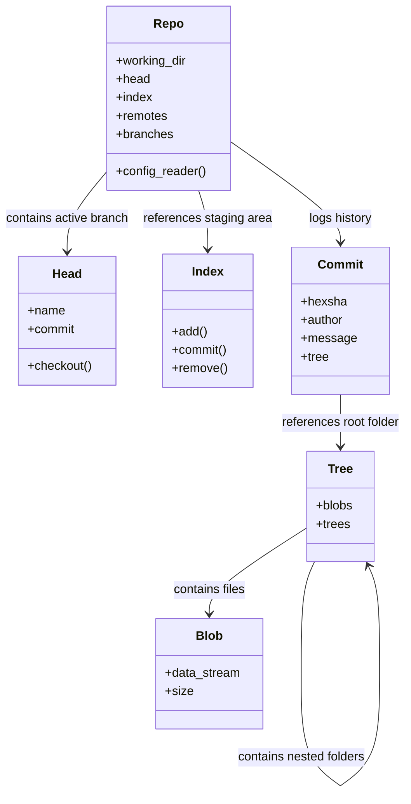

# GitPython Overview: Automating Version Control with Python

In a modern DevOps pipeline, automation is key. From building and testing to deploying and monitoring, automation reduces human error and accelerates release cycles. One area that frequently requires automation is version control. Whether you are building custom CI/CD pipelines, automating documentation updates, versioning infrastructure configurations, or performing code audits, interacting with Git programmatically is essential.

While you can write standard Python scripts that run raw Git CLI commands using the `subprocess` module, this approach is fragile. It requires parsing raw text output, dealing with platform-dependent command interpreters, and handling OS-specific errors. 

**GitPython** solves this by wrapping the Git command-line interface into a native, object-oriented Python API. In this guide, we will explore the fundamental concepts of GitPython, its architecture, installation, and basic operations.

---

## Why Automate Git?

Before diving into the code, let's look at real-world scenarios where programmatically interacting with Git is necessary:

1. **Automated Documentation Generation**: Extracting files, API specs, or markdown documents from repositories and automatically publishing them to websites or wikis.
2. **Configuration Management**: Automating changes to infrastructure-as-code files (YAML, JSON, TOML) in a git repository and committing them based on environment triggers.
3. **Release Tagging and Bumping**: Automatically calculating semantic versions (SemVer) based on commit messages, updating configuration files, tagging the release commit, and pushing it back to origin.
4. **Code Quality Audits**: Running automated analysis tools across repositories to extract git author statistics, trace the age of files, or search for hardcoded secrets in historical commits.
5. **CI/CD Orchestration**: Triggering remote test pipelines or staging deployments by programmatically creating branch variations.

---

## GitPython vs. Subprocess vs. Pygit2

When choosing how to interact with Git in Python, you have three main paths. Here is a comparison to help you understand the trade-offs:

| Feature / Criteria | Subprocess (CLI Wrapping) | GitPython | Pygit2 (libgit2 Bindings) |
| :--- | :--- | :--- | :--- |
| **API Style** | Raw Command Strings | Object-Oriented (Pythonic) | Object-Oriented (C-Bindings) |
| **Parsing Output** | Manual (Regex/String Splits) | Automatic (Objects/Attributes) | Automatic (Objects/Attributes) |
| **Performance** | Slow (Spawns shell processes) | Medium (Spawns git processes) | Extremely Fast (Native C execution) |
| **Dependencies** | Requires System Git CLI | Requires System Git CLI | Requires libgit2 C-library |
| **Ease of Use** | Low (Hard to scale safely) | High (Very intuitive) | Medium (Complex compilation/install) |
| **Platform Portability**| Low (Different shell syntax) | High (Cross-platform Python wrapper) | High (If binaries are pre-compiled) |

*Note: GitPython strikes the best balance of ease of use, rich feature set, and simplicity of installation, making it the go-to standard for most DevOps scripts.*

---

## GitPython Internal Architecture

GitPython maps Git concepts directly to Python objects. Understanding this object model is essential for navigating the API:



### The Key Objects

* **`Repo`**: The central entry point representing a Git repository (either a local directory or a bare repository).
* **`Commit`**: An immutable object representing a snapshot of the repository at a specific point in time, including author information, message, and parent commits.
* **`Tree`**: Represents a directory in Git. It can contain `Blob` objects (files) or other `Tree` objects (subdirectories).
* **`Blob`**: Represents a file stored in the Git repository. You can use it to read file contents directly from git history.
* **`Index`**: Represents the staging area (also known as the cache or index). It is used to prepare changes for the next commit.
* **`Remote`**: Represents a link to a remote repository hosted on GitHub, GitLab, or a custom Git server.

---

## Installation & Setup

To use GitPython, you must have Git installed on your local operating system. GitPython uses the command-line client to execute its commands.

### 1. Install Git
* **Windows**: Download and run the installer from the official [Git site](https://git-scm.com/).
* **Linux (Debian/Ubuntu)**: Run `sudo apt-get install git`.
* **macOS**: Install via Homebrew: `brew install git`.

### 2. Install the Python Package
Use pip to install `GitPython`:

```bash
pip install GitPython
```

### 3. Verification Script
Save and run this script to ensure your environment is configured correctly:

```python
import sys
import git

try:
    git_version = git.cmd.Git().version()
    print("✅ Git environment found successfully!")
    print(f"Git CLI version: {git_version}")
    print(f"GitPython package path: {git.__file__}")
except Exception as e:
    print(f"❌ Error configuring GitPython: {e}")
    sys.exit(1)
```

---

## Detailed Usage Guide

Now let's explore how to use the GitPython API to inspect local repositories, read commit histories, and execute native commands.

### 1. Initializing and Opening a Repository

To perform any action, you must first instantiate a `Repo` object. You can either open an existing directory or initialize a new one.

```python
import os
from git import Repo

# Define paths
repo_dir = os.path.join(os.getcwd(), "test_repo")
os.makedirs(repo_dir, exist_ok=True)

# Pattern 1: Initializing a new repository (equivalent to 'git init')
if not os.path.exists(os.path.join(repo_dir, ".git")):
    repo = Repo.init(repo_dir)
    print(f"Initialized a new repository at: {repo.working_dir}")
else:
    # Pattern 2: Opening an existing repository
    repo = Repo(repo_dir)
    print(f"Opened existing repository at: {repo.working_dir}")

# Check repository configuration values
is_bare = repo.bare # True if the repository has no working directory
active_branch_name = repo.active_branch.name

print(f"Is bare repository: {is_bare}")
print(f"Active Branch: {active_branch_name}")
```

### 2. Inspecting Repository Status

The `Repo` object provides helper methods to inspect the current state of files. We can check if there are modifications, untracked files, or staged updates.

```python
from git import Repo

def print_repo_status(repo_path):
    repo = Repo(repo_path)
    
    # is_dirty checks if there are uncommitted modifications in the working tree
    # index=True includes staged changes, working_tree=True includes unstaged files
    if repo.is_dirty(untracked_files=True):
        print("⚠️ Repository is dirty (has changes).")
        
        # 1. Untracked files (new files that git hasn't started tracking)
        untracked = repo.untracked_files
        if untracked:
            print("\nUntracked Files:")
            for file in untracked:
                print(f"  - {file}")
                
        # 2. Modified files (tracked files with local changes)
        # We find these by comparing the working directory diff with the head index
        diff_head = repo.index.diff(None)
        if diff_head:
            print("\nModified Files:")
            for diff in diff_head:
                print(f"  - {diff.a_path} (change type: {diff.change_type})")
    else:
        print("✅ Repository is clean. No local modifications.")

# Example usage:
# print_repo_status("./test_repo")
```

### 3. Programmatic Commit History Inspection

One of the most powerful features of GitPython is the ability to read the commit log as a list of Python objects. This allows you to inspect authors, times, hashes, and commit messages.

```python
from datetime import datetime
from git import Repo

def inspect_recent_commits(repo_path, count=5):
    repo = Repo(repo_path)
    
    # repo.iter_commits returns a generator yielding Commit objects in reverse chronological order
    # 'max_count' limits the number of commits returned
    print(f"--- Fetching the last {count} commits from branch '{repo.active_branch}' ---")
    
    for commit in repo.iter_commits(max_count=count):
        # Format variables from the commit object
        commit_hash = commit.hexsha
        short_hash = commit.hexsha[:8]
        author_name = commit.author.name
        author_email = commit.author.email
        
        # Convert timestamp to human-readable date
        commit_date = datetime.fromtimestamp(commit.committed_date)
        formatted_date = commit_date.strftime("%Y-%m-%d %H:%M:%S")
        
        message = commit.message.strip()
        
        print(f"\nCommit: {short_hash} [{commit_hash}]")
        print(f"Author: {author_name} <{author_email}>")
        print(f"Date:   {formatted_date}")
        print(f"Message: {message}")
        print("-" * 40)

# Example usage:
# inspect_recent_commits("./test_repo", count=3)
```

### 4. Running Raw Git Commands Directly

Sometimes you need to run a Git command that does not have a native Python class helper, or you simply prefer using the standard CLI syntax. 

GitPython provides a wrapper around the raw command-line utility via `repo.git`.

```python
from git import Repo

repo = Repo("./test_repo")

# The repo.git object maps attributes directly to Git CLI subcommands.
# For example, repo.git.status() runs 'git status'.
# You pass arguments as parameters: repo.git.log(n=5, oneline=True) runs 'git log -n 5 --oneline'

print("Running raw Git commands:")

# 1. Get CLI version
git_version = repo.git.version()
print(f"Version: {git_version}")

# 2. Run status with porcelain formatting
status_output = repo.git.status(porcelain=True)
print(f"Porcelain Status:\n{status_output}")

# 3. Running commands with lists of arguments
# This prevents shell injection vulnerabilities
log_output = repo.git.log("--oneline", "-n", "3")
print(f"Recent History Log:\n{log_output}")
```

---

## Advanced Architecture: Interacting with Tree and Blob Objects

To audit files in git history without checking them out to disk, you can traverse the `Tree` object of a specific commit.

```python
from git import Repo, Blob, Tree

repo = Repo("./test_repo")

# Get the Tree object representing the root folder of the latest commit
head_commit = repo.head.commit
root_tree = head_commit.tree

print(f"Auditing root directory structures at commit: {head_commit.hexsha[:8]}")

def traverse_git_tree(tree, depth=0):
    indent = "  " * depth
    
    # Iterate through direct children of the tree
    for item in tree:
        if isinstance(item, Blob):
            # It's a file
            print(f"{indent}📄 File: {item.path} (Size: {item.size} bytes)")
        elif isinstance(item, Tree):
            # It's a subdirectory, recurse into it
            print(f"{indent}📁 Directory: {item.name}/")
            traverse_git_tree(item, depth + 1)

traverse_git_tree(root_tree)
```

---

## Best Practices for DevOps Scripts

When writing automated scripts that run in headless environments (like Jenkins workers or Docker runners), observe the following rules:

1. **Catch Exceptions Safely**: GitPython raises specific exception classes like `InvalidGitRepositoryError` and `GitCommandError`. Always catch these to prevent your pipeline script from crashing ungracefully.
2. **Path Resolution**: Never hardcode relative directory paths. Always use Python's `os.path` or `pathlib` to resolve absolute paths relative to the executing script.
3. **Avoid Shell Interp**: When executing raw git commands using `repo.git`, pass arguments as positional arguments (e.g. `repo.git.checkout("branch_name")`) rather than building raw command strings. This protects against argument injection attacks.
4. **Clean up Resources**: If your script clones repositories or builds temporary directory copies, use Python's `shutil.rmtree()` within a `finally` block to ensure target directories are cleaned up upon completion.

---

## Summary

GitPython provides a complete object-oriented interface for automating version control. By mapping standard Git components directly to Python classes, it eliminates the complexity of shell command orchestration. In the next section, we will cover how to **clone remote repositories** programmatically.
