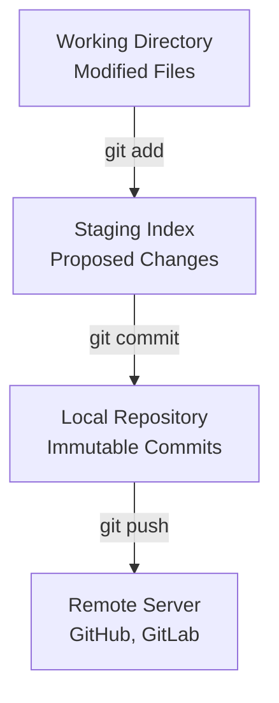

# Committing and Pushing Changes: Automating Repository Updates

A key task in DevOps automation is writing updates back to a Git repository. For example, a configuration management script might modify system configs, an automated build pipeline might bump a version number, or a backup tool might export database dumps. All of these require staging the updated files, committing them with audit trails, and pushing them to a remote server.

In this guide, we will cover how to manage the Git **Index** (staging area), write metadata-rich commits with custom author signatures, and securely push changes back to origin while verifying transfer success.

---

## The Commit Pipeline: Workspace to Remote

In Git, changes flow through three main stages before they reach your remote repository:



1. **Working Directory**: The actual files on disk that you are editing.
2. **Staging Index (Staging Area)**: A file that contains the list of changes proposed for the next snapshot.
3. **Local History**: Stored inside the `.git` directory, containing the chain of verified commits.
4. **Remote Repository**: The central server where team members sync their changes.

---

## 1. Staging Files in the Index

Before you can commit a file, it must be added to the Staging Index. In GitPython, this is managed via `repo.index`.

### Adding Specific Files
```python
from git import Repo

repo = Repo("./my-project")

# List of files you want to stage
files_to_stage = ["config/production.json", "version.txt"]

# Add files to the index (equivalent to 'git add file1 file2')
repo.index.add(files_to_stage)
print("Staged files in the index.")
```

### Staging All Changes (`git add .` and `git add -A`)
If your script creates many files dynamically and you want to stage everything:

```python
# Stage all changes, including untracked and modified files
# equivalent to 'git add -A'
repo.index.add("*")

# Alternatively, stage only modified/deleted tracked files (git add -u)
# repo.index.add(update=True)
```

### Removing Files from Staging
If your script mistakenly stages a file, you can reset it:

```python
# Unstage a file (equivalent to 'git reset HEAD file')
repo.index.reset(paths=["temp_debug.log"])
```

---

## 2. Committing Staged Changes

Once files are in the Index, you create a new commit. In automation, it is a best practice to set explicit author names and emails so team members can audit what was updated by a bot versus a human.

GitPython uses the **`Actor`** class to represent authors and committers.

```python
from git import Repo, Actor

repo = Repo("./my-project")

# 1. Define custom Actor details for the automation system
bot_author = Actor("DevOps Version Bot", "bot-service@company.com")
committer_signature = Actor("CI Pipeline Runner", "runner-04@company.com")

# 2. Compile a structured commit message (conforming to Conventional Commits)
commit_msg = (
    "chore(config): auto-bump application version\n\n"
    "This commit was automatically generated by the pipeline runner "
    "upon successful completion of the deployment suite."
)

# 3. Create the commit
# We pass the message, author, and committer
new_commit = repo.index.commit(
    message=commit_msg,
    author=bot_author,
    committer=committer_signature
)

print("✅ Commit created successfully!")
print(f"Commit Hash: {new_commit.hexsha}")
print(f"Author Signature: {new_commit.author.name} <{new_commit.author.email}>")
```

---

## 3. Pushing Changes and Verifying Success

Pushing changes over the network can fail due to authentication errors, server outages, or git branch conflicts (e.g. someone else pushed changes to the remote branch while your script was running).

When you call `origin.push()`, GitPython returns a list of **`PushInfo`** objects. You must inspect this list to verify if the transfer was successful.

```python
from git import Repo

repo = Repo("./my-project")

try:
    # 1. Fetch the remote reference
    origin = repo.remote(name="origin")
    
    # 2. Push the active branch to remote
    print(f"Pushing branch '{repo.active_branch.name}' to remote origin...")
    push_results = origin.push()
    
    # 3. Inspect the push results
    # Every remote branch reference updated gets a PushInfo object
    for info in push_results:
        # Check flags using bitwise operations
        if info.flags & info.ERROR:
            print(f"❌ Push failed for reference {info.local_ref}!")
            print(f"Reason/Summary: {info.summary}")
        else:
            print(f"🚀 Push succeeded!")
            print(f"Summary: {info.summary}")
            print(f"Local Ref: {info.local_ref} -> Remote Ref: {info.remote_ref_string}")
            
except Exception as e:
    print(f"❌ Network or connection error: {e}")
```

### Dealing with Force Pushing
In some specialized automation tasks (like resetting a release branch to match master, or updating a floating tag), you may need to force push changes. Pass the `force=True` argument:

> [!WARNING]
> Force pushing (`git push --force`) overrides remote history and can delete commits pushed by other users. Use this with extreme caution and only on dedicated, non-protected branches.

```python
# Force push the branch (equivalent to 'git push origin main --force')
# Only use this if you are absolutely sure no one else has pushed changes
# origin.push(force=True)
```

---

## Complete Real-World Scenario: Automated Configuration Backup

Here is a complete, production-ready script that backups configurations, commits changes, and pushes updates:

```python
import os
import json
from datetime import datetime
from git import Repo, Actor

def backup_config_to_git(repo_path, config_data, filename="system_config.json"):
    try:
        # 1. Ensure repository is open
        repo = Repo(repo_path)
        
        # 2. Write configuration to file
        file_path = os.path.join(repo_path, filename)
        with open(file_path, "w", encoding="utf-8") as f:
            json.dump(config_data, f, indent=4)
            
        print(f"Saved configuration updates to: {file_path}")
        
        # 3. Check if any modifications actually occurred
        # No need to commit if the config values didn't change
        if not repo.is_dirty(untracked_files=True):
            print("No configuration changes detected. Skipping commit.")
            return True
            
        # 4. Stage the file
        repo.index.add([file_path])
        
        # 5. Commit with timestamp metadata
        timestamp = datetime.now().strftime("%Y-%m-%d %H:%M:%S")
        commit_message = f"chore(backup): auto-backup configurations - {timestamp}"
        bot = Actor("Config Backup Daemon", "backup@company.com")
        
        commit = repo.index.commit(commit_message, author=bot, committer=bot)
        print(f"Committed backup snapshot: {commit.hexsha[:8]}")
        
        # 6. Push to remote origin
        origin = repo.remote(name="origin")
        push_info = origin.push()
        
        # 7. Validate push state
        for info in push_info:
            if info.flags & info.ERROR:
                print(f"❌ Failed to push backup: {info.summary}")
                return False
                
        print("✅ Backup successfully pushed to remote repository.")
        return True
        
    except Exception as e:
        print(f"❌ Backup pipeline failed: {e}")
        return False
```

---

## Summary

Automating staging, committing, and pushing forms the foundation of automated release tagging and GitOps workflows. By using explicit custom actors for commits and parsing `PushInfo` arrays, you can write self-auditing, robust repository writers. In the next section, we will learn how to **manage branches** programmatically.
