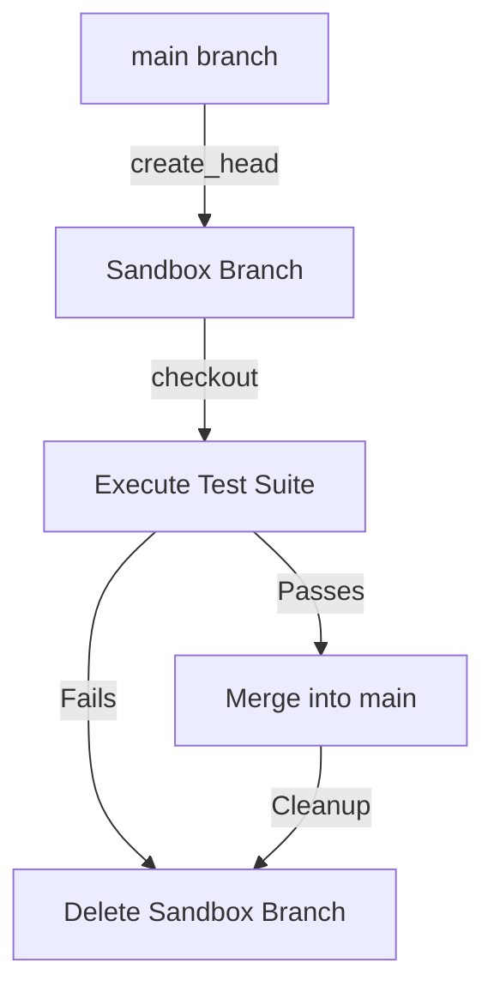

# Branch Management: Automating Feature and Release Streams

In Git, a branch is simply a lightweight, mutable pointer to a specific commit. Branches allow teams to isolate changes for new features, bug fixes, or release preparations. Programmatic branch management is key for building intelligent CI/CD orchestrators, sandbox test environments, or automated version release pipelines.

In this guide, we will explore how to query, create, checkout, merge, and clean up branches programmatically using GitPython, and how to handle merge conflicts safely inside your scripts.

---

## The Branch Lifecycle in Automation

When orchestrating a deployment pipeline, your script often manages a branch lifecycle:



---

## 1. Querying Local and Remote Branches

Before creating branches, you often need to check which references exist.

```python
from git import Repo

repo = Repo("./my-project")

# 1. Get the current active branch name
active_branch = repo.active_branch
print(f"Current active branch: {active_branch.name}")

# 2. List all local branches
print("\nLocal Branches:")
for branch in repo.branches:
    print(f" - {branch.name} (pointing to commit: {branch.commit.hexsha[:8]})")

# 3. List all remote-tracking references
print("\nRemote Tracking References:")
for ref in repo.references:
    # Filter to display remote refs (typically under origin/)
    if ref.name.startswith("origin/"):
        print(f" - {ref.name}")
```

---

## 2. Creating and Switching Branches

To create a new branch, use `create_head()`. To switch to it, you assign the branch head to the repo's HEAD reference and reset the working directory.

```python
from git import Repo

repo = Repo("./my-project")
new_branch_name = "feature-ticket-104"

# 1. Check if the branch already exists
if new_branch_name not in repo.branches:
    # Create the branch head (equivalent to 'git branch feature-ticket-104')
    # By default, it starts from the current HEAD commit.
    # You can specify a starting commit hash or tag: repo.create_head(name, "v1.2.0")
    new_branch = repo.create_head(new_branch_name)
    print(f"Created local branch: {new_branch.name}")
else:
    new_branch = repo.branches[new_branch_name]
    print(f"Branch '{new_branch_name}' already exists.")

# 2. Checkout (switch) to the branch
# We set repo.head.reference to point to our new branch
repo.head.reference = new_branch

# Reset index and working tree to match the new HEAD (equivalent to 'git checkout -f')
repo.head.reset(index=True, working_tree=True)
print(f"Active branch is now: {repo.active_branch.name}")
```

> [!NOTE]
> If the working directory has modified, uncommitted files, switching branches can fail. It is a best practice to ensure the repository `is_dirty()` is checked before attempting a branch checkout, or handle the exception.

---

## 3. Merging Branches Programmatically

GitPython does not have a high-level Python class representing a "Merge". Instead, we use the raw command wrapper `repo.git.merge()` to run the Git CLI merge logic.

This is because merge conflict resolution often requires user intervention or advanced file-merging algorithms.

```python
import git
from git import Repo

repo = Repo("./my-project")

# Ensure we are back on 'main' before merging
repo.heads.main.checkout()
print(f"Checked out active branch: {repo.active_branch.name}")

try:
    print("Attempting to merge 'feature-ticket-104' into 'main'...")
    # Equivalent to running 'git merge feature-ticket-104'
    merge_output = repo.git.merge("feature-ticket-104")
    print("✅ Merge completed successfully!")
    print(merge_output)
except git.exc.GitCommandError as e:
    print("\n❌ Merge Conflict detected! Git returned an error:")
    print(e.stderr)
    
    # In automation, if a merge fails due to conflicts, 
    # we typically abort the merge to keep the workspace clean
    print("Aborting the merge to revert working tree...")
    repo.git.merge("--abort")
```

---

## 4. Cleaning Up (Deleting Branches)

Once code changes are merged to main, delete feature branches to prevent the repository references from growing out of control.

### Deleting Local Branch

```python
from git import Repo

repo = Repo("./my-project")
branch_to_delete = "feature-ticket-104"

try:
    # Delete the local branch pointer
    # You cannot delete the branch you are currently on. Checkout 'main' first.
    if repo.active_branch.name == branch_to_delete:
        repo.heads.main.checkout()
        
    repo.delete_head(branch_to_delete)
    print(f"🗑️ Local branch '{branch_to_delete}' deleted.")
except Exception as e:
    print(f"Failed to delete local branch: {e}")
```

### Deleting Remote Branch
To delete the branch on the remote server, push a deleted reference using a colon `:` prefix:

```python
from git import Repo

repo = Repo("./my-project")
origin = repo.remote("origin")
branch_to_delete = "feature-ticket-104"

try:
    # Equivalent to running 'git push origin :feature-ticket-104'
    print(f"Pushing deletion request for remote branch '{branch_to_delete}'...")
    origin.push(f":{branch_to_delete}")
    print("🗑️ Remote branch deleted on origin.")
except Exception as e:
    print(f"Failed to delete remote branch: {e}")
```

---

## Complete Integration: Sandbox Test Run Pipeline

Here is a complete workflow script demonstrating the full lifecycle of a feature branch in a CI test pipeline:

```python
import git
import subprocess
from git import Repo

def run_feature_ci_pipeline(repo_path, branch_name):
    repo = Repo(repo_path)
    
    # 1. Fetch remote changes to make sure we are up-to-date
    print("Fetching remote branches...")
    repo.remote("origin").fetch()
    
    # 2. Ensure we start fresh from origin/main
    repo.heads.main.checkout()
    repo.git.reset("--hard", "origin/main")
    
    # 3. Create unique sandbox branch
    if branch_name in repo.branches:
        print(f"Cleaning up old local branch '{branch_name}'...")
        repo.delete_head(branch_name, force=True)
        
    sandbox_branch = repo.create_head(branch_name)
    sandbox_branch.checkout()
    print(f"Created sandboxed environment on branch: {repo.active_branch.name}")
    
    # 4. Run test suites locally on this branch
    try:
        print("Running tests on feature branch...")
        # Run pytest shell command
        subprocess.run(["pytest", "tests/"], check=True)
        print("✅ All tests passed!")
        tests_passed = True
    except subprocess.CalledProcessError:
        print("❌ Test suite failed on feature branch!")
        tests_passed = False
        
    # 5. If tests passed, merge to main, else discard
    if tests_passed:
        print("Merging changes to main...")
        repo.heads.main.checkout()
        repo.git.merge(branch_name)
        
        print("Pushing merged main to remote origin...")
        repo.remote("origin").push()
    else:
        print("Discarding changes. Reverting local workspace.")
        repo.heads.main.checkout()
        
    # 6. Delete the temporary sandbox branch
    repo.delete_head(branch_name, force=True)
    print(f"Sandbox branch '{branch_name}' cleaned up.")

# Example:
# run_feature_ci_pipeline("./my-project", "sandbox-temp-run")
```

---

## Summary

Automating branch management is key for building sandboxed environments and running automated integrations. By combining checkouts, command wrappers for merges, and reference removals, you can control the entire repository flow. In the next section, we will learn how to **automate Pull Requests** on remote platforms.
