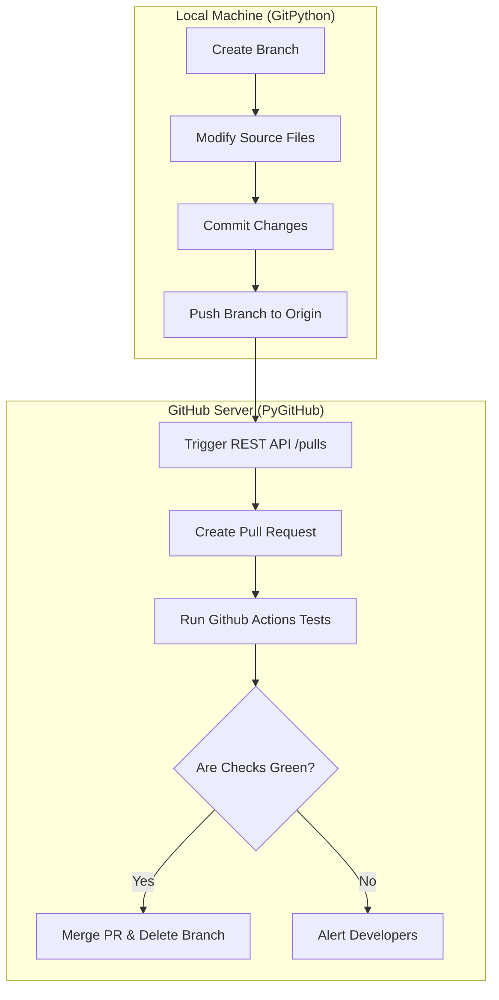

# Pull Request Automation: Integrating Git and GitHub APIs

Git is a decentralized version control tool that runs locally on your machine. However, modern engineering teams coordinate code changes on centralized hosting platforms like GitHub or GitLab. These platforms wrap the core Git protocol with collaborative features like **Pull Requests (PRs)**, code reviews, access controls, and status checks.

To automate the full code integration cycle, you cannot rely on GitPython alone because Git itself does not have a concept of a "Pull Request". Instead, you must combine GitPython (for local commits and branch pushing) with a platform SDK like **PyGitHub** (for creating, checking, and merging PRs programmatically).

In this guide, we will write a complete Python automation script that makes code modifications, pushes branches, opens a GitHub Pull Request, checks status workflows, and merges the PR once all tests pass.

---

## Git vs. Platform APIs

It is important to understand which tool handles which step in the deployment workflow:



---

## Prerequisites: Setting Up Tokens

To interact with GitHub's REST API, you need a **Personal Access Token (PAT)**.
1. Go to **Settings** -> **Developer Settings** -> **Personal Access Tokens**.
2. Generate a token with the `repo` scope.
3. Save the token as an environment variable:
   ```bash
   export GITHUB_TOKEN="ghp_yourtokenvalue"
   ```

---

## Complete Pipeline: Branch, Commit, Push, PR, and Auto-Merge

Here is a comprehensive script that implements the entire end-to-end pull request cycle in Python. It includes:
1. Local git operations (GitPython).
2. Remote API interactions (PyGitHub).
3. Status check polling.
4. Auto-merging upon check completion.

Install requirements:
```bash
pip install GitPython PyGithub
```

Save this file as `pr_automator.py`:

```python
import os
import time
from git import Repo
from github import Github, GithubException

# --- Configurations ---
LOCAL_REPO_PATH = "./my-project"
GITHUB_REPO_NAME = "my-organization/my-project" # format: owner/repo
FEATURE_BRANCH = "chore-bump-configs"
TARGET_BRANCH = "main"

def execute_git_operations(repo_path, branch_name):
    """
    Creates feature branch, modifies a configuration file, commits, and pushes to remote.
    """
    print("--- [1/5] Executing local Git operations ---")
    repo = Repo(repo_path)
    
    # 1. Pull latest master changes
    repo.heads.main.checkout()
    repo.remote("origin").pull()
    
    # 2. Create or reset local branch
    if branch_name in repo.branches:
        print(f"Resetting existing local branch '{branch_name}'...")
        repo.delete_head(branch_name, force=True)
        
    branch = repo.create_head(branch_name)
    branch.checkout()
    print(f"Switched to branch: {repo.active_branch.name}")
    
    # 3. Simulate file modifications (e.g. updating config values)
    config_file = os.path.join(repo_path, "app_config.json")
    config_data = {"environment": "production", "version": "2.4.1", "status": "active"}
    
    with open(config_file, "w", encoding="utf-8") as f:
        import json
        json.dump(config_data, f, indent=4)
        
    # 4. Stage and commit changes
    repo.index.add([config_file])
    repo.index.commit("chore: automatic config updates for production release")
    print("Changes committed to local history.")
    
    # 5. Push branch to remote server
    print("Pushing branch to remote origin...")
    origin = repo.remote("origin")
    origin.push(branch_name, force=True)
    print("Branch successfully pushed.")

def create_pull_request(token, repo_name, source_branch, target_branch):
    """
    Creates a Pull Request on GitHub.
    """
    print("\n--- [2/5] Creating GitHub Pull Request ---")
    gh = Github(token)
    repo = gh.get_repo(repo_name)
    
    try:
        pr = repo.create_pull(
            title="chore(release): automated configuration sync",
            body="This PR was automatically created by the python release daemon to sync version files.",
            head=source_branch,
            base=target_branch
        )
        print(f"🎉 Pull Request created successfully!")
        print(f"PR Number: #{pr.number}")
        print(f"URL: {pr.html_url}")
        return pr
    except GithubException as e:
        print(f"❌ Failed to create Pull Request: {e}")
        return None

def monitor_status_checks(pr, timeout_seconds=300, poll_interval=15):
    """
    Polls the GitHub PR mergeable status and branch checks until completion.
    """
    print("\n--- [3/5] Monitoring Status Checks & Workflows ---")
    start_time = time.time()
    
    while time.time() - start_time < timeout_seconds:
        # Refresh PR details from GitHub API
        pr.update()
        
        # Check mergeable status
        # None means GitHub is calculating it in the background
        mergeable = pr.mergeable
        mergeable_state = pr.mergeable_state
        print(f"Refreshed status: mergeable={mergeable}, state={mergeable_state}")
        
        # Check commit status (e.g. GitHub Actions pipelines)
        # We fetch the latest commit on the feature branch
        last_commit = pr.get_commits().reversed[0]
        check_runs = last_commit.get_check_runs()
        
        all_passed = True
        has_checks = False
        
        for run in check_runs:
            has_checks = True
            print(f" - Check: {run.name} | Status: {run.status} | Conclusion: {run.conclusion}")
            if run.status != "completed" or run.conclusion != "success":
                all_passed = False
                
        # If GitHub has no checks or they are all green, check if mergeable state is clean
        if mergeable and mergeable_state == "clean" and (not has_checks or all_passed):
            print("✅ All check runs passed and branch is mergeable!")
            return True
            
        if mergeable_state == "blocked":
            print("⚠️ Merge is blocked (e.g. needs code review or check failed).")
            
        print(f"Waiting {poll_interval}s before next poll...")
        time.sleep(poll_interval)
        
    print("❌ Timeout reached while waiting for status checks.")
    return False

def merge_pull_request(pr):
    """
    Merges the Pull Request on GitHub.
    """
    print("\n--- [4/5] Merging Pull Request ---")
    try:
        # Perform a squash merge
        status = pr.merge(
            commit_message="Squashed and merged automatically by PR Automation Suite",
            merge_method="squash"
        )
        if status.merged:
            print("🎉 Pull Request successfully merged!")
            return True
        else:
            print("❌ Merge call returned False.")
            return False
    except GithubException as e:
        print(f"❌ Failed to merge Pull Request: {e}")
        return False

def cleanup_remote_branch(token, repo_name, branch_name):
    """
    Deletes the remote feature branch.
    """
    print("\n--- [5/5] Cleaning up remote branch ---")
    gh = Github(token)
    repo = gh.get_repo(repo_name)
    try:
        # Delete remote branch reference
        ref = repo.get_git_ref(f"heads/{branch_name}")
        ref.delete()
        print(f"🗑️ Deleted remote branch '{branch_name}' on GitHub.")
    except Exception as e:
        print(f"Failed to delete branch reference: {e}")

# --- Orchestrating the full flow ---
def run_pr_automation_pipeline():
    token = os.environ.get("GITHUB_TOKEN")
    if not token:
        print("Error: GITHUB_TOKEN environment variable not set.")
        return

    # 1. Run local Git setup
    execute_git_operations(LOCAL_REPO_PATH, FEATURE_BRANCH)
    
    # 2. Create the Pull Request
    pr = create_pull_request(token, GITHUB_REPO_NAME, FEATURE_BRANCH, TARGET_BRANCH)
    if not pr:
        return
        
    # 3. Wait for checks to pass
    checks_passed = monitor_status_checks(pr)
    
    if checks_passed:
        # 4. Merge the PR
        merge_ok = merge_pull_request(pr)
        if merge_ok:
            # 5. Clean up remote branch
            cleanup_remote_branch(token, GITHUB_REPO_NAME, FEATURE_BRANCH)
    else:
        print("Aborting merge. The PR remains open for investigation.")

# if __name__ == "__main__":
#     run_pr_automation_pipeline()
```

---

## Summary

By connecting local Git commands (GitPython) with remote platform workflows (PyGitHub), you can automate the entire code review and merge pipeline. This reduces manual human wait times, ensuring configuration and dependency updates are tested, reviewed, and merged safely. In the next section, we will cover **Git Hooks** using Python.
