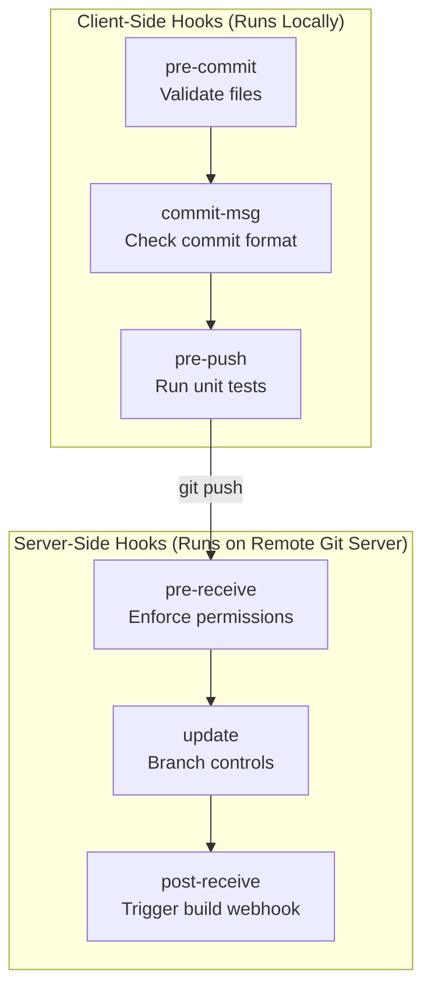

# Git Hooks with Python: Enforcing Quality Controls Locally

Ensuring code quality in a large engineering team requires continuous gates. While CI/CD servers verify code compliance, catching errors *after* code is pushed is slow. Developers must wait for a server slot, review remote console failures, fix the issues locally, commit again, and repeat.

**Git Hooks** solve this by shifting testing "left" (executing checks locally on the developer's computer). Git hooks are executable scripts that run automatically before or after key events like committing, pushing, or checking out branches.

While hooks are historically written in Shell script (Bash), you can write them entirely in **Python**. Python hooks are easier to write, cross-platform (running identically on Windows, macOS, and Linux), and have access to the full Python standard library.

In this guide, we will write client-side Git hooks in Python, configure validation routines for commits and pushes, and automate hook installation for dev teams.

---

## Client-Side Hooks vs. Server-Side Hooks

Git hooks belong to two main categories:



1. **Client-Side Hooks**: Run on the developer's local machine. Used to format code, enforce linting, check commit messages, and run local test suites.
2. **Server-Side Hooks**: Run on the Git hosting server (e.g. a self-hosted GitLab instance). Used to validate pull request permission rules or trigger webhook builds.

---

## Setting Up Python Hooks in Git

Every Git repository has a hidden `.git/hooks/` directory. Inside, you will find template files (like `pre-commit.sample`).

To run a Python hook:
1. Create a file inside `.git/hooks/` with the exact hook name and **no file extension** (e.g. `.git/hooks/pre-commit`).
2. Add a **shebang line** pointing to the Python interpreter as the first line of the file.
3. Make the file executable (`chmod +x`).

---

## 1. Creating a `pre-commit` Hook (Linting and Leak Prevention)

A `pre-commit` hook runs after `git commit` is initiated but before the commit message prompt is shown. If the script exits with status code `1` (or any non-zero value), the commit is aborted.

Save this file as `.git/hooks/pre-commit`:

```python
#!/usr/bin/env python3
import sys
import subprocess

def get_staged_files():
    """
    Returns a list of files currently staged in the index (git status cached).
    """
    # Run git diff-index to list staged files (filter out deleted ones)
    result = subprocess.run(
        ["git", "diff-index", "--cached", "--name-only", "HEAD"],
        capture_output=True,
        text=True,
        check=True
    )
    return [line.strip() for line in result.stdout.splitlines() if line.strip()]

def check_file_safety(filepath):
    """
    Scans Python files for forbidden statements (like hardcoded TODOs or print statements).
    """
    if not filepath.endswith(".py"):
        return True # Skip non-python files

    has_errors = False
    try:
        with open(filepath, "r", encoding="utf-8") as f:
            for line_no, line in enumerate(f, 1):
                # Check for unresolved prints where logging should be used instead
                # Bypassed if developer writes '# allow-print' inline
                if "print(" in line and "# allow-print" not in line:
                    print(f"❌ Error: {filepath}:{line_no} - Found print() statement. Use logging.")
                    has_errors = True
                
                # Check for merge conflict markers left by mistake
                if "<<<<<<<" in line or "=======" in line:
                    print(f"❌ Error: {filepath}:{line_no} - Unresolved merge conflict markers!")
                    has_errors = True
    except FileNotFoundError:
        pass # Staged file could be a deletion, ignore

    return not has_errors

def main():
    print("⏳ Running pre-commit validation checks...")
    staged_files = get_staged_files()
    
    commit_approved = True
    for file in staged_files:
        if not check_file_safety(file):
            commit_approved = False
            
    if not commit_approved:
        print("\n⚠️ Commit aborted due to file validation failures.")
        sys.exit(1) # Reject commit
        
    print("✅ Pre-commit validation successful.")
    sys.exit(0) # Proceed with commit

if __name__ == "__main__":
    main()
```

---

## 2. Creating a `commit-msg` Hook (Enforcing Git Conventions)

A `commit-msg` hook is used to enforce standardized commit formats (such as Conventional Commits or checking that messages start with an issue ticket ID like `TICKET-1234`).

Git passes the path of a temporary file containing the written commit message as the first argument (`sys.argv[1]`).

Save this file as `.git/hooks/commit-msg`:

```python
#!/usr/bin/env python3
import sys
import re

def validate_commit_message(msg_file):
    with open(msg_file, "r", encoding="utf-8") as f:
        message = f.read().strip()

    # Rule 1: Ignore empty messages (git handles these)
    if not message:
        return True

    # Rule 2: Conventional Commits regex pattern
    # Format: feat(scope): message, fix: message, chore: message
    pattern = r"^(feat|fix|docs|style|refactor|perf|test|build|ci|chore|revert)(\([\w\-]+\))?:\s+.+"
    
    if not re.match(pattern, message):
        print("\n❌ Invalid commit message structure!")
        print(f"Current message: '{message}'")
        print("Standard Format Required:")
        print("  - <type>(<scope>): <subject>")
        print("Examples:")
        print("  - feat(auth): add MFA support")
        print("  - fix: resolve memory leak in backup task")
        return False
        
    return True

def main():
    if len(sys.argv) < 2:
        print("Error: Path to commit message file was not provided.")
        sys.exit(1)
        
    msg_file_path = sys.argv[1]
    
    if not validate_commit_message(msg_file_path):
        sys.exit(1) # Reject commit
        
    sys.exit(0) # Accept commit

if __name__ == "__main__":
    main()
```

---

## 3. Creating a `pre-push` Hook (Preventing Broken Pushes)

A `pre-push` hook executes when you run `git push`. This is the final client gate. It is typically used to run the local unit test suite to make sure you do not push broken builds to the central server.

Save this file as `.git/hooks/pre-push`:

```python
#!/usr/bin/env python3
import sys
import subprocess

def run_local_tests():
    """
    Executes unit test suite.
    """
    print("🧪 Running local test suite before pushing changes...")
    try:
        # Run pytest shell command
        subprocess.run(["pytest", "tests/"], check=True)
        print("✅ Tests passed successfully!")
        return True
    except FileNotFoundError:
        print("Warning: pytest test runner not found. Skipping validation.")
        return True
    except subprocess.CalledProcessError:
        print("❌ Test runner failed. Broken tests found!")
        return False

def main():
    if not run_local_tests():
        print("\n⚠️ Push aborted! Please fix failing unit tests before pushing.")
        sys.exit(1) # Block push
        
    sys.exit(0) # Allow push

if __name__ == "__main__":
    main()
```

---

## Distributing Hooks Across the Team

Since the `.git/` folder is not committed to remote repositories, git hooks inside `.git/hooks/` cannot be tracked by version control directly.

To distribute hooks across your engineering team, use one of the two patterns below:

### Pattern A: Custom Hooks Directory (Git 2.9+)
In Git 2.9 or later, you can configure Git to load hooks from a directory tracked in your repository (like `githooks/`) instead of `.git/hooks/`.

1. Create a `githooks/` directory at the root of your repository.
2. Put your hook files (`pre-commit`, `commit-msg`, `pre-push`) inside it.
3. Commit `githooks/` to Git.
4. Have team members run this command once during repository setup:
   ```bash
   git config core.hooksPath githooks
   ```

### Pattern B: Automated Bootstrap Script
You can write an installation Python script that developers run once to copy files into `.git/hooks/` and make them executable:

```python
# Save as scripts/install_hooks.py
import os
import shutil
import stat

def install_hooks():
    script_dir = os.path.dirname(os.path.abspath(__file__))
    project_root = os.path.dirname(script_dir)
    
    source_dir = os.path.join(project_root, "githooks")
    dest_dir = os.path.join(project_root, ".git", "hooks")
    
    if not os.path.exists(dest_dir):
        print("Error: .git/hooks directory not found. Are you in a git repository?")
        return
        
    print(f"Installing hooks from {source_dir} to {dest_dir}...")
    
    for filename in os.listdir(source_dir):
        source_path = os.path.join(source_dir, filename)
        dest_path = os.path.join(dest_dir, filename)
        
        # Copy the file
        shutil.copy2(source_path, dest_path)
        
        # Add executable permissions (chmod +x)
        current_permissions = os.stat(dest_path).st_mode
        os.chmod(dest_path, current_permissions | stat.S_IEXEC)
        print(f" - Configured: {filename}")

# if __name__ == "__main__":
#     install_hooks()
```

---

## Summary

Git hooks are a powerful way to catch code quality, syntax formatting, and credentials issues before they ever leave a developer's computer. Writing hooks in Python ensures they run consistently across multiple operating systems. In the next chapter, we will learn about **GitHub API Automation**.
