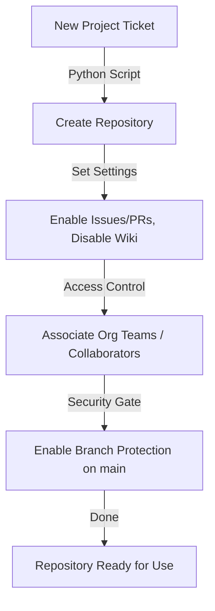

# Managing Repositories: Programmatic Configuration and Access Provisioning

In enterprise environments, manually creating and configuring repositories is a bottleneck. When a new project starts, team members must manually configure settings, add team collaborators, invite external contractors, set up branch protection rules, and block direct pushes to production. This process is slow and prone to security oversights.

Automating repository management ensures compliance and security. Using PyGithub, you can build a repository provisioning pipeline that creates repos, configures access permissions, and enforces strict branch protection policies automatically.

In this guide, we will cover how to create repositories under personal and organization scopes, invite collaborators with explicit roles, manage team associations, set up branch protection rules, and handle repository deletions safely.

---

## The Provisioning Flow



---

## 1. Creating a Repository

You can create a repository under your personal account using `AuthenticatedUser.create_repo()`, or under an organization using `Organization.create_repo()`.

### Creating a Personal Repository

```python
from github import Github

g = Github("ghp_yourpersonaltoken")
user = g.get_user()

try:
    # Create repository with standard configuration settings
    repo = user.create_repo(
        name="automated-infra-backup",
        description="Daily backups of infrastructure configs.",
        homepage="https://infra.mycompany.com",
        private=True,          # Private repository
        has_issues=True,       # Enable issue tracker
        has_projects=False,    # Disable projects boards
        has_wiki=False,        # Disable wiki
        auto_init=True,        # Initialize with a README
        gitignore_template="Python", # Add Python gitignore
        license_template="mit" # Add MIT License
    )
    print(f"✅ Repository created: {repo.html_url}")
except Exception as e:
    print(f"Failed to create repo: {e}")
```

### Creating an Organization Repository

```python
from github import Github

g = Github("ghp_org_token")
org = g.get_organization("my-enterprise-org")

try:
    repo = org.create_repo(
        name="billing-microservice",
        description="Core billing microservice API.",
        private=True,
        has_issues=True,
        has_wiki=True
    )
    print(f"✅ Org repository created: {repo.html_url}")
except Exception as e:
    print(f"Failed to create org repository: {e}")
```

---

## 2. Access Control: Collaborators and Teams

Managing access is critical. You can add individual collaborators or grant access to whole organization teams.

### Managing Individual Collaborators
You can add a collaborator by their GitHub username and assign a specific permission role (e.g., `pull`, `push`, `admin`, `maintain`, or `triage`).

```python
from github import Github

g = Github("ghp_token")
repo = g.get_repo("my-enterprise-org/billing-microservice")

# Invite a developer with 'push' (write) permissions
try:
    repo.add_to_collaborators("developer_username", permission="push")
    print("✅ Collaborator invitation sent successfully.")
except Exception as e:
    print(f"Failed to add collaborator: {e}")

# Remove collaborator
# repo.remove_from_collaborators("developer_username")
```

### Managing Organization Teams
For enterprise security, it is best to assign access permissions to **Teams** rather than individuals.

```python
from github import Github

g = Github("ghp_token")
org = g.get_organization("my-enterprise-org")
repo = g.get_repo("my-enterprise-org/billing-microservice")

# Fetch the engineering team by slug name
try:
    team = org.get_team_by_slug("backend-engineers")
    
    # Add repository to the team with push (write) permissions
    team.add_to_repos(repo)
    team.update_status_in_repo(repo, permission="push")
    print(f"✅ Team 'backend-engineers' now has write access to {repo.name}.")
except Exception as e:
    print(f"Failed to configure team access: {e}")
```

---

## 3. Enforcing Branch Protection Rules

Branch protection rules prevent code from being deleted or modified accidentally. It is standard practice to protect the `main` or `master` branch.

```python
from github import Github

g = Github("ghp_token")
repo = g.get_repo("my-enterprise-org/billing-microservice")

# Get reference to the branch we want to protect
main_branch = repo.get_branch("main")

try:
    print("Configuring branch protection rules on 'main'...")
    
    # Configure branch protection
    # We require PR approvals and enforce rules for administrators
    main_branch.edit_protection(
        enforce_admins=True,                    # Enforce rules for admins too
        dismiss_stale_reviews=True,             # Dismiss PR approvals on new commits
        required_approving_review_count=1,      # Require at least 1 approval
        require_code_owner_reviews=True,        # Require approval from CODEOWNERS
        strict=True                             # Require branch to be up to date before merging
    )
    
    print("✅ Branch protection rules successfully applied.")
except Exception as e:
    print(f"Failed to apply branch protection: {e}")
```

---

## 4. Deleting a Repository

Deleting a repository is a high-risk operation. Your scripts should require explicit confirmation and safety checks before calling the delete endpoint.

```python
from github import Github

g = Github("ghp_admin_token")
repo = g.get_repo("my-enterprise-org/temporary-project")

# Safeguard check: ensure repository name matches before deleting
confirm_name = input(f"To delete, type the name of the repository '{repo.name}': ")

if confirm_name == repo.name:
    try:
        repo.delete()
        print("🗑️ Repository deleted successfully.")
    except Exception as e:
        print(f"Failed to delete repository: {e}")
else:
    print("Operation cancelled. Repository name mismatch.")
```

---

## Summary

Automating repository management ensures all new projects are initialized with the correct access permissions and branch protection policies. In the next section, we will cover how to **manage Pull Requests** programmatically.
