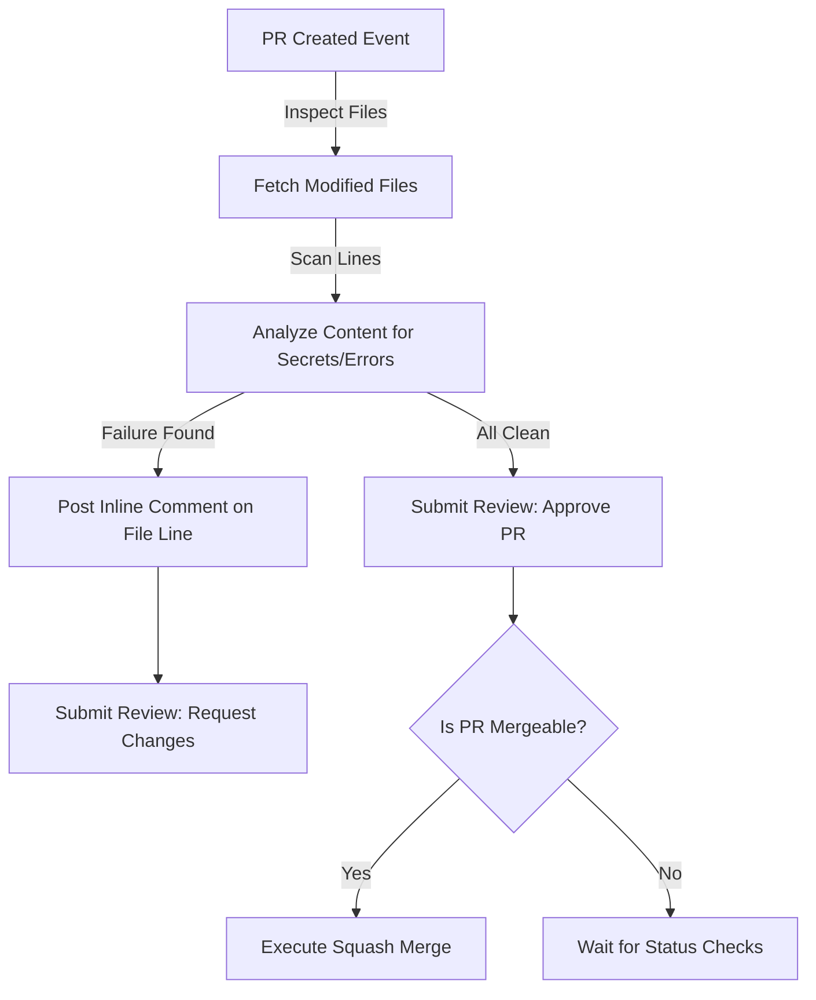

# Managing Pull Requests: Automated Code Review and Merge Pipelines

In collaborative software development, Pull Requests (PRs) act as gatekeepers for code changes. Instead of developers merging changes directly into production branches, code must be reviewed, tested, and approved. 

Automating Pull Request management allows you to build automated security audits (scanning file diffs for hardcoded passwords), auto-assign code reviewers based on files changed, and auto-merge code dependencies once build checks pass.

In this guide, we will cover how to query and filter active pull requests, programmatically create draft and standard PRs, run automated reviews, post line-by-line inline comments on files, and merge pull requests using different merge strategies.

---

## The Automated PR Lifecycle



---

## 1. Querying and Listing Pull Requests

You can query a repository for pull requests and filter by state (`open`, `closed`, or `all`), base branch, and sorting order.

```python
from github import Github

g = Github("ghp_token")
repo = g.get_repo("my-company/my-project")

# List all open pull requests targetting 'main' branch
open_prs = repo.get_pulls(
    state="open",
    sort="created",
    direction="desc",
    base="main"
)

print(f"Active Pull Requests in {repo.full_name}:")
for pr in open_prs:
    print(f" - #{pr.number}: '{pr.title}' created by {pr.user.login}")
    print(f"   Source Branch: {pr.head.ref} -> Target Branch: {pr.base.ref}")
    print(f"   URL: {pr.html_url}\n")
```

---

## 2. Creating a Pull Request (Standard & Draft)

To create a PR, you define the title, description, source branch (`head`), and target branch (`base`). You can also request a **Draft Pull Request** by setting the `draft` argument to `True`.

```python
from github import Github

g = Github("ghp_token")
repo = g.get_repo("my-company/my-project")

try:
    # Create standard pull request
    pr = repo.create_pull(
        title="feat(billing): integrate stripe payment gateway",
        body="This pull request adds support for Stripe recurring subscriptions.",
        head="feature-stripe-billing",
        base="main",
        draft=False # Set to True to create a Draft PR
    )
    print(f"✅ Pull Request #{pr.number} created: {pr.html_url}")
    
    # Request code reviews from specific team members
    pr.create_review_request(reviewers=["lead_developer", "security_engineer"])
    print("✅ Requested reviews from target users.")
except Exception as e:
    print(f"Failed to create PR: {e}")
```

---

## 3. Automated Code Review: Scanning Diffs and Posting Comments

If you are building an automated code checker (e.g. searching for security issues, checkstyle violations, or unoptimized imports), you need to inspect the code diff files and post comments on the exact line of code where the issue was found.

To post inline comments, you retrieve the changed files using `pr.get_files()` and create comments on specific lines.

```python
from github import Github

g = Github("ghp_token")
repo = g.get_repo("my-company/my-project")
pr = repo.get_pull(42) # Fetch Pull Request #42

def perform_security_review(pull_request):
    print(f"Starting security review on PR #{pull_request.number}...")
    
    # List of files modified in this PR
    changed_files = pull_request.get_files()
    violations_found = False
    
    # We fetch the latest commit hash to attach comments to
    latest_commit = pull_request.get_commits().reversed[0]
    
    for file in changed_files:
        # Check if the file is a Python file
        if file.filename.endswith(".py"):
            print(f"Scanning file: {file.filename}")
            
            # Read the file patch/diff (raw diff showing additions and deletions)
            patch = file.patch
            if not patch:
                continue
                
            # Iterate through added lines in the patch
            lines = patch.split("\n")
            for line_idx, line in enumerate(lines):
                # Check for hardcoded AWS keys or credentials in added lines (starting with '+')
                if line.startswith("+") and ("AWS_SECRET" in line or "PASSWORD =" in line):
                    print(f"🚨 Security Violation found in {file.filename}!")
                    violations_found = True
                    
                    # Post an inline comment on the specific file line
                    # 'position' represents the relative index line within the patch file
                    pull_request.create_review_comment(
                        body="⚠️ Security Alert: Hardcoded credentials detected! Please use environment variables instead.",
                        commit=latest_commit,
                        path=file.filename,
                        position=line_idx
                    )
                    
    # Submit the overall review status
    if violations_found:
        pull_request.create_review(
            commit=latest_commit,
            body="Review completed. Security violations were found. Please fix them.",
            event="REQUEST_CHANGES" # Request changes blocking the PR
        )
        print("❌ Security audit failed. Changes requested.")
    else:
        pull_request.create_review(
            commit=latest_commit,
            body="Security audit passed. No credentials leaks found.",
            event="APPROVE" # Approve the PR
        )
        print("✅ Security audit passed. PR approved.")

# perform_security_review(pr)
```

---

## 4. Merging the Pull Request

Once tests have passed and approval reviews have been received, your script can merge the PR. You can choose from three merge methods: `merge` (merge commit), `squash`, or `rebase`.

```python
from github import Github

g = Github("ghp_token")
repo = g.get_repo("my-company/my-project")
pr = repo.get_pull(42)

# Check if the PR can be merged
# pr.mergeable is True if there are no merge conflicts, False if there are conflicts, None if calculating
if pr.mergeable:
    try:
        print("Merging PR...")
        # Execute squash merge
        status = pr.merge(
            commit_title=f"Merge pull request #{pr.number} from {pr.head.ref}",
            commit_message="Automated deployment merge",
            merge_method="squash"
        )
        
        if status.merged:
            print("🎉 Pull Request successfully merged and closed.")
        else:
            print("❌ Merge request was rejected by server.")
    except Exception as e:
        print(f"Failed to merge PR: {e}")
else:
    print("⚠️ Cannot merge: PR has merge conflicts or is blocked by branch protection policies.")
```

---

## Summary

Automating Pull Request interactions enables you to build continuous integration loops. By scanning file diffs, adding line-specific inline comments, and programmatically approving or requesting changes, you can ensure code meets quality and security standards before it is merged. In the next section, we will cover how to **manage GitHub Issues**.
