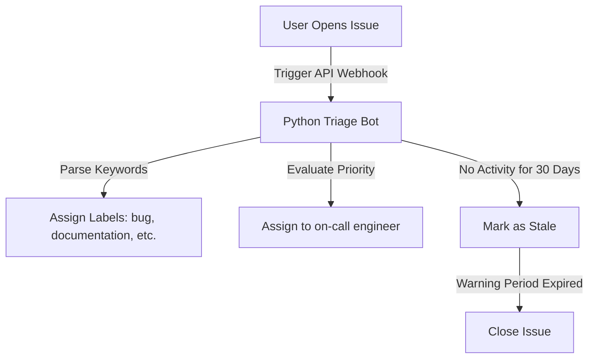

# Managing Issues: Automated Triage and Lifecycle Operations

GitHub Issues serve as the central tracking system for bug reports, task lists, and user feature requests. For large open-source repositories or busy corporate workspaces, the volume of incoming issues can quickly overwhelm developers. Manually labeling reports, assigning tickets, and closing stale questions consumes valuable engineering time.

Automating issue management allows you to write bots that triage incoming issues in real time. Using PyGithub, you can auto-apply tags based on keywords, assign developers based on the subject, clean up inactive issues, and use issues as interactive command prompts to trigger backend workflows.

In this guide, we will cover how to query and filter issues, create new tickets, manage comments and reactions, add or remove labels, assign tickets, and build a working **Stale Issue Bot** to automate repository cleanup.

---

## The Issue Triage Pipeline



---

## 1. Querying and Filtering Issues

When fetching issues, the GitHub API returns both issues and pull requests because pull requests are structured as issues with pull metadata under the hood. You must check the `.pull_request` attribute to filter them.

```python
from github import Github

g = Github("ghp_token")
repo = g.get_repo("my-company/my-project")

# Retrieve open issues
open_issues = repo.get_issues(state="open", sort="updated", direction="desc")

print(f"Open Issues in {repo.full_name}:")
for issue in open_issues:
    # Filter out Pull Requests
    if not issue.pull_request:
        labels = [label.name for label in issue.labels]
        print(f" - #{issue.number}: {issue.title}")
        print(f"   Assignees: {[a.login for a in issue.assignees]}")
        print(f"   Labels:    {labels}")
        print(f"   Created:   {issue.created_at}\n")
```

---

## 2. Creating a Ticket

Creating an issue programmatically requires a title, but you can also include a detailed description (body), list of assignees, labels, and target milestones.

```python
from github import Github

g = Github("ghp_token")
repo = g.get_repo("my-company/my-project")

try:
    # Create the issue
    issue = repo.create_issue(
        title="Bug: Backup script fails with timeout on large databases",
        body=(
            "### Description\n"
            "The daily backup cron job timed out when processing the primary SQL database.\n\n"
            "### Steps to Reproduce\n"
            "1. Run `python backup.py --env prod`.\n"
            "2. Wait for 5 minutes.\n"
            "3. Script crashes with SocketTimeoutException.\n\n"
            "### Log Details\n"
            "```text\n"
            "socket.timeout: The write operation timed out\n"
            "```"
        ),
        assignees=["database_administrator"],
        labels=["bug", "priority-high"]
    )
    print(f"✅ Issue #{issue.number} created successfully: {issue.html_url}")
except Exception as e:
    print(f"Failed to create issue: {e}")
```

---

## 3. Adding Comments and Reactions

Automated bots can communicate with users by adding markdown-formatted comments and emojis (reactions) to issues.

```python
from github import Github

g = Github("ghp_token")
repo = g.get_repo("my-company/my-project")
issue = repo.get_issue(15) # Fetch Issue #15

# 1. Post a comment
comment = issue.create_comment(
    "🤖 **Auto-Triage Update:** This issue has been flagged as a high-priority bug. "
    "An on-call engineer has been assigned to investigate."
)
print(f"Comment posted: {comment.id}")

# 2. Add an emoji reaction to the comment
# Supported reactions: '+1', '-1', 'laugh', 'confused', 'heart', 'hooray', 'rocket', 'eyes'
comment.create_reaction("+1")
print("Added thumbs-up reaction to comment.")
```

---

## 4. Modifying Issue Attributes (Assigning and Labeling)

You can dynamically update labels and assignees as the ticket progresses through the lifecycle.

```python
from github import Github

g = Github("ghp_token")
repo = g.get_repo("my-company/my-project")
issue = repo.get_issue(15)

# Add a new label (preserves existing labels)
issue.add_to_labels("in-progress")

# Set the entire labels list (overrides existing labels)
# issue.set_labels(["bug", "in-progress"])

# Remove a specific label
issue.remove_from_labels("priority-high")

# Assign additional developers
issue.add_to_assignees("additional_developer")

# Remove assignee
# issue.remove_from_assignees("database_administrator")
```

---

## 5. Building a Stale Issue Cleanup Bot

Here is a complete, production-ready script that scans for open issues with no comments or activity for over 30 days, marks them as stale, and alerts users.

```python
import datetime
from github import Github
from github import GithubException

# Configurations
STALE_DAYS_LIMIT = 30
STALE_LABEL = "status: stale"
WARNING_MESSAGE = (
    "🤖 **Stale Issue Alert:** This issue has not seen any activity for the past 30 days. "
    "It will be closed automatically in 7 days if no further comments are received. "
    "To keep it open, simply add a comment."
)

def run_stale_cleanup_bot(token, repo_name):
    gh = Github(token)
    try:
        repo = gh.get_repo(repo_name)
        open_issues = repo.get_issues(state="open")
        
        # Calculate threshold date
        cutoff_date = datetime.datetime.now() - datetime.timedelta(days=STALE_DAYS_LIMIT)
        print(f"Scanning issues updated before: {cutoff_date}")
        
        for issue in open_issues:
            # Filter out Pull Requests
            if issue.pull_request:
                continue
                
            # Check if the issue was updated before the cutoff date
            if issue.updated_at < cutoff_date:
                print(f"Found stale issue: #{issue.number} - '{issue.title}' (Last updated: {issue.updated_at})")
                
                # Check if it is already labeled as stale
                current_labels = [label.name for label in issue.labels]
                
                if STALE_LABEL not in current_labels:
                    # 1. Apply the stale label
                    issue.add_to_labels(STALE_LABEL)
                    print(f" - Applied '{STALE_LABEL}' label.")
                    
                    # 2. Leave a warning comment
                    issue.create_comment(WARNING_MESSAGE)
                    print(" - Left warning comment.")
                else:
                    # If it was already marked stale and still has no updates, close it
                    # (In production, you'd check if the stale label was applied > 7 days ago)
                    print(" - Issue is already stale. Closing ticket.")
                    issue.edit(state="closed", state_reason="not_planned")
                    print(" - Issue closed successfully.")
                    
    except GithubException as e:
        print(f"GitHub API Error: {e.status} - {e.data.get('message')}")
    except Exception as e:
        print(f"An error occurred: {e}")

# Example:
# run_stale_cleanup_bot("ghp_token", "my-company/my-project")
```

---

## Summary

Automating issue management allows you to streamline issue tracking and keep your project board organized. Emojis, tags, comments, and milestones let you automate team coordination. In the next section, we will cover how to **build real-time receivers using GitHub Webhooks**.
