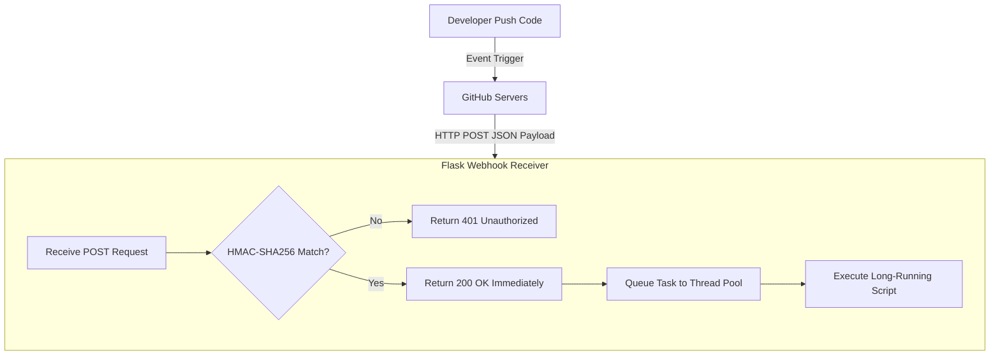

# GitHub Webhooks: Building Event-Driven DevOps Pipelines

Polling an API for changes (e.g., repeatedly calling `get_pulls()` every 60 seconds) is inefficient. It consumes rate limit quotas, wastes CPU cycles, and introduces latency between the event occurring and your script taking action.

**Webhooks** solve this by enabling an event-driven architecture. Instead of your script asking GitHub for updates, GitHub notifies your script. When an event occurs (such as code pushed, a issue opened, or a release published), GitHub sends an HTTP POST request containing a detailed JSON payload and security headers to a web server you configure.

In this guide, we will build a production-ready GitHub Webhook receiver using **Flask**. We will cover cryptographic signature verification using HMAC-SHA256 to prevent unauthorized requests, map payloads for common events, and handle webhooks asynchronously using thread pools to prevent timeouts.

---

## Webhook Architecture



---

## Webhook Payloads and Headers

When GitHub sends a webhook, it includes metadata in the HTTP headers:
* **`X-GitHub-Event`**: The type of event (e.g. `push`, `pull_request`, `ping`, `issues`).
* **`X-Hub-Signature-256`**: The HMAC-SHA256 signature used to verify that the payload was sent by GitHub and matches the configured shared secret.
* **`X-GitHub-Delivery`**: A unique GUID identifying this specific delivery.

---

## 1. Webhook Signature Verification (Security First)

To prevent attackers from sending fake payloads to your webhook endpoint, you must configure a **Secret** token in your GitHub webhook settings. GitHub uses this secret to generate an HMAC-SHA256 signature of the request body, which it sends in the `X-Hub-Signature-256` header.

Your server must compute the same hash and verify they match.

> [!IMPORTANT]
> To prevent **timing attacks**, always verify signatures using **`hmac.compare_digest()`** instead of a standard `==` string comparison. Standard comparison returns as soon as a character mismatch is found, allowing attackers to guess hashes byte-by-byte by measuring response latencies.

Here is the Python implementation for signature validation:

```python
import hmac
import hashlib

def verify_signature(secret: bytes, payload_bytes: bytes, signature_header: str) -> bool:
    """
    Cryptographically validates the webhook payload signature.
    """
    if not signature_header:
        return False

    # Signatures look like: sha256=12345abcde...
    sha_name, signature_hash = signature_header.split("=")
    if sha_name != "sha256":
        return False

    # Compute HMAC SHA256 signature using the shared secret
    mac = hmac.new(secret, msg=payload_bytes, digestmod=hashlib.sha256)
    computed_hash = mac.hexdigest()

    # Compare computed hash with received hash in constant time
    return hmac.compare_digest(computed_hash, signature_hash)
```

---

## 2. Production Webhook Server with Asynchronous Task Execution

GitHub expects your server to respond to webhooks within **10 seconds**. If your script performs long-running tasks (like cloning a repository, running tests, or deploying code) inside the webhook request thread, the request will time out, and GitHub will mark it as failed.

To solve this, return a `200 OK` response immediately, and process the payload asynchronously using a thread pool.

Here is the complete webhook receiver script. Save it as `webhook_receiver.py`:

```python
import os
from concurrent.futures import ThreadPoolExecutor
from flask import Flask, request, jsonify, abort

app = Flask(__name__)

# Load the shared secret from environment variables
WEBHOOK_SECRET = os.environ.get("GITHUB_WEBHOOK_SECRET", "default_secret").encode("utf-8")

# Initialize ThreadPoolExecutor to handle automation tasks asynchronously
# This keeps the main Flask HTTP thread responsive
executor = ThreadPoolExecutor(max_workers=4)

def process_push_event(payload):
    """
    Asynchronous worker task to handle push events.
    """
    ref = payload.get("ref", "")
    branch = ref.replace("refs/heads/", "")
    repo_name = payload.get("repository", {}).get("full_name")
    commits = payload.get("commits", [])
    
    print(f"\n[Task Runner] Processing push to {repo_name} on branch '{branch}'")
    print(f"[Task Runner] Total commits pushed: {len(commits)}")
    
    # Run automation steps here
    # e.g., trigger local test suites or execute deployments
    # (Simulated work)
    import time
    time.sleep(5)
    print("[Task Runner] Push event processing completed.")

def process_pull_request_event(payload):
    """
    Asynchronous worker task to handle pull request events.
    """
    action = payload.get("action")
    pr_number = payload.get("number")
    pr_title = payload.get("pull_request", {}).get("title")
    
    print(f"\n[Task Runner] PR #{pr_number} updated with action '{action}'")
    print(f"[Task Runner] Title: {pr_title}")
    
    if action == "opened":
        print("[Task Runner] Running linting audits on new PR...")
        # Simulate work
        import time
        time.sleep(3)
        print("[Task Runner] PR checks complete.")

@app.route("/webhook", methods=["POST"])
def github_webhook_endpoint():
    # 1. Get the signature header
    signature = request.headers.get("X-Hub-Signature-256")
    
    # 2. Verify signature to protect against unauthorized requests
    # request.data contains the raw body bytes
    if not verify_signature(WEBHOOK_SECRET, request.data, signature):
        print("❌ Rejecting request: Invalid signature.")
        abort(401, "Invalid signature")
        
    # 3. Retrieve event type
    event_type = request.headers.get("X-GitHub-Event")
    payload = request.json
    
    print(f"✅ Webhook verified. Event: {event_type}")
    
    # 4. Route events to async thread pool tasks
    if event_type == "push":
        executor.submit(process_push_event, payload)
        
    elif event_type == "pull_request":
        executor.submit(process_pull_request_event, payload)
        
    elif event_type == "ping":
        return jsonify({"message": "pong"}), 200
        
    else:
        print(f"Event type '{event_type}' received but ignored.")
        return jsonify({"status": "ignored"}), 200

    # 5. Return success immediately (within 10s)
    return jsonify({"status": "queued"}), 202

if __name__ == "__main__":
    # In production, run this server behind a WSGI server like Gunicorn:
    # gunicorn -w 4 -b 0.0.0.0:5000 webhook_receiver:app
    app.run(port=5000)
```

---

## Running and Exposing the Webhook Server

To configure and test the webhook server locally:

1. **Start the Flask Server**:
   ```bash
   export GITHUB_WEBHOOK_SECRET="super_secret_webhook_token"
   python webhook_receiver.py
   ```
2. **Expose Localhost using Ngrok**:
   Webhooks require a public URL. Download and run **ngrok** to expose port 5000:
   ```bash
   ngrok http 5000
   ```
3. **Configure Webhook on GitHub**:
   * Navigate to your GitHub Repository -> **Settings** -> **Webhooks** -> **Add Webhook**.
   * **Payload URL**: Use the HTTPS URL provided by ngrok (e.g. `https://1234abc.ngrok-free.app/webhook`).
   * **Content type**: `application/json`.
   * **Secret**: `super_secret_webhook_token` (must match the env variable).
   * Click **Add Webhook**.
4. GitHub will immediately send a `ping` event. You should see a `200 OK` logged in your Flask console.

---

## Summary

Webhooks allow you to transition from static polling to real-time, event-driven DevOps pipelines. By implementing HMAC-SHA256 verification and processing tasks asynchronously in thread pools, you can build secure, responsive integrations. In the next section, we will cover how to **integrate Python with GitHub Actions**.
