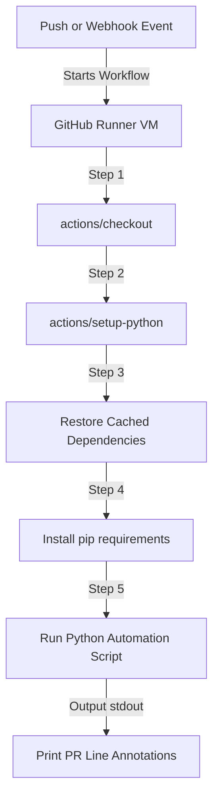

# GitHub Actions with Python: Workflow Orchestration and CI Automation

GitHub Actions is an integrated CI/CD platform that allows you to automate build, test, and deployment workflows directly within your code repositories. Rather than maintaining dedicated build servers (like Jenkins), you define workflows in YAML configuration files, and GitHub runs them on managed runner virtual machines.

Python plays a double role in GitHub Actions:
1. **Running inside workflows**: You can run Python scripts inside your build runners to execute complex audits, parse metrics, or run validation tasks.
2. **Triggering workflows from outside**: You can write Python scripts that use the GitHub REST API to trigger Actions workflows programmatically.

In this guide, we will write a complete GitHub Actions YAML workflow that sets up a Python environment, caches dependencies, runs a custom Python linting script, outputs UI annotations back to GitHub using workflow commands, and triggers the workflow from Python using the GitHub API.

---

## Actions Workflow Architecture



---

## 1. Running Python Scripts in a Workflow

To run a Python script, create a YAML workflow file inside the `.github/workflows/` directory of your repository.

Here is a complete workflow (`.github/workflows/pr-checks.yml`) that configures caching and executes a Python script when code is pushed:

```yaml
name: Pull Request Verification

on:
  pull_request:
    branches: [ main ]
  workflow_dispatch:
    inputs:
      debug_mode:
        description: 'Enable verbose debugging logs'
        required: false
        default: 'false'

jobs:
  python-audit:
    runs-on: ubuntu-latest

    steps:
      # 1. Check out the repository files
      - name: Checkout Repository Code
        uses: actions/checkout@v3

      # 2. Set up Python and cache pip packages automatically
      - name: Configure Python Environment
        uses: actions/setup-python@v4
        with:
          python-version: '3.10'
          cache: 'pip' # Speeds up builds by caching dependencies

      # 3. Install requirements
      - name: Install Project Dependencies
        run: |
          python -m pip install --upgrade pip
          if [ -f requirements.txt ]; then pip install -r requirements.txt; fi

      # 4. Run the Python linting script
      # We pass secrets and workflow inputs as environment variables
      - name: Execute Code Audit
        run: python scripts/code_auditor.py
        env:
          GITHUB_TOKEN: ${{ secrets.GITHUB_TOKEN }}
          DEBUG_LOGS: ${{ github.event.inputs.debug_mode }}
```

---

## 2. Writing Interactive Scripts: Workflow Commands

GitHub Actions runners listen to the standard output of your Python scripts. By printing messages using a special syntax called **Workflow Commands**, your Python scripts can directly interact with the GitHub runner environment.

### Creating Warning and Error PR Annotations
If your Python script detects a warning or error, you can print a workflow command. GitHub will catch this and display it as a highlighted annotation directly on the code diff in the Pull Request UI!

Syntax format:
`::(warning|error) file={name},line={line}::{message}`

### Python script implementation: `scripts/code_auditor.py`

```python
import os
import sys

def audit_code_file(filepath):
    """
    Scans a file and outputs annotations to the GitHub Actions UI on failure.
    """
    has_errors = False
    try:
        with open(filepath, "r", encoding="utf-8") as f:
            for line_no, line in enumerate(f, 1):
                # Search for hardcoded dummy variables or placeholders
                if "PLACEHOLDER" in line:
                    # Print warning annotation command for GitHub Actions
                    print(f"::warning file={filepath},line={line_no}::Placeholder value detected. Ensure this is replaced before release.")
                    
                if "TODO" in line:
                    print(f"::notice file={filepath},line={line_no}::Unresolved TODO item found.")
                    
    except Exception as e:
        print(f"Failed to read {filepath}: {e}")
        
    return not has_errors

def main():
    debug_mode = os.environ.get("DEBUG_LOGS", "false")
    if debug_mode == "true":
        print("Verbose debug logging enabled.")

    target_files = ["app.py", "database.py"]
    all_clear = True
    
    for file in target_files:
        if os.path.exists(file):
            print(f"Auditing file: {file}")
            if not audit_code_file(file):
                all_clear = False
                
    # If the audit fails, exit with non-zero code to fail the build step
    if not all_clear:
        print("❌ Code audit encountered errors. Review annotations.")
        sys.exit(1)
        
    print("✅ All audit checks completed successfully.")
    sys.exit(0)

if __name__ == "__main__":
    main()
```

---

## 3. Triggering Action Workflows Programmatically

If you have a Python script running on an external server and you want to trigger a GitHub Action workflow in your repository, you use the `workflow_dispatch` event.

Ensure your workflow YAML file contains `on: [workflow_dispatch]` as shown in the YAML example above.

```python
from github import Github
from github import GithubException

def trigger_github_workflow(token, repo_name, workflow_file, target_branch="main"):
    gh = Github(token)
    try:
        repo = gh.get_repo(repo_name)
        
        # 1. Fetch the target workflow by filename
        workflow = repo.get_workflow(workflow_file)
        
        # 2. Trigger the run (workflow_dispatch)
        # You pass the target git branch and any defined input parameters
        print(f"Triggering workflow '{workflow_file}' on branch '{target_branch}'...")
        status = workflow.create_dispatch(
            ref=target_branch,
            inputs={
                "debug_mode": "true" # Must match inputs defined in workflow YAML
            }
        )
        
        if status:
            print("🚀 GitHub Actions workflow successfully triggered!")
        else:
            print("Failed to dispatch workflow.")
            
    except GithubException as e:
        print(f"GitHub API Error: {e.status} - {e.data.get('message')}")
    except Exception as e:
        print(f"Unexpected error: {e}")

# Example usage:
# trigger_github_workflow(
#     token="ghp_yourtoken",
#     repo_name="my-organization/my-project",
#     workflow_file="pr-checks.yml"
# )
```

---

## 4. Passing Outputs back to GitHub Actions

Your Python script can write variable outputs that subsequent steps in the YAML workflow can read. To do this, write to the filepath specified in the `GITHUB_OUTPUT` environment variable.

In Python:
```python
import os

# Get output filepath from runner environment
github_output_file = os.environ.get("GITHUB_OUTPUT")

if github_output_file:
    with open(github_output_file, "a", encoding="utf-8") as f:
        # Format: key=value
        f.write("audit_status=passed\n")
        f.write("errors_count=0\n")
    print("Metrics written to GITHUB_OUTPUT.")
```

---

## Summary

Integrating Python with GitHub Actions creates a highly modular CI/CD pipeline. Your Python scripts do the heavy lifting (analyzing, verifying, formatting), while GitHub Actions handles host provisioning, environment configurations, and UI visualization. In the next chapter, we will cover **Jenkins Automation**.
