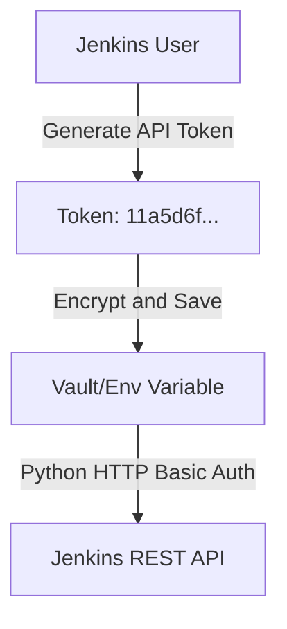

# Jenkins API Overview: Automating Continuous Integration

Continuous Integration (CI) relies on automated builders to constantly compile code, run tests, and check artifact dependencies. While modern platforms like GitHub Actions have gained popularity, **Jenkins** remains the industry standard for large enterprise environments that require custom build runners, complex multi-stage pipelines, and on-premises control.

While Jenkins provides a rich web UI to click buttons and review builds, doing this manually does not scale. Programmatically interacting with Jenkins allows you to trigger builds on external triggers (like a monitoring alert), query build health from custom dashboards, audit job configurations across hundreds of projects, and update plugin details automatically.

In this guide, we will explore Jenkins' architecture, detail the REST API structure, cover CSRF protection (Crumbs), explain how to generate secure API Tokens, and lay out best practices for connecting Jenkins to your Python systems.

---

## Why Automate Jenkins?

In complex DevOps environments, Python scripts interact with Jenkins to orchestrate tasks:

1. **Triggering Deployments on Webhooks**: Starting builds dynamically when a deployment request is approved in an internal ticketing system.
2. **Audit Compliance**: Querying all jobs to audit who has access, what credentials they use, and if they follow naming conventions.
3. **Automated Rollbacks**: Monitoring production systems and automatically triggering a Jenkins rollback pipeline if health checks drop.
4. **Dynamic Resource Provisioning**: Launching new Jenkins agents or adjusting worker pools based on build queue length.

---

## Comparison: Jenkins Web UI vs. REST API

| Feature / Task | Web User Interface | Jenkins REST API |
| :--- | :--- | :--- |
| **Triggering Builds** | Manual mouse clicks | Programmatic HTTP POST calls |
| **Audit Controls** | Click through individual jobs | Batch request job list JSON |
| **CSRF Protection** | Handled transparently by browser | Must supply a Crumb token in headers |
| **Configuration** | UI Forms and Pipeline scripts | Submit raw config XML files |
| **Error Debugging** | Scroll through console log in browser | Download and grep logs via API |
| **Scalability** | Low (Limits speed to human actions) | High (Supports bulk updates) |

---

## Authenticating with the Jenkins API

For security compliance, you must never hardcode your main Jenkins account password in automation scripts. Instead, you generate a **Jenkins API Token** that represents your account permissions but can be revoked independently.



### Steps to Generate an API Token:
1. Log in to your Jenkins dashboard.
2. Click on your **Username** in the top-right corner.
3. Click on the **Configure** link in the left-hand navigation sidebar.
4. Scroll down to the **API Token** section.
5. Click **Add new Token**, give it a descriptive name (e.g. `python-monitor-service`), and click **Generate**.
6. Copy the displayed token code immediately. Jenkins will mask this token once you navigate away from the page.

### The Basic Auth Header
When communicating with the Jenkins API, you use standard HTTP Basic Authentication.
* **Username**: Your Jenkins username.
* **Password**: Your Jenkins API Token.

In Python, this is formatted as a header:
`Authorization: Basic <Base64(username:token)>`

---

## The Jenkins REST API Layout

Jenkins exposes a REST API on almost every page. You access it by appending `/api/json` (for JSON output) or `/api/xml` (for XML output) to any Jenkins path:

* **Global Server Details**: `http://<jenkins-host>/api/json`
  * Returns list of jobs, views, executor counts, and system descriptions.
* **Job Properties**: `http://<jenkins-host>/job/<job-name>/api/json`
  * Returns build history, parameters, active builds, and branch details.
* **Build Details**: `http://<jenkins-host>/job/<job-name>/<build-number>/api/json`
  * Returns build status, duration, actions, and change lists.
* **Console Logs**: `http://<jenkins-host>/job/<job-name>/<build-number>/consoleText`
  * Returns the raw console output string of the build.

---

## CSRF Protection and Crumb Issuers

By default, Jenkins enables CSRF (Cross-Site Request Forgery) protection to prevent malicious scripts from executing actions on your server. When enabled, any request that modifies state (like triggering a build, creating a job, or deleting a config) must include a **Crumb** header.

Before sending a POST request, your script must request a crumb from the Jenkins Crumb Issuer.

### How to Fetch and Use a Crumb in Python:

```python
import requests
from requests.auth import HTTPBasicAuth

# Connection details
jenkins_url = "http://localhost:8080"
user = "admin"
api_token = "11a5d6f6e09398f481c0090c238b71d6f7"
auth = HTTPBasicAuth(user, api_token)

def trigger_build_raw_http(job_name):
    try:
        # 1. Fetch the CSRF Crumb
        crumb_url = f"{jenkins_url}/crumbIssuer/api/json"
        crumb_response = requests.get(crumb_url, auth=auth, timeout=5)
        
        headers = {}
        if crumb_response.status_code == 200:
            crumb_data = crumb_response.json()
            crumb_field = crumb_data.get("crumbRequestField")
            crumb_value = crumb_data.get("crumb")
            
            # Add Crumb to the request headers
            headers[crumb_field] = crumb_value
            print(f"Crumb acquired successfully: {crumb_value[:8]}...")
        else:
            print("CSRF protection appears to be disabled or inaccessible.")
            
        # 2. Trigger the job build (POST request)
        build_url = f"{jenkins_url}/job/{job_name}/build"
        response = requests.post(build_url, auth=auth, headers=headers, timeout=5)
        
        if response.status_code == 201:
            print(f"✅ Build successfully triggered for '{job_name}'!")
        else:
            print(f"❌ Failed to trigger build: {response.status_code} - {response.text}")
            
    except Exception as e:
        print(f"API request failed: {e}")

# Example:
# trigger_build_raw_http("deploy-service")
```

---

## Summary

The Jenkins REST API provides complete control over your continuous integration system. While writing raw HTTP requests is fully functional, managing CSRF crumbs, authentication headers, and URL encoding for complex workflows is error-prone. In the next section, we will introduce the **python-jenkins** library, which simplifies these operations.
