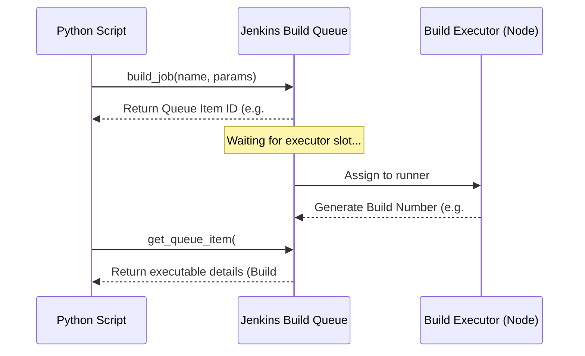

# Triggering Jenkins Builds: Automated Launch and Queue Monitoring

The core task of CI/CD orchestration is starting builds. For example, a version bump script might trigger a compile job, a QA workflow might start an automated test suite, or a deployment controller might trigger a staging release.

With `python-jenkins`, you can trigger basic builds as well as parameterized builds (e.g. specifying a git branch, deployment target, or version identifier).

However, triggering a build in Jenkins is asynchronous. Jenkins does not run jobs instantly; it places them into a **Build Queue** until a runner is free. To write reliable automation scripts, you must handle parameters correctly and poll the queue to track when your build starts and extract its build number.

In this guide, we will cover how to trigger jobs, format build parameters, query queue statuses, and track execution starts.

---

## The Build Trigger Lifecycle

When a script triggers a Jenkins job, it goes through several queue states:



---

## 1. Triggering a Basic Build

For simple jobs that do not require configuration inputs:

```python
import jenkins

server = jenkins.Jenkins("http://localhost:8080", username="admin", password="token")
job_name = "cleanup-temp-directories"

try:
    print(f"Triggering basic build for '{job_name}'...")
    # Trigger build (equivalent to clicking 'Build Now')
    server.build_job(job_name)
    print("✅ Build command sent to Jenkins queue.")
except Exception as e:
    print(f"Failed to trigger build: {e}")
```

---

## 2. Triggering Parameterized Builds

Parameterized jobs require key-value inputs. When triggering these jobs, pass a Python dictionary containing the parameter values to the `parameters` argument.

> [!IMPORTANT]
> Jenkins requires all parameters to be submitted as **string values**. If your job expects a boolean parameter (e.g., `RUN_TESTS`), pass the string `"true"` or `"false"` instead of Python's `True` or `False`. If your parameter is a number, pass it as a string (e.g. `"15"`).

```python
import jenkins

server = jenkins.Jenkins("http://localhost:8080", username="admin", password="token")
job_name = "deploy-microservice"

# Define build configuration parameters
build_parameters = {
    "GIT_BRANCH": "release-v2.3",
    "TARGET_ENVIRONMENT": "staging",
    "RUN_INTEGRATION_TESTS": "true", # Boolean passed as string
    "REPLICAS": "3"                  # Number passed as string
}

try:
    print(f"Triggering parameterized build for '{job_name}'...")
    server.build_job(job_name, parameters=build_parameters)
    print("✅ Parameterized build command sent successfully.")
except Exception as e:
    print(f"Failed to trigger build: {e}")
```

---

## 3. Resolving Build Numbers: Tracking the Queue

When you trigger a build with `server.build_job()`, Jenkins does not return the build number (e.g., Build #15) because it hasn't been assigned yet. Instead, it returns a **Queue Item ID** (e.g., Queue ID #405).

To track the build status, you must poll the queue item until the job starts running and extract the generated build number.

```python
import time
import jenkins

server = jenkins.Jenkins("http://localhost:8080", username="admin", password="token")
job_name = "deploy-microservice"

def trigger_and_track_build(job, params):
    try:
        # 1. Trigger the parameterized job and get the queue item ID
        queue_item_id = server.build_job(job, parameters=params)
        print(f"Job added to Jenkins queue. Queue Item ID: {queue_item_id}")
        
        build_number = None
        
        # 2. Poll the queue until the item starts executing
        # The queue item status will include 'executable' metadata once it starts
        while True:
            queue_info = server.get_queue_item(queue_item_id)
            
            # Check if the build has started
            if "executable" in queue_info:
                build_number = queue_info["executable"]["number"]
                print(f"\n🚀 Job has left the queue and is now running!")
                print(f"Build Number: #{build_number}")
                break
                
            # If still queued, check why (e.g., waiting for executors)
            elif "why" in queue_info:
                print(f"Queued status: {queue_info['why']}...", end="\r")
            else:
                print("Waiting in build queue...", end="\r")
                
            time.sleep(2)
            
        build_url = f"{server.server}/job/{job}/{build_number}/"
        print(f"🔗 Build URL: {build_url}")
        return build_number
        
    except Exception as e:
        print(f"\n❌ Error triggering build: {e}")
        return None

# Run the tracker
# params = {"GIT_BRANCH": "main"}
# trigger_and_track_build(job_name, params)
```

---

## Summary

Starting builds is the initial step in automating CI/CD tasks. Because Jenkins queues jobs asynchronously, you must extract the queue item ID and poll the queue to retrieve the actual build number. In the next section, we will cover how to **monitor build status and retrieve logs**.
