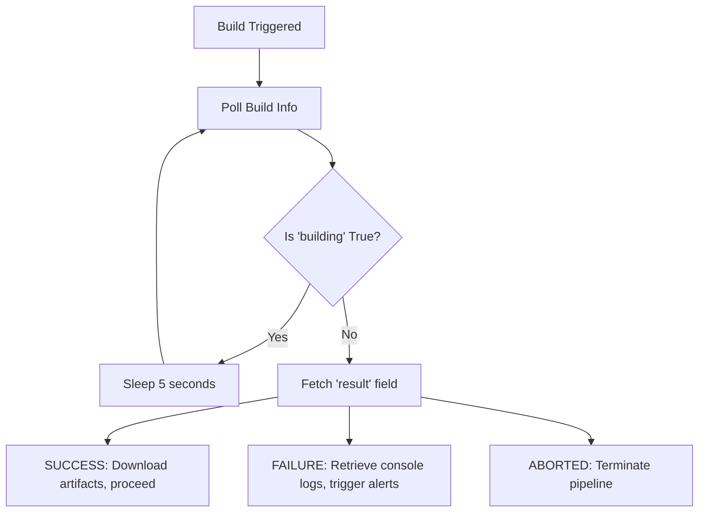

# Monitoring Build Status and Logs: Closed-Loop Automation

Triggering a Jenkins build is only half the task. To complete the automation loop, your script must monitor the build to check if it succeeds or fails. This allows you to orchestrate subsequent stages, notify teams of test results, download compiled artifacts, or initiate rollbacks on failure.

Using `python-jenkins`, you can poll active runs, evaluate results, stream console logs, and download archived build outputs.

In this guide, we will build a monitoring wrapper script that polls for build completion, extracts execution states, retrieves console logs, and downloads artifacts.

---

## The Build Status Lifecycle



---

## 1. Polling for Build Completion with Timeouts

When writing scripts that poll APIs, you must enforce timeouts. If a build hangs or an agent goes offline indefinitely, your script must time out and abort instead of running forever.

Here is a polling loop implementation:

```python
import time
import jenkins

server = jenkins.Jenkins("http://localhost:8080", username="admin", password="token")

def wait_for_build_completion(job, build_num, timeout_seconds=600, poll_interval=10):
    """
    Polls the status of an active build until completion or timeout.
    """
    print(f"Monitoring build #{build_num} of job '{job}'...")
    start_time = time.time()
    
    while time.time() - start_time < timeout_seconds:
        try:
            # Fetch build details dict
            build_info = server.get_build_info(job, build_num)
            
            # Check if the build is still running
            is_building = build_info.get("building", False)
            
            if not is_building:
                result = build_info.get("result")
                print(f"\n✅ Build completed with result: {result}")
                return result
            else:
                elapsed = int(time.time() - start_time)
                print(f"Build #{build_num} still running... (Elapsed: {elapsed}s)", end="\r")
                
        except Exception as e:
            print(f"\nError querying build status: {e}")
            
        time.sleep(poll_interval)
        
    print("\n❌ Timeout reached! Build did not complete within the limit.")
    return "TIMEOUT"
```

---

## 2. Fetching Console Logs on Failure

If a build fails, you need to analyze the logs to locate the error. You can download the entire console output using `get_build_console_output()`.

```python
import os
import jenkins

server = jenkins.Jenkins("http://localhost:8080", username="admin", password="token")

def save_console_logs(job, build_num, output_dir="./logs"):
    try:
        # Retrieve raw text output from the build console
        logs = server.get_build_console_output(job, build_num)
        
        os.makedirs(output_dir, exist_ok=True)
        log_filepath = os.path.join(output_dir, f"{job}_build_{build_num}.log")
        
        with open(log_filepath, "w", encoding="utf-8") as f:
            f.write(logs)
            
        print(f"✅ Console logs saved to: {log_filepath}")
        
        # Print the last 15 lines of log for quick inspection
        lines = logs.splitlines()
        print("\n--- Last 15 Console Log Lines ---")
        for line in lines[-15:]:
            print(line)
            
    except Exception as e:
        print(f"Failed to retrieve console output: {e}")
```

---

## 3. Downloading Archived Build Artifacts

If your Jenkins job packages output files (like compiled binaries, debian packages, or test reports) using the `archiveArtifacts` pipeline step, you can download them programmatically.

```python
import os
import requests
import jenkins

server = jenkins.Jenkins("http://localhost:8080", username="admin", password="token")

def download_build_artifacts(job, build_num, dest_dir="./downloads"):
    try:
        build_info = server.get_build_info(job, build_num)
        artifacts = build_info.get("artifacts", [])
        
        if not artifacts:
            print("No archived artifacts found for this build.")
            return False
            
        os.makedirs(dest_dir, exist_ok=True)
        print(f"Found {len(artifacts)} artifacts to download...")
        
        for artifact in artifacts:
            filename = artifact["fileName"]
            relative_path = artifact["relativePath"]
            
            # Construct download URL
            # Format: http://jenkins:8080/job/job_name/build_num/artifact/path/to/file
            download_url = f"{server.server}/job/{job}/{build_num}/artifact/{relative_path}"
            dest_filepath = os.path.join(dest_dir, filename)
            
            print(f"Downloading: {filename} from {download_url}...")
            
            # Download using requests with Jenkins credentials for private servers
            # Since Jenkins artifacts require authentication, we pass our API credentials
            response = requests.get(
                download_url, 
                auth=(server.username, server.password), 
                timeout=15, 
                stream=True
            )
            
            if response.status_code == 200:
                with open(dest_filepath, "wb") as f:
                    for chunk in response.iter_content(chunk_size=8192):
                        f.write(chunk)
                print(f"✅ Downloaded: {dest_filepath}")
            else:
                print(f"❌ Failed to download {filename}: HTTP {response.status_code}")
                
        return True
    except Exception as e:
        print(f"Error downloading artifacts: {e}")
        return False
```

---

## Summary

Monitoring build execution and capturing logs and artifacts allows you to build closed-loop CI/CD pipelines. If a test fails, you can parse the logs to extract details, and if it passes, you can immediately download the compiled code for deployment. In the next section, we will cover how to **manage and configure jobs** programmatically.
