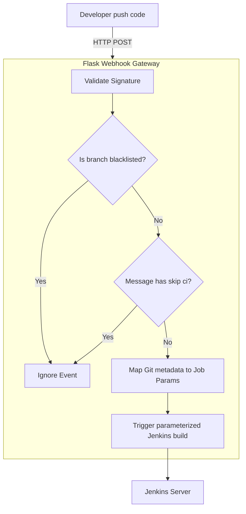

# Jenkins Webhooks: Building Custom Intermediate Triggers

While Jenkins has native plugins (like the Git plugin or GitHub integration plugin) that listen for pushes to trigger builds, using them directly has limitations. In complex enterprise environments, you often need an **intermediate mediator server**. 

An intermediate server allows you to:
1. **Filter triggers**: Only run builds if changes affect specific folders (monorepo setups) or if the commit message contains specific flags (e.g. `[skip ci]` checks).
2. **Coordinate actions**: Query security platforms or check target environment health before starting a build.
3. **Verify credentials**: Validate webhook signatures securely before passing requests to Jenkins.

In this guide, we will write a Python Flask webhook receiver that acts as an intermediate gateway. It receives GitHub push webhooks, parses branches, filters out branch exclusions, maps git metadata, and triggers parameterized Jenkins pipelines.

---

## Mediator Webhook Architecture



---

## Creating the Webhook Mediator Server

We will write a Flask server that:
1. Listens for POST requests from GitHub.
2. Extracts repository names, branch paths, and pusher details.
3. Excludes branches (e.g., skips drafts or debug branches).
4. Connects to Jenkins using the `python-jenkins` client to start a parameterized build.

Install dependencies:
```bash
pip install Flask python-jenkins requests
```

Save this file as `jenkins_mediator.py`:

```python
import os
import jenkins
from flask import Flask, request, jsonify

app = Flask(__name__)

# --- Configurations ---
# Jenkins connection details
JENKINS_URL = os.environ.get("JENKINS_URL", "http://localhost:8080")
JENKINS_USER = os.environ.get("JENKINS_USER", "admin")
JENKINS_TOKEN = os.environ.get("JENKINS_TOKEN", "your_api_token_here")
TARGET_JOB_NAME = "automated-service-deploy"

# Connect to Jenkins
server = jenkins.Jenkins(JENKINS_URL, username=JENKINS_USER, password=JENKINS_TOKEN)

# List of branches that should NOT trigger deployments
BRANCH_BLACKLIST = ["experimental", "draft-feature", "tmp-debug"]

def evaluate_build_trigger(branch_name, commit_message):
    """
    Business logic to evaluate if the push event warrants starting a Jenkins build.
    """
    # Rule 1: Exclude blacklisted branches
    if branch_name in BRANCH_BLACKLIST:
        print(f"Skipping build: Branch '{branch_name}' is blacklisted.")
        return False
        
    # Rule 2: Skip builds if commit message contains [skip ci] or [ci skip]
    if "[skip ci]" in commit_message.lower() or "[ci skip]" in commit_message.lower():
        print("Skipping build: Commit message contains bypass flag [skip ci].")
        return False
        
    return True

@app.route("/webhook/github", methods=["POST"])
def github_webhook_receiver():
    # 1. Verify this is a push event
    event_type = request.headers.get("X-GitHub-Event")
    
    if event_type == "ping":
        return jsonify({"message": "pong"}), 200
        
    if event_type != "push":
        return jsonify({"message": "Event ignored. Only push event is supported."}), 400

    payload = request.json
    if not payload:
        return jsonify({"message": "Malformed JSON payload."}), 400

    # 2. Extract repository and branch details
    ref = payload.get("ref", "") # e.g. 'refs/heads/main'
    branch_name = ref.replace("refs/heads/", "")
    repo_name = payload.get("repository", {}).get("full_name")
    
    # Get details of the latest commit in this push
    head_commit = payload.get("head_commit", {})
    commit_message = head_commit.get("message", "")
    commit_hash = head_commit.get("id", "unknown")
    pusher_name = payload.get("pusher", {}).get("name", "unknown")

    print(f"\nIncoming push event for: {repo_name} on branch '{branch_name}'")
    print(f"Commit message: '{commit_message}'")

    # 3. Evaluate build criteria
    if not evaluate_build_trigger(branch_name, commit_message):
        return jsonify({"status": "skipped", "reason": "Triage rules not met"}), 200

    # 4. Map git metadata to Jenkins job parameters
    job_parameters = {
        "GIT_BRANCH": branch_name,
        "COMMIT_HASH": commit_hash,
        "TRIGGER_SOURCE": f"Webhook Mediator (Pusher: {pusher_name})",
        # Auto-approve production deployments if pushed directly to main
        "AUTO_DEPLOY": "true" if branch_name == "main" else "false"
    }

    # 5. Trigger the Jenkins build
    try:
        if not server.job_exists(TARGET_JOB_NAME):
            print(f"Error: Jenkins job '{TARGET_JOB_NAME}' not found.")
            return jsonify({"status": "error", "message": "Target job not found"}), 500
            
        print(f"Triggering build for: '{TARGET_JOB_NAME}'...")
        queue_item_id = server.build_job(TARGET_JOB_NAME, parameters=job_parameters)
        print(f"✅ Job triggered successfully. Queue Item: #{queue_item_id}")
        
        return jsonify({
            "status": "triggered",
            "branch": branch_name,
            "queue_id": queue_item_id
        }), 202
        
    except Exception as e:
        print(f"❌ Failed to communicate with Jenkins: {e}")
        return jsonify({"status": "error", "message": str(e)}), 500

if __name__ == "__main__":
    # Run the server locally on port 5000
    app.run(port=5000)
```

---

## Configuring the Pipeline Parameters in Jenkins

For the above script to work, the Jenkins job (`automated-service-deploy`) must be configured to accept the parameters:
1. Open the job configuration page in the Jenkins web UI.
2. Check the box **This project is parameterized**.
3. Add **String Parameters** with the following names:
   * `GIT_BRANCH`
   * `COMMIT_HASH`
   * `TRIGGER_SOURCE`
   * `AUTO_DEPLOY`

You can access these parameters in a Jenkins Pipeline script:

```groovy
pipeline {
    agent any
    parameters {
        string(name: 'GIT_BRANCH', defaultValue: 'main')
        string(name: 'COMMIT_HASH', defaultValue: '')
        string(name: 'TRIGGER_SOURCE', defaultValue: 'manual')
        string(name: 'AUTO_DEPLOY', defaultValue: 'false')
    }
    stages {
        stage('Deploy') {
            steps {
                echo "Trigger source: ${params.TRIGGER_SOURCE}"
                echo "Deploying branch: ${params.GIT_BRANCH} (Commit: ${params.COMMIT_HASH})"
            }
        }
    }
}
```

---

## Summary

Building intermediate webhook receivers gives you total control over build trigger conditions. By validating commit messages and branch names in Python before forwarding them to Jenkins, you can build cleaner pipelines and reduce workload on your build runners. In the next chapter, we will cover **Pipeline Scripting**.
