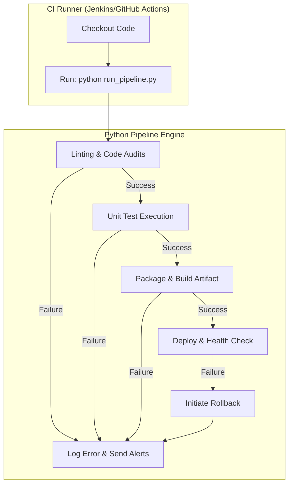

# Pipeline Automation Patterns: Building Robust Runner Engines

Pipeline scripting coordinates build, test, and deployment steps into a cohesive, automated delivery workflow. While CI servers (such as Jenkins, GitHub Actions, or GitLab CI) provision build nodes, writing the core step logic directly in platform-specific scripts (like Jenkins Groovy files or complex YAML constructs) is a anti-pattern. 

It locks your workflows to a single CI vendor, makes local testing impossible, and turns pipeline configuration changes into slow, commit-and-wait cycles.

A better pattern is **Platform-Agnostic Pipeline Orchestration**. You write your core compilation, testing, packaging, and validation logic in modular Python scripts stored inside your code repository. The CI server simply checks out the code and calls your Python scripts.

In this guide, we will explore the design patterns of Python pipeline runners, implement a sequential step executor with error trapping, and manage configurations across multiple environments.

---

## Architecture: Platform-Agnostic Execution

By moving build logic into Python, you decouple pipeline orchestration from the CI host:



---

## 1. The Sequential Step Runner Pattern

A pipeline consists of steps run in a specific order. If any step fails, the pipeline must stop immediately, print the log output of the failing step, run cleanup routines, and exit with a non-zero code to notify the CI runner.

Here is a structured, object-oriented pipeline runner implementation:

```python
import sys
import os
import subprocess
import time
from datetime import datetime

class PipelineStep:
    def __init__(self, name, command_args):
        self.name = name
        self.command_args = command_args

    def execute(self):
        print(f"\n==================================================")
        print(f"▶️ [{datetime.now().strftime('%H:%M:%S')}] Starting Step: {self.name}")
        print(f"Command: {' '.join(self.command_args)}")
        print(f"==================================================")
        
        start_time = time.time()
        try:
            # Run the command and stream output directly to stdout/stderr in real time
            result = subprocess.run(
                self.command_args, 
                check=True, 
                text=True
            )
            duration = time.time() - start_time
            print(f"✅ Step '{self.name}' passed. (Duration: {duration:.2f}s)")
            return True
        except subprocess.CalledProcessError as e:
            duration = time.time() - start_time
            print(f"❌ Step '{self.name}' failed with exit code {e.returncode}! (Duration: {duration:.2f}s)")
            return False

class PipelineEngine:
    def __init__(self):
        self.steps = []

    def add_step(self, name, command_args):
        self.steps.append(PipelineStep(name, command_args))

    def run(self):
        start_time = time.time()
        print("🚀 Starting Pipeline Engine...")
        
        for step in self.steps:
            success = step.execute()
            if not success:
                print("\n❌ Pipeline aborted due to step failure!")
                sys.exit(1) # Exit immediately with failure status
                
        total_duration = time.time() - start_time
        print(f"\n🎉 Pipeline completed successfully! (Total Time: {total_duration:.2f}s)")
        sys.exit(0) # Exit with success status
```

---

## 2. Multi-Environment Configurations

Pipelines must adapt to different deploy environments (Development, Staging, Production). Instead of hardcoding environment-specific values, use environment variables to configure your pipeline parameters.

Here is a parameterized pipeline runner that adjusts its stages based on the target environment:

```python
# Save this file as run_pipeline.py
# (Requires the classes defined in the previous section)

def run_environment_pipeline():
    # 1. Fetch target environment, defaulting to 'development'
    environment = os.environ.get("DEPLOY_ENV", "development").lower()
    print(f"Deploy Target: {environment.upper()}")
    
    engine = PipelineEngine()
    
    # 2. Add baseline check steps (run in all environments)
    engine.add_step("Linting Checks", ["flake8", "."])
    engine.add_step("Unit Test Suite", ["pytest", "tests/unit"])
    
    # 3. Add environment-specific deployment and packaging steps
    if environment == "production":
        print("🔒 Production environment detected: Enforcing strict compliance checks.")
        # Add dependency security scanning before packaging
        engine.add_step("Security Audit", ["safety", "check"])
        engine.add_step("Build Release Package", ["python", "-m", "build"])
        # Production deployment
        engine.add_step("Deploy to Production", ["python", "scripts/deploy.py", "--env", "prod"])
        
    elif environment == "staging":
        print("🧪 Staging environment detected: Configuring integration checks.")
        engine.add_step("Build Staging Package", ["python", "-m", "build"])
        engine.add_step("Deploy to Staging", ["python", "scripts/deploy.py", "--env", "staging"])
        # Run heavy database integration test suites on staging
        engine.add_step("Integration Tests", ["pytest", "tests/integration"])
        
    else:
        print("💻 Development environment detected: Skipping packaging and deployments.")
        
    # Execute the configured pipeline
    engine.run()

if __name__ == "__main__":
    run_environment_pipeline()
```

---

## 3. Best Practices for Writing Clean Pipeline Runners

1. **Avoid Global State**: Do not share mutable variables between pipeline steps. If Step 3 needs a build version calculated in Step 2, write that value to a file (like `build_version.txt`) or pass it via standard output, rather than relying on global variables.
2. **Clean up Resources (Always)**: Wrap operations that allocate resources (like creating virtual environments or launching Docker containers) inside `try...finally` blocks to ensure they are cleaned up even if steps fail.
3. **Capture Failures at the Source**: Ensure your shell commands return correct exit codes on failure. Python's `subprocess.run(..., check=True)` depends on non-zero exit codes to detect failures.
4. **Log Timestamps**: Standardize log formatting to print timestamps at the start of each step. This allows developers to locate bottlenecks and optimize build times.

---

## Summary

Writing your pipeline workflows in Python allows you to build platform-agnostic, easily testable execution scripts. In the next section, we will cover how to **automate alerts and notifications** to keep your team informed of build outcomes.
