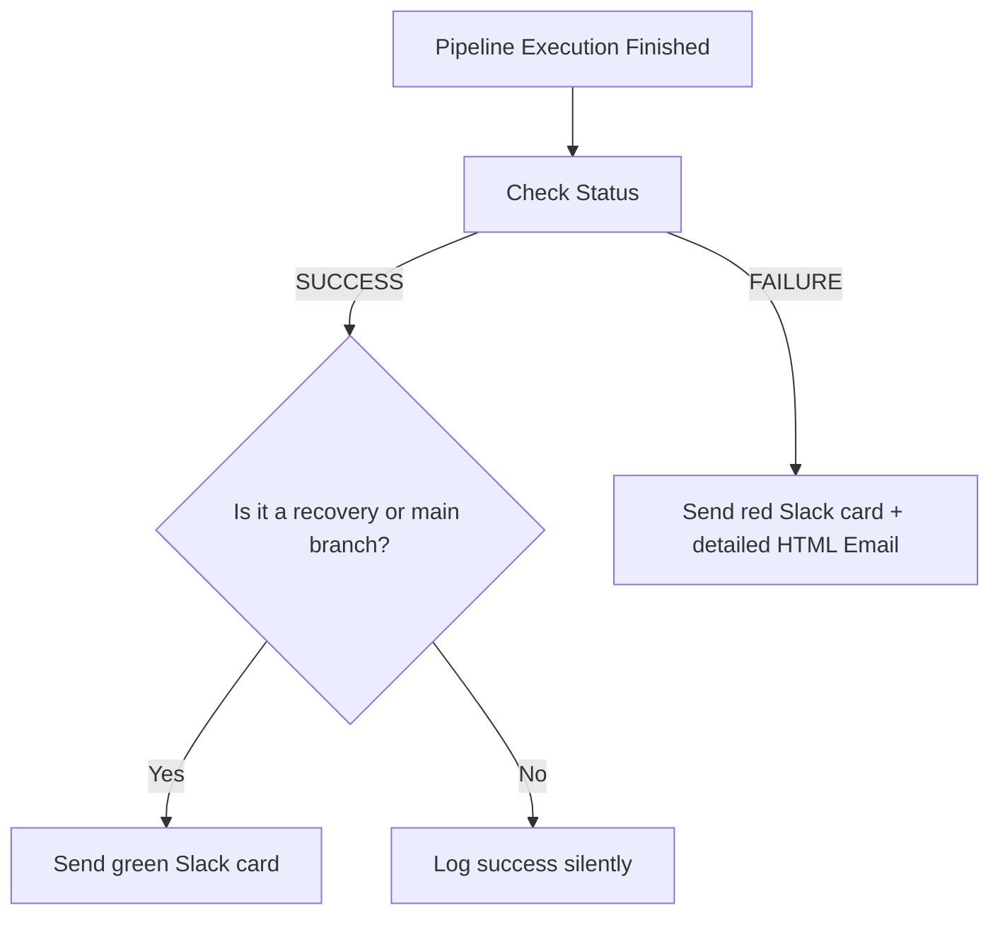

# Notification Automation: Slack, Email, and Pipeline Reporting

When a CI/CD pipeline runs, it does so in a headless environment. Developers do not sit and watch terminal outputs. Your automation scripts must notify the team when changes occur, or more importantly, when a build breaks.

However, poorly designed alert systems can lead to **notification fatigue**. If a script sends a separate Slack message for every successful build or alerts the entire team about a warning on a private test branch, developers will mute the channel.

In this guide, we will design an automated notification system in Python. We will cover how to send structured Slack alerts with color-coded severity headers, format rich HTML emails with test reports, extract git metadata to provide context, and apply best practices to keep alerts readable.

---

## Designing Effective Alerts

An alert is only useful if it provides enough context for a developer to immediately understand the issue and fix it. An effective alert should contain:
* **The Status**: Is the build failing (`❌`) or has it recovered (`✅`)?
* **The Location**: Which repository, branch, and commit hash triggered this build?
* **The Culprit**: Who committed the changes (the Git author)?
* **Actionable Next Steps**: A direct hyperlink to the build logs and the specific error stack trace.



---

## 1. Sending Structured Slack Notifications

Slack Incoming Webhooks allow you to post structured message cards using JSON payloads. We will use the `attachments` block to add a colored sidebar representing the severity of the alert.

```python
import os
import requests

def send_slack_pipeline_alert(job_name, status, build_url, git_branch, git_author, error_summary=None):
    webhook_url = os.environ.get("SLACK_WEBHOOK_URL")
    if not webhook_url:
        print("Warning: SLACK_WEBHOOK_URL not configured. Skipping Slack notification.")
        return False

    # Define color and emoji based on status
    if status.upper() == "SUCCESS":
        color = "#36a64f" # Green
        emoji = "✅"
    elif status.upper() == "WARNING":
        color = "#ff9900" # Orange
        emoji = "⚠️"
    else:
        color = "#ff0000" # Red
        emoji = "❌"

    # Construct the JSON payload
    payload = {
        "text": f"{emoji} *Pipeline Status Update: {job_name}*",
        "attachments": [
            {
                "color": color,
                "title": f"Build Details - #{job_name}",
                "title_link": build_url,
                "mrkdwn_in": ["text"],
                "text": (
                    f"• *Status:* {status.upper()}\n"
                    f"• *Branch:* `{git_branch}`\n"
                    f"• *Author:* {git_author}\n" +
                    (f"• *Error:* `{error_summary}`" if error_summary else "")
                )
            }
        ]
    }

    try:
        response = requests.post(webhook_url, json=payload, timeout=5)
        if response.status_code == 200:
            print("Slack pipeline alert sent successfully.")
            return True
        else:
            print(f"Slack API error: {response.status_code} - {response.text}")
            return False
    except Exception as e:
        print(f"Failed to connect to Slack API: {e}")
        return False
```

---

## 2. Formatting Rich HTML Email Summaries

Sometimes your team needs a detailed report of a build, such as compiler warnings, dependency licenses, or unit test details. We can use Python's built-in `smtplib` and `email.mime` modules to format and send HTML-based email alerts.

```python
import os
import smtplib
from email.mime.text import MIMEText
from email.mime.multipart import MIMEMultipart

def send_html_email_report(job_name, status, test_stats, logs_snippet):
    smtp_server = os.environ.get("SMTP_SERVER", "smtp.gmail.com")
    smtp_port = int(os.environ.get("SMTP_PORT", 587))
    sender_email = os.environ.get("SENDER_EMAIL")
    sender_password = os.environ.get("SENDER_PASSWORD")
    recipient_email = os.environ.get("RECIPIENT_EMAIL")

    if not all([sender_email, sender_password, recipient_email]):
        print("Warning: SMTP credentials missing. Skipping email notification.")
        return False

    # Create root message container
    msg = MIMEMultipart("alternative")
    msg["Subject"] = f"[{status.upper()}] Build Report for {job_name}"
    msg["From"] = sender_email
    msg["To"] = recipient_email

    # Format the HTML body with styles
    status_color = "green" if status.upper() == "SUCCESS" else "red"
    
    html = f"""
    <html>
      <body style="font-family: Arial, sans-serif; color: #333; line-height: 1.6;">
        <h2 style="color: #2c3e50;">Pipeline Report: {job_name}</h2>
        <p><strong>Status:</strong> 
          <span style="color: {status_color}; font-weight: bold; font-size: 1.2em;">
            {status.upper()}
          </span>
        </p>
        <hr style="border: 0; border-top: 1px solid #eee;" />
        
        <h3>Test Statistics</h3>
        <table border="1" cellpadding="5" cellspacing="0" style="border-collapse: collapse; width: 100%; max-width: 400px;">
          <tr style="background-color: #f8f9fa;">
            <th>Metric</th>
            <th>Value</th>
          </tr>
          <tr><td>Total Tests Run</td><td>{test_stats.get('total', 0)}</td></tr>
          <tr style="color: green;"><td>Passed</td><td>{test_stats.get('passed', 0)}</td></tr>
          <tr style="color: red;"><td>Failed</td><td>{test_stats.get('failed', 0)}</td></tr>
        </table>
        
        <h3>Failure Logs Snippet</h3>
        <pre style="background-color: #f4f4f4; padding: 10px; border: 1px solid #ddd; overflow-x: auto; max-height: 300px; font-family: Courier, monospace;">
{logs_snippet}
        </pre>
        <p style="font-size: 0.8em; color: #888;">This is an automated notification from your CI/CD runner.</p>
      </body>
    </html>
    """
    
    msg.attach(MIMEText(html, "html"))

    try:
        with smtplib.SMTP(smtp_server, smtp_port) as server:
            server.starttls()
            server.login(sender_email, sender_password)
            server.send_message(msg)
            print("✅ HTML Email report sent successfully.")
            return True
    except Exception as e:
        print(f"Failed to send email: {e}")
        return False
```

---

## 3. Best Practices to Prevent Notification Noise

1. **Only Notify on State Changes**: 
   If a build runs successfully 50 times a day, posting 50 success messages to Slack is spam. Configure your notifier to only post a success alert if the *previous* build failed (representing a recovery).
2. **Excluding Branch noise**: 
   Restrict automated slack messages to main branches (e.g., `main`, `release/*`). Do not notify the shared team channel about errors on private feature branches.
3. **Use Threading**: 
   If your pipeline sends multiple updates (start, build, test, deploy), avoid posting multiple separate messages. Instead, save the timestamp (`ts`) returned by the first Slack post, and send subsequent updates as threaded replies using the `thread_ts` parameter.

---

## Summary

Automating pipeline notifications bridges the gap between running background scripts and human team coordination. By formatting structured Slack cards and detailed HTML emails containing Git author references, your team can instantly resolve issues. In the next section, we will cover **Artifact Management**.
