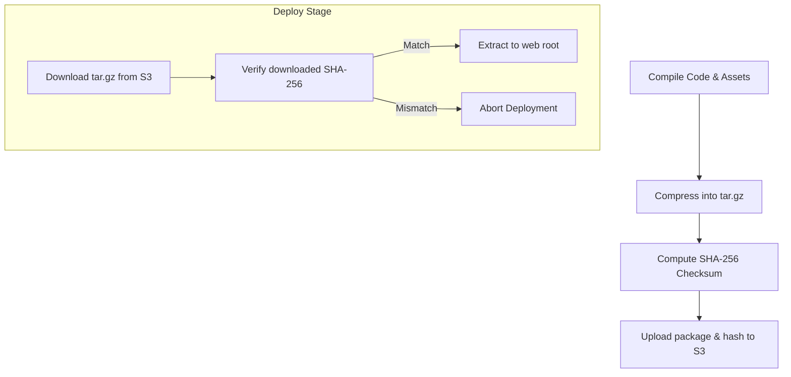

# Artifact Management: Packaging, Integrity, and Storage

In a modular CI/CD pipeline, the **Build** phase and the **Deploy** phase are separated. This decoupling ensures that you build code once, verify it, and deploy the exact same compiled package across Staging and Production.

The output generated by the build phase is called a **build artifact** (e.g. compiled binaries, web asset zip files, Debian packages, or JAR files). 

To manage artifacts programmatically using Python, your scripts must:
1. **Compress**: Bundle files into a single, portable archive (e.g. `.tar.gz`).
2. **Verify**: Calculate a cryptographic checksum (e.g. SHA-256) to ensure the file is not corrupted during transmission.
3. **Store**: Upload the package and its checksum to an artifact repository (like AWS S3, Nexus, or Artifactory).

In this guide, we will write a Python script that packages build folders, generates integrity verification checksums, and uploads files to remote storage.

---

## The Build-to-Deploy Lifecycle



---

## 1. Packaging Build Outputs

Python's built-in `tarfile` and `zipfile` modules allow you to compile directories into compressed archives. For Linux systems, `.tar.gz` is the standard deployment format.

```python
import tarfile
import os

def create_tar_archive(source_dir, output_filename):
    """
    Recursively compresses a directory into a tar.gz archive.
    """
    if not os.path.exists(source_dir):
        print(f"Error: Source directory '{source_dir}' does not exist.")
        return False
        
    print(f"Creating archive {output_filename} from {source_dir}...")
    try:
        with tarfile.open(output_filename, "w:gz") as tar:
            # arcname=os.path.basename ensures files are extracted relatively, 
            # preventing absolute path nesting inside the tarball
            tar.add(source_dir, arcname=os.path.basename(source_dir))
            
        file_size_mb = os.path.getsize(output_filename) / (1024 * 1024)
        print(f"✅ Archive created. Size: {file_size_mb:.2f} MB")
        return True
    except Exception as e:
        print(f"Failed to create archive: {e}")
        return False
```

---

## 2. Generating SHA-256 Checksums for Integrity

To guarantee that your artifact is not modified or corrupted while uploading or downloading, calculate its SHA-256 hash. Upload this hash alongside your build file. During deployment, calculate the hash again and verify it matches the source.

```python
import hashlib

def generate_file_sha256(filepath):
    """
    Calculates the SHA-256 checksum of a file.
    Reads the file in blocks to avoid loading huge files into memory.
    """
    sha256_hash = hashlib.sha256()
    try:
        with open(filepath, "rb") as f:
            # Read in 64 Kilobyte chunks
            for byte_block in iter(lambda: f.read(65536), b""):
                sha256_hash.update(byte_block)
                
        checksum = sha256_hash.hexdigest()
        print(f"File Checksum: {checksum}")
        return checksum
    except FileNotFoundError:
        print(f"Error: File '{filepath}' not found.")
        return None
```

---

## 3. Uploading to Artifact Storage (S3 Example)

Once your artifact is packaged and verified, upload it to your object storage bucket. We will use the `boto3` library to send files to AWS S3.

Install Boto3:
```bash
pip install boto3
```

Here is the upload script:

```python
import boto3
from botocore.exceptions import NoCredentialsError, ClientError

def upload_to_s3(local_file, bucket, s3_key):
    """
    Uploads a file to an Amazon S3 bucket.
    """
    # Initialize the S3 client
    # Credentials are automatically loaded from env or AWS configuration profiles
    s3_client = boto3.client('s3')
    
    try:
        print(f"Uploading '{local_file}' to s3://{bucket}/{s3_key}...")
        s3_client.upload_file(local_file, bucket, s3_key)
        print("✅ Upload completed successfully.")
        return True
    except FileNotFoundError:
        print("Error: The local file was not found.")
        return False
    except NoCredentialsError:
        print("Error: AWS credentials were not found.")
        return False
    except ClientError as e:
        print(f"AWS API Error: {e}")
        return False
```

---

## Complete Pipeline Integration: Package and Upload

Here is a complete script that coordinates the build packaging, hashing, and remote upload:

```python
import os

def run_artifact_upload_pipeline():
    # Configuration details
    build_dir = "./dist"
    archive_name = "application-build.tar.gz"
    s3_bucket = "my-company-builds"
    s3_key_path = f"artifacts/{archive_name}"
    
    # 1. Package the build folder
    if not create_tar_archive(build_dir, archive_name):
        print("Pipeline aborted: Packaging failed.")
        return False
        
    # 2. Generate the checksum
    checksum = generate_file_sha256(archive_name)
    if not checksum:
        print("Pipeline aborted: Checksum generation failed.")
        return False
        
    # Write the checksum to a local metadata file
    checksum_file = f"{archive_name}.sha256"
    with open(checksum_file, "w", encoding="utf-8") as f:
        f.write(checksum)
        
    # 3. Upload both the archive and the checksum metadata file to S3
    archive_uploaded = upload_to_s3(archive_name, s3_bucket, s3_key_path)
    meta_uploaded = upload_to_s3(checksum_file, s3_bucket, f"{s3_key_path}.sha256")
    
    # Clean up local temporary files
    if os.path.exists(archive_name):
        os.remove(archive_name)
    if os.path.exists(checksum_file):
        os.remove(checksum_file)
        
    if archive_uploaded and meta_uploaded:
        print("🎉 Artifact management pipeline finished successfully!")
        return True
        
    return False

# if __name__ == "__main__":
#     run_artifact_upload_pipeline()
```

---

## Summary

Artifact management separates your builds from deployments, ensuring you are deploying the exact same files that passed verification. Compressing files, generating verification checksums, and uploading them to remote object storage creates a clean, repeatable build cycle. In the next section, we will cover **Deployment Automation**.
