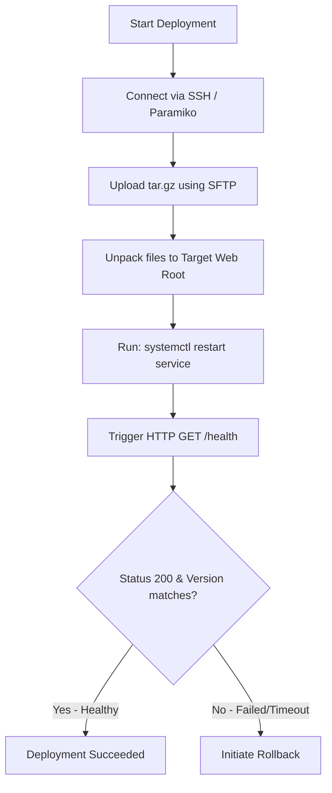

# Deployment Automation: Remote Deployments and Post-Deploy Checks

Deployment automation is the process of taking verified build artifacts and installing them on target staging or production servers. A deployment script needs to upload the package to the target server, extract the files, update system configurations, restart the application services (e.g. systemd or Docker containers), and verify the deployment.

You should never assume a deployment succeeded just because the files were transferred. A syntax error in a configuration file or a database connection timeout can cause the application to crash immediately after restarting. Therefore, **post-deployment health check validation** is a requirement.

In this guide, we will write a Python script that uploads an archive to a remote server using Paramiko (SSH/SFTP), extracts it, restarts the systemd service, and monitors a web health endpoint to verify the deployment.

---

## Deployment and Verification Flow



---

## 1. Remote Execution and Uploads using Paramiko

We use the **Paramiko** library to establish SSH connections and upload files via SFTP to our deployment targets.

Install Paramiko:
```bash
pip install paramiko requests
```

Here is the SSH deployment function:

```python
import os
import paramiko

def execute_remote_deployment(host, username, key_path, local_file, target_dir, service_name):
    """
    Connects to a remote server via SSH, uploads an archive, extracts it, and restarts the service.
    """
    ssh = paramiko.SSHClient()
    ssh.set_missing_host_key_policy(paramiko.AutoAddPolicy())
    
    try:
        # 1. Establish SSH connection
        print(f"Connecting to remote server {host}...")
        ssh.connect(hostname=host, username=username, key_filename=key_path, timeout=10)
        
        # 2. Upload file via SFTP
        print("Opening SFTP channel...")
        sftp = ssh.open_sftp()
        filename = os.path.basename(local_file)
        remote_file_path = os.path.join(target_dir, filename).replace('\\', '/')
        
        print(f"Uploading local file {local_file} to {remote_file_path}...")
        sftp.put(local_file, remote_file_path)
        sftp.close()
        
        # 3. Execute extraction and restart commands
        print("Unpacking files and restarting service...")
        
        # We chain commands: unpack the archive, delete the temporary tarball, and restart the service
        commands = [
            f"tar -xzf {remote_file_path} -C {target_dir}",
            f"rm -f {remote_file_path}",
            f"sudo systemctl restart {service_name}"
        ]
        
        for cmd in commands:
            print(f"Executing: {cmd}")
            stdin, stdout, stderr = ssh.exec_command(cmd)
            
            # Wait for command completion and capture exit status
            exit_status = stdout.channel.recv_exit_status()
            
            if exit_status != 0:
                error_msg = stderr.read().decode('utf-8')
                print(f"❌ Command failed: '{cmd}'. Stderr: {error_msg}")
                return False
                
        print("✅ Remote deployment commands completed successfully.")
        return True
        
    except Exception as e:
        print(f"❌ SSH Deployment failed: {e}")
        return False
    finally:
        ssh.close()
```

---

## 2. Post-Deployment Health Verification

After restarting the application, your script should poll the service's HTTP health check endpoint (typically `/health` or `/status`) to verify it is running the correct version and is healthy.

We will write a verification loop that uses **exponential backoff** (waiting progressively longer between retries) to give the application time to initialize.

```python
import time
import requests

def verify_app_health(health_url, expected_version, max_retries=5):
    """
    Polls the health endpoint to confirm the server is running the new version.
    """
    print(f"Starting post-deployment checks on {health_url}...")
    
    # Initialize retry delay (in seconds)
    delay = 2
    
    for i in range(1, max_retries + 1):
        try:
            response = requests.get(health_url, timeout=5)
            
            if response.status_code == 200:
                data = response.json()
                active_version = data.get("version")
                status = data.get("status")
                
                if status == "healthy" and active_version == expected_version:
                    print(f"✅ Success! App is healthy. Active version: {active_version}")
                    return True
                else:
                    print(f"⚠️ Attempt {i}: App returned unhealthy state or version mismatch: {data}")
            else:
                print(f"⚠️ Attempt {i}: Received HTTP status code {response.status_code}")
                
        except requests.RequestException as e:
            print(f"⚠️ Attempt {i}: Failed to connect. Error: {e}")
            
        if i < max_retries:
            print(f"Sleeping {delay}s before retrying...")
            time.sleep(delay)
            # Double the delay for the next retry (exponential backoff)
            delay *= 2
            
    print("❌ Deployment validation failed! Application did not recover.")
    return False
```

---

## Complete Deployment Orchestrator

Here is how you integrate the upload, execution, and health validation steps into a unified script:

```python
def run_deployment_pipeline():
    # Target configurations
    host = "192.168.1.50"
    username = "deploy-user"
    key_path = "/home/runner/.ssh/deploy_key"
    local_artifact = "./application-build.tar.gz"
    target_dir = "/var/www/my-app"
    service_name = "my-web-app.service"
    
    health_check_url = "http://192.168.1.50/health"
    deploy_version = "1.4.2"
    
    # 1. Execute the deployment
    deploy_success = execute_remote_deployment(
        host=host,
        username=username,
        key_path=key_path,
        local_file=local_artifact,
        target_dir=target_dir,
        service_name=service_name
    )
    
    if not deploy_success:
        print("Deployment aborted due to SSH command failure.")
        return False
        
    # 2. Wait 3 seconds for the application startup routine to begin
    time.sleep(3)
    
    # 3. Run health check validation
    validation_success = verify_app_health(health_check_url, deploy_version)
    
    if validation_success:
        print("🎉 Service successfully deployed and validated!")
        return True
    else:
        print("🚨 Deployment failed validation! A rollback is required.")
        return False

# if __name__ == "__main__":
#     run_deployment_pipeline()
```

---

## Summary

Automating deployments removes manual server tasks and ensures deployments are repeatable. By validating the deployment with post-deploy health checks, you can immediately identify broken deployments. In the next section, we will cover how to **automate rollbacks** if the health validation checks fail.
