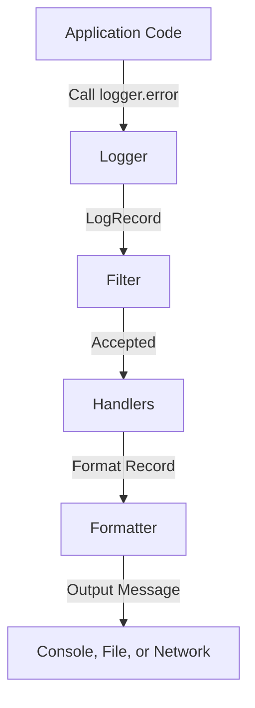
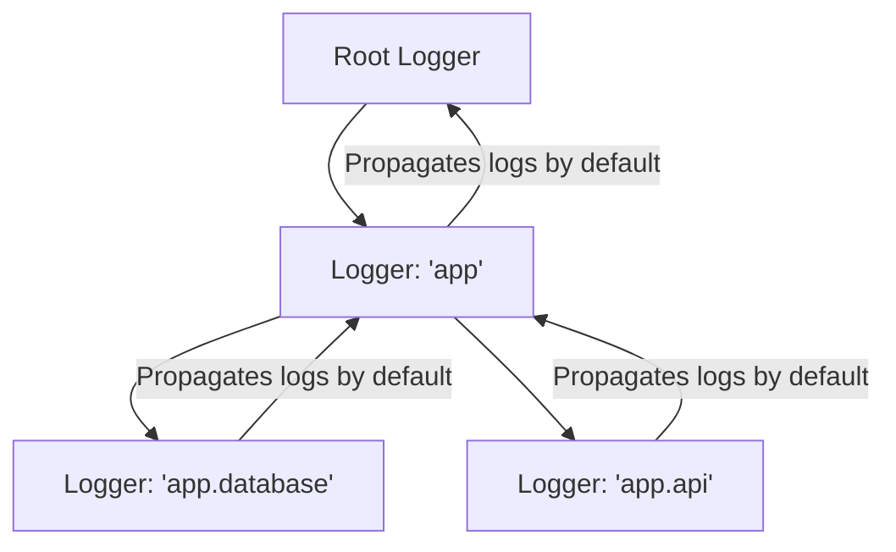

# Logging Module Overview: Designing System Observability

When writing automation scripts and daemon services, you cannot sit in front of the console and look at outputs. If a script fails at midnight, you need a record of what happened before the crash. 

Historically, developers use `print()` statements to output debug messages. While print statements are simple, they are a major anti-pattern in production DevOps code. Print statements lack severity thresholds, cannot be easily redirected to files or log servers, and do not capture critical context like timestamps, execution threads, or line numbers.

Python includes a powerful built-in **`logging`** module. It provides a thread-safe, flexible, and hierarchical system for tracking runtime events.

In this guide, we will compare logging with prints, detail the core architecture of the logging framework, examine the hierarchical propagation tree, and configure basic global logger states.

---

## Logging vs. Print Statements

Here is a comparison of print statements and logging to help you understand why logging is required for production scripts:

| Feature / Capability | Print Statements (`print()`) | Python Logging Module (`logging`) |
| :--- | :--- | :--- |
| **Severity Levels** | None (All messages are equal) | 5 standard levels (DEBUG, INFO, WARNING, etc.) |
| **Output Targets** | Standard stdout (hard to redirect) | Multiple (Console, Files, Syslog, Email, Sockets) |
| **Thread Safety** | Poor (Outputs can overwrite/interleave) | High (Thread-safe lock allocations) |
| **Runtime Toggles** | Cannot disable without editing code | Change level threshold via environment configuration |
| **Audit Context** | Message text only | Captures timestamp, line number, PID, and thread |

---

## Core Components of the Logging Framework

The logging module is organized around four core classes:

1. **Loggers**: The main entry point. Your application code calls methods on a logger (e.g., `logger.info("Service started")`) to generate log events.
2. **Handlers**: Determine where the log message goes. A single logger can have multiple handlers (e.g. sending logs to the console AND saving them to a log file).
3. **Formatters**: Define the layout and structure of the final string output (e.g. prepending timestamps or formatting as JSON).
4. **Filters**: Provide fine-grained control to determine which log records should be processed or modified.



---

## The Logger Hierarchy and Propagation Tree

Loggers in Python are organized hierarchically using **dot notation** (e.g., `app.database`, `app.api.auth`). The logger named `app` is the parent of `app.database`. At the top of the tree sits the **Root Logger**.

When a log message is generated on a child logger:
1. The child logger evaluates if the message meets its configured level threshold.
2. If it passes, the message is sent to the child logger's handlers.
3. The message then **propagates** up the tree to the parent logger's handlers, and continues up to the root logger's handlers.



You can disable this propagation behavior by setting `logger.propagate = False`.

---

## 1. Quick Global Setup with `basicConfig`

The fastest way to configure your logging system is using `logging.basicConfig()`. This sets up default handlers and formatters on the root logger.

```python
import logging

# Configure global logging settings
logging.basicConfig(
    level=logging.INFO, # Capture INFO, WARNING, ERROR, and CRITICAL logs
    format="%(asctime)s [%(levelname)s] (%(filename)s:%(lineno)d) - %(message)s",
    datefmt="%Y-%m-%d %H:%M:%S"
)

# Test log levels
logging.debug("This is a DEBUG message. (Will not print: INFO threshold)")
logging.info("This is an INFO message. (Will print)")
logging.warning("This is a WARNING message. (Will print)")
```

### Limitations of `basicConfig`
While `basicConfig` is great for simple scripts, calling it multiple times has no effect. The first call configures the system, and subsequent calls are ignored. For complex applications, you should construct loggers, handlers, and formatters manually.

---

## 2. Manual Configuration Example

Here is how you instantiate loggers manually, customize propagation, and add dedicated handlers:

```python
import logging

def configure_custom_logger():
    # 1. Create a named logger
    # In files, standard practice is to use __name__ to match file hierarchy
    logger = logging.getLogger("app.db")
    logger.setLevel(logging.DEBUG) # Base logger captures everything

    # Disable propagation to prevent root logger from duplicates
    logger.propagate = False

    # 2. Create a console handler
    console_handler = logging.StreamHandler()
    console_handler.setLevel(logging.INFO) # Console only prints INFO and above

    # 3. Create a formatter and attach it to the handler
    formatter = logging.Formatter("%(name)s - %(levelname)s - %(message)s")
    console_handler.setFormatter(formatter)

    # 4. Attach handler to the logger
    logger.addHandler(console_handler)

    # --- Test logs ---
    logger.debug("Connecting to database...") # Ignored by handler (DEBUG < INFO)
    logger.info("Database connection established.") # Printed
    logger.error("Failed to execute SQL query!") # Printed

if __name__ == "__main__":
    configure_custom_logger()
```

---

## Summary

The Python logging module provides a flexible, hierarchical logging framework. By organizing loggers using dot notation and configuring multiple handlers, you can route runtime data to the correct destinations. In the next section, we will cover **Log Levels** in detail.
