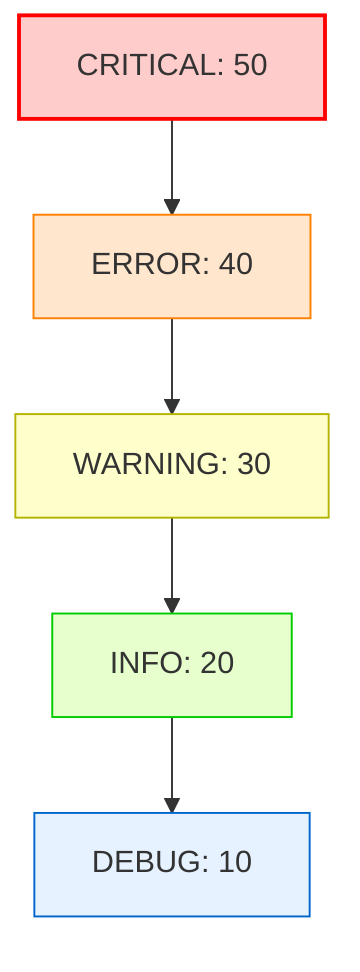

# Log Levels: Managing Message Severity

Log levels categorize log events by severity. By assigning levels, you can filter messages depending on the execution environment. For example, you want verbose debug logs when running a script locally on a laptop, but only error alerts when running the service in production.

In this guide, we will examine the numeric value hierarchy of standard log levels, define when to use each level, and implement custom log levels in Python.

---

## The Log Level Hierarchy

Python's `logging` module defines five standard levels. Each level is associated with an integer value. When you configure a logger with a specific level threshold, it will process logs at that level and any level with a higher numeric value.

| Level Name | Numeric Value | Description | Use Case |
| :--- | :--- | :--- | :--- |
| **`CRITICAL`** | `50` | Fatal errors that cause the program to halt. | Ports blocked, database unreachable. |
| **`ERROR`** | `40` | Serious errors where an operation failed. | API request failed, user signup error. |
| **`WARNING`** | `30` | Unexpected conditions that do not halt execution. | Disk space low, deprecated API usage. |
| **`INFO`** | `20` | General confirmation of system milestones. | Server started, backup finished. |
| **`DEBUG`** | `10` | High-verbosity diagnostics for debugging. | Variables states, connection status. |
| **`NOTSET`** | `0` | Default state. Inherits parent's level. | Root logger defaults to `WARNING`. |



---

## 1. Emitting Standard Log Levels

To emit a log, call the corresponding method on your logger object:

```python
import logging

# Set threshold to INFO (logs at INFO, WARNING, ERROR, CRITICAL are printed)
logging.basicConfig(level=logging.INFO)
logger = logging.getLogger("system_status")

logger.debug("Parsing system metrics...")          # Ignored (10 < 20)
logger.info("Service backup completed.")            # Printed (20 >= 20)
logger.warning("Egress network traffic spike!")     # Printed (30 >= 20)
logger.error("Failed to authenticate user token.")  # Printed (40 >= 20)
logger.critical("Memory exhaustion! Shutting down.") # Printed (50 >= 20)
```

---

## 2. Defining Custom Log Levels

Sometimes standard levels are not enough. You might want a **`TRACE`** level (numeric value `5`) for extremely low-level logs (such as printing raw hex bytes of TCP packets), or a **`VERBOSE`** level (numeric value `15`) for details between DEBUG and INFO.

To add a custom log level:
1. Choose a unique integer value (e.g. `5` for `TRACE`).
2. Register the level name using `logging.addLevelName()`.
3. Add a helper method to the `Logger` class so you can call `logger.trace()`.

Here is the implementation:

```python
import logging

# 1. Define custom level variables
TRACE_LEVEL_NUM = 5
TRACE_LEVEL_NAME = "TRACE"

# 2. Register level name in the logging framework
# This maps the integer 5 to the string 'TRACE'
logging.addLevelName(TRACE_LEVEL_NUM, TRACE_LEVEL_NAME)

# 3. Add helper method to the Logger class
def trace(self, message, *args, **kws):
    if self.isEnabledFor(TRACE_LEVEL_NUM):
        # Yes, level meets threshold, emit the log record
        self._log(TRACE_LEVEL_NUM, message, args, **kws)

# Attach trace function directly to the logging.Logger class
logging.Logger.trace = trace

# --- Test the custom level configuration ---
logging.basicConfig(level=TRACE_LEVEL_NUM) # Set global threshold to TRACE (5)
logger = logging.getLogger("network_audit")

# Emit custom log
logger.trace("Raw TCP frame received: 0x54 0x45 0x53 0x54")
logger.debug("TCP frame successfully parsed.")
```

---

## 3. Best Practices for Setting Severity Levels

1. **Be Consistent**: Make sure your team agrees on what constitutes an `ERROR` vs. a `WARNING`. If a failing database write is labeled as `WARNING` in one file and `ERROR` in another, setting up alert filters is difficult.
2. **Alerts should map to ERROR/CRITICAL**: If an alert calls your PagerDuty or Slack page, the log level should be `CRITICAL` or `ERROR`. Do not trigger alerts on `WARNING` logs.
3. **Use DEBUG for Variables**: Never log local variable dumps or list states at `INFO` level. This creates noise in production files. Keep variables in `DEBUG` blocks.

---

## Summary

Assigning correct log levels allows you to control the detail density of your system logs. By using standard levels consistently or registering custom levels like `TRACE`, you can filter messages dynamically. In the next section, we will cover **Log Handlers**.
