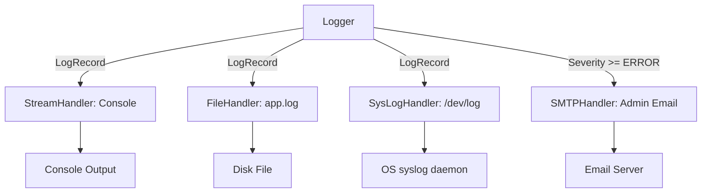

# Log Handlers: Routing Log Streams to Destinations

Loggers collect events, but **Handlers** determine where those events are sent. A single logger can distribute messages to multiple destinations simultaneously. For example, you can print system warnings to the console, save details to local log files, and send critical stack traces directly to your email inbox or a central syslog server.

In this guide, we will explore standard and advanced handlers (including `SysLogHandler` and `HTTPHandler`) and implement a high-performance **Asynchronous QueueHandler** pattern to prevent logging operations from blocking your main application thread.

---

## The Log Routing Flow



---

## 1. Advanced Handlers: Syslog and HTTP

Beyond standard files and console streams, production services often integrate with operating system syslog daemons or directly post logs to web endpoints.

### Using `SysLogHandler` (Unix/Linux Integration)
On Linux systems, using system syslog daemon (`/dev/log`) is standard practice for background services. This lets the OS handle log aggregation and rotation.

```python
import logging
from logging.handlers import SysLogHandler

logger = logging.getLogger("syslog_service")
logger.setLevel(logging.INFO)

# Connect to syslog daemon (uses UDP socket transport)
# On Linux, path is '/dev/log'; on macOS, use '/var/run/syslog'
try:
    syslog_handler = SysLogHandler(address="/dev/log")
    formatter = logging.Formatter("%(name)s[%(process)d]: %(message)s")
    syslog_handler.setFormatter(formatter)
    
    logger.addHandler(syslog_handler)
    logger.info("Service initialized. Log sent to Linux syslog daemon.")
except Exception as e:
    print(f"Syslog connection failed (running on Windows?): {e}")
```

### Using `HTTPHandler` (Web Log Aggregators)
If you want to send logs directly to a monitoring endpoint (like an internal log ingestion API), use `HTTPHandler`:

```python
import logging
from logging.handlers import HTTPHandler

logger = logging.getLogger("http_logger")
logger.setLevel(logging.WARNING)

# Send logs as POST requests to: http://logs.company.com/ingest
# secure=True uses HTTPS
http_handler = HTTPHandler(
    host="logs.company.com",
    url="/ingest",
    method="POST",
    secure=False
)

logger.addHandler(http_handler)
logger.warning("Resource limits reached: API rate limit threshold exceeded.")
```

---

## 2. High-Performance Asynchronous Logging: `QueueHandler`

In high-performance or real-time applications, blocking operations inside handlers is a major performance bottleneck. For example:
* A `FileHandler` can block if the disk is under heavy load.
* An `SMTPHandler` or `HTTPHandler` will block the executing thread while waiting for a network handshake and response (often taking 500ms to 2s).

To prevent logging from slowing down your application, you should use the **`QueueHandler`** and **`QueueListener`** pattern.


Here is a complete, thread-safe asynchronous logging implementation:

```python
import queue
import time
import logging
from logging.handlers import QueueHandler, QueueListener

def setup_async_logging():
    # 1. Create the main logger
    logger = logging.getLogger("async_app")
    logger.setLevel(logging.DEBUG)

    # 2. Create the slow handlers (simulated here by adding a file handler)
    file_handler = logging.FileHandler("app.log")
    formatter = logging.Formatter("%(asctime)s - %(levelname)s - %(message)s")
    file_handler.setFormatter(formatter)

    # 3. Create a thread-safe Queue
    log_queue = queue.Queue(-1) # -1 means infinite size

    # 4. Create QueueHandler and attach it to the logger
    # The main thread only writes to the queue (extremely fast, non-blocking)
    queue_handler = QueueHandler(log_queue)
    logger.addHandler(queue_handler)

    # 5. Create QueueListener to fetch logs from the queue and write to the file
    # This runs on a separate background thread
    listener = QueueListener(log_queue, file_handler)
    listener.start() # Start background thread

    # --- Test run ---
    logger.info("Application starting up...")
    logger.warning("Low memory warning detected.")
    
    # Allow the listener background thread to flush queues before stopping
    time.sleep(1)
    listener.stop() # Safely stop the listener thread
    print("Log files written asynchronously.")

if __name__ == "__main__":
    setup_async_logging()
```

---

## Summary

Handlers determine the final destination of log streams. While `FileHandler` and `StreamHandler` cover basic needs, integrating `SysLogHandler` or utilizing `QueueHandler` to prevent performance bottlenecks ensures your logging system is ready for high-performance production workloads. In the next section, we will cover **Log Formatters**.
