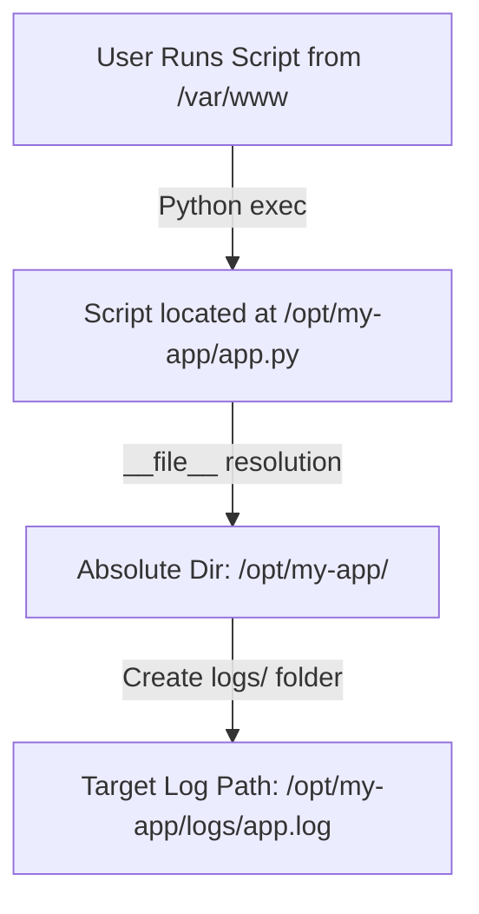

# Logging to Files: Persistent Disk Log Management

Console logs are temporary. When a terminal session ends or a docker container is destroyed, console output is lost. For persistent system monitoring, auditing, and troubleshooting, you must save log streams directly to a disk file.

While configuring a local file logger is simple in Python, production scripts must handle several edge cases:
1. **Dynamic Path Resolution**: Avoiding relative paths that break when the script is executed from different directory contexts.
2. **Directory Management**: Programmatically creating destination folders if they do not exist.
3. **Permissions Failures**: Handling read-only environments (e.g. attempting to write to `/var/log` without root permissions) and falling back gracefully to safe directories.
4. **Character Encoding**: Specifying proper text encoding (UTF-8) to prevent crashes when logging special characters or emojis.

In this guide, we will write a production-ready file logger setup that manages paths, creates folders, handles fallback permissions, and configures file encoding.

---

## The Path Resolution Problem

If you configure a file logger with a relative path:
```python
logging.basicConfig(filename="app.log")
```
The location of `app.log` depends on the **Current Working Directory (CWD)** where the script was launched from. If a user runs your script from `/home/user`, the log file is created in `/home/user/app.log`. If they run it from `/var/www`, it creates `/var/www/app.log`.

To prevent logs from scattering, always resolve absolute paths relative to the script file location using `__file__`.



---

## 1. Production-Ready File Logger Setup

Here is a complete setup script that resolves directory paths, verifies directory permissions, and handles falling back to a writable folder (like the user's home folder) if the primary target path is write-protected:

```python
import os
import sys
import logging

def get_writable_log_path(primary_path):
    """
    Verifies if a directory is writable. 
    If not, returns a fallback directory inside the user's home directory.
    """
    directory = os.path.dirname(primary_path)
    
    # 1. Attempt to create the folder if it does not exist
    try:
        os.makedirs(directory, exist_ok=True)
    except OSError:
        pass # Handle failure in permission checks below

    # 2. Check if we can write to the directory
    if os.path.exists(directory) and os.access(directory, os.W_OK):
        return primary_path
        
    # 3. Fallback: User home directory (~/.app_logs/app.log)
    print(f"⚠️ Warning: Directory '{directory}' is not writable. Falling back to home directory...")
    fallback_dir = os.path.join(os.path.expanduser("~"), ".app_logs")
    os.makedirs(fallback_dir, exist_ok=True)
    
    return os.path.join(fallback_dir, "app.log")

def initialize_file_logger():
    # Define primary target path (e.g. system level logs directory)
    # Inside actual scripts, resolve absolute paths:
    script_dir = os.path.dirname(os.path.abspath(__file__))
    primary_log_file = os.path.join(script_dir, "logs", "production_app.log")
    
    # Resolve write access
    final_log_path = get_writable_log_path(primary_log_file)
    print(f"Logging outputs directed to: {final_log_path}")

    # Create custom logger
    logger = logging.getLogger("file_service")
    logger.setLevel(logging.INFO)

    # Configure FileHandler
    # We specify 'encoding="utf-8"' to prevent crashes when logging emojis/unusual symbols
    # We use 'filemode="a"' to append logs (preserves history)
    file_handler = logging.FileHandler(
        filename=final_log_path,
        mode="a",
        encoding="utf-8"
    )

    formatter = logging.Formatter("%(asctime)s - %(levelname)s - (%(filename)s:%(lineno)d) - %(message)s")
    file_handler.setFormatter(formatter)
    logger.addHandler(file_handler)
    
    return logger

# Run the initialization
# logger = initialize_file_logger()
# logger.info("Persistent file logging initialized successfully! 🚀")
```

---

## 2. Character Encoding and Unicode Log Safety

If your application logs metadata from external API requests, it may receive emojis, foreign accents, or special symbols. 

If your file handler uses the system's default encoding (which might be `CP1252` on Windows or `ASCII` on bare containers), writing a Unicode character will throw a **`UnicodeEncodeError`** and crash your script.

Always configure the file handler with **`encoding="utf-8"`**:

```python
import logging

# ALWAYS declare encoding to prevent character crashes
handler = logging.FileHandler("unicode_safe.log", encoding="utf-8")
```

---

## 3. Overwriting vs. Appending Log Files

* **Append Mode (`mode='a'`)**: The default setting. It appends new logs to the end of the file. This preserves history and is required for production monitoring.
* **Overwrite Mode (`mode='w'`)**: Overwrites the file on every execution. This is useful for short-lived test suites or clean debug runs where you don't care about previous log logs.

```python
# Setup a fresh log file for every run
fresh_run_handler = logging.FileHandler("test_run.log", mode="w")
```

---

## Summary

Writing persistent logs to disk requires managing file paths and handling directory permissions. By resolving absolute paths, falling back to writable directories, and enforcing UTF-8 encoding, you can write file loggers that remain stable in any environment. In the next section, we will cover **Log Rotation** to prevent files from consuming all disk space.
