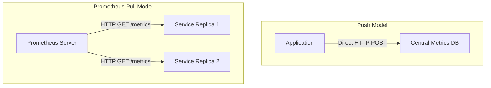

# Prometheus Client: Introduction to Metrics Collection

When running production systems, knowing *what* happened is only half the battle. Logs (e.g. stack traces, error messages) capture discrete events. However, to understand system health trends, you need **Metrics**—numerical values recorded over time (e.g. CPU load, active connections, requests per second).

**Prometheus** is the industry-standard open-source monitoring and alerting toolkit. Unlike traditional push-based monitoring systems that require your servers to constantly send metrics to a central database, Prometheus uses a **pull-based** model: it periodically scrapes metrics from an HTTP endpoint exposed by your application.

To instrument Python applications for Prometheus, we use the official **`prometheus-client`** library.

In this guide, we will compare logs and metrics, examine the pull vs. push monitoring model, define the four core Prometheus metric types, and write a setup script to initialize metrics.

---

## Logs vs. Metrics

| Criteria | Logs (Events) | Metrics (Performance Data) |
| :--- | :--- | :--- |
| **Data Type** | Text strings / JSON documents | Numeric values over time (Time Series) |
| **Volume** | High (Grows with every transaction) | Low (Constant size, independent of traffic volume) |
| **Primary Use Case**| Troubleshooting specific errors | Dashboard visualization & alerting thresholds |
| **Storage Cost** | High (Requires indexing text databases) | Low (Optimized compression for numbers) |
| **Query Speed** | Slow (Scanning millions of strings) | Fast (Aggregating numbers over time) |

---

## Pull vs. Push Monitoring Models

Most monitoring tools use a **Push model** (your script calls a server API to save data). Prometheus uses a **Pull model** (your script runs a mini web server, and Prometheus scrapes it).



### Why Pull?
* **Decoupled Architecture**: If your metrics server goes down, your application code is unaffected.
* **No Client Configuration**: The client doesn't need to know where the Prometheus server is located.
* **Automatic Service Discovery**: Prometheus automatically detects new application replicas and starts scraping them.

---

## Core Metric Types

Prometheus defines four metric types:

### 1. Counter
A cumulative metric that only increases or resets to zero upon restart. 
* *Best for*: Count of events, like total HTTP requests, exceptions caught, or bytes transmitted.
* *Standard naming*: `http_requests_total`

### 2. Gauge
A metric that represents a single numerical value that can go up and down.
* *Best for*: Current states, like CPU utilization, memory bytes used, active concurrent users, or queue size.
* *Standard naming*: `system_memory_usage_bytes`

### 3. Histogram
Samples observations (like response times or file sizes) and counts them in configurable range buckets. It also tracks the total sum and count of all observed values.
* *Best for*: Latency measurements.
* *Standard naming*: `http_request_duration_seconds`

### 4. Summary
Similar to a histogram, a summary samples observations and calculates configurable quantiles (e.g. p50, p95, p99 response times) over a sliding time window.
* *Best for*: High-precision quantiles for a single instance.

---

## The Prometheus Text Format

When Prometheus scrapes your application's `/metrics` endpoint, it expects the response body formatted in this exact structure:

```text
# HELP http_requests_total Total number of HTTP requests processed.
# TYPE http_requests_total counter
http_requests_total{method="GET",status="200"} 452
http_requests_total{method="POST",status="500"} 3

# HELP active_connections_total Current number of active client connections.
# TYPE active_connections_total gauge
active_connections_total 12
```

---

## 1. Initializing Metrics in Python

Install the Prometheus client library:

```bash
pip install prometheus-client
```

Here is a Python script that instantiates all four metric types:

```python
from prometheus_client import Counter, Gauge, Histogram, Summary

# 1. Counter (ends in _total)
REQUEST_COUNTER = Counter(
    "http_requests_total",
    "Total count of HTTP requests processed by the application"
)

# 2. Gauge
QUEUE_DEPTH = Gauge(
    "job_queue_depth_total",
    "Current number of elements waiting in the background worker queue"
)

# 3. Histogram
# By default, uses standard buckets: [.005, .01, .025, .05, .075, .1, .25, .5, .75, 1.0, 2.5, 5.0, 10.0]
REQUEST_LATENCY = Histogram(
    "http_request_duration_seconds",
    "Distribution of HTTP response times in seconds"
)

# 4. Summary
# Quantiles are defined as dict: {percentile: allowed_error}
DATABASE_LATENCY = Summary(
    "db_query_duration_seconds",
    "Quantile distribution of database query latencies",
    ["query_type"] # Label names
)

print("✅ Prometheus metrics initialized successfully.")
```

---

## Summary

Metrics track system performance trends over time, complimenting log files. Prometheus uses a pull model to collect these metrics in a standard text format. In the next section, we will cover how to **expose metrics** via a web endpoint.
