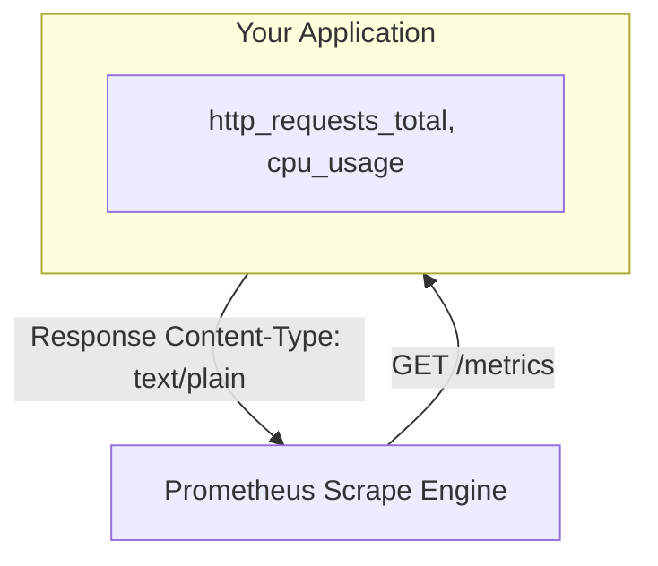

# Exposing Metrics: HTTP Servers and Framework Integrations

Prometheus requires your application to expose an HTTP endpoint where it can scrape metric values. The official `prometheus-client` provides two patterns to expose metrics:
1. **The Built-in HTTP Server**: Starts a lightweight, dedicated web server on a background thread. Best for scripts, workers, or daemons that do not already run a web server.
2. **Web Framework Integrations**: Exposes a `/metrics` route inside your existing web server (like Flask or FastAPI). Best for APIs or web services to avoid running a second server on a different port.

In this guide, we will write a background daemon metrics server, configure route integrations for Flask and FastAPI, and write a verification script to validate metrics endpoints.

---

## The Scraping Interface



---

## 1. Exposing Metrics with the Built-in Server

For background workers or queue consumers, the built-in HTTP server runs on a background daemon thread. It serves metrics on the path `/metrics` (e.g. `http://localhost:8000/metrics`).

```python
import time
from prometheus_client import start_http_server, Counter

# 1. Define a metric
TASK_COUNTER = Counter("background_tasks_total", "Count of tasks processed")

def main():
    # 2. Start the HTTP metrics server on port 8000
    # This runs a background HTTP server thread immediately
    metrics_port = 8000
    print(f"Starting Prometheus metrics server on http://localhost:{metrics_port}/metrics")
    start_http_server(metrics_port)
    
    # 3. Simulate processing work in a loop
    while True:
        print("Processing queue task...")
        TASK_COUNTER.inc()
        time.sleep(5)

if __name__ == "__main__":
    main()
```

---

## 2. Integrating with a FastAPI Application

If you are already running a FastAPI application, you can expose the `/metrics` route directly on your existing API server.

Install FastAPI and Uvicorn:
```bash
pip install fastapi uvicorn prometheus-client
```

Here is the FastAPI route integration code:

```python
from fastapi import FastAPI, Response
from prometheus_client import generate_latest, CONTENT_TYPE_LATEST, Counter

app = FastAPI(title="Billing Service API")

# Define metrics
API_REQUESTS = Counter(
    "api_requests_processed_total", 
    "Total API requests processed", 
    ["endpoint", "method"]
)

@app.get("/")
def read_root():
    API_REQUESTS.labels(endpoint="/", method="GET").inc()
    return {"message": "Billing API Online"}

@app.get("/payment")
def process_payment():
    API_REQUESTS.labels(endpoint="/payment", method="GET").inc()
    return {"status": "payment_approved"}

# Expose the metrics endpoint
@app.get("/metrics")
def expose_metrics():
    # generate_latest() pulls all registered metrics and formats them in the Prometheus layout
    # CONTENT_TYPE_LATEST is the header: 'text/plain; version=0.0.4; charset=utf-8'
    return Response(
        content=generate_latest(),
        media_type=CONTENT_TYPE_LATEST
    )

if __name__ == "__main__":
    import uvicorn
    uvicorn.run(app, host="0.0.0.0", port=8000)
```

---

## 3. Validating the Scrape Endpoint

Here is a Python verification script that queries your metrics endpoint, checks the status code, and confirms the payload conforms to the Prometheus plain-text layout.

```python
import requests

def validate_metrics_endpoint(url):
    print(f"Testing metrics endpoint at: {url}...")
    try:
        response = requests.get(url, timeout=5)
        
        # 1. Verify HTTP status code is 200
        if response.status_code != 200:
            print(f"❌ Failure: Server returned status code {response.status_code}")
            return False
            
        # 2. Verify Content-Type headers
        content_type = response.headers.get("Content-Type", "")
        print(f"Header: Content-Type = {content_type}")
        
        if "text/plain" not in content_type:
            print("❌ Failure: Header is not standard Prometheus text/plain format.")
            return False
            
        # 3. Check for typical format tags (HELP/TYPE)
        payload = response.text
        if "# HELP" in payload and "# TYPE" in payload:
            print("✅ Success: Metrics payload conforms to the Prometheus text format.")
            return True
        else:
            print("⚠️ Warning: Payload does not contain any registered HELP or TYPE tags.")
            return True
            
    except requests.RequestException as e:
        print(f"❌ Failed to connect to server: {e}")
        return False

# Example usage:
# validate_metrics_endpoint("http://localhost:8000/metrics")
```

---

## Summary

Exposing metrics lets Prometheus scrape your application's state. Using the built-in HTTP server or integrating a `/metrics` route into Flask or FastAPI allows you to expose metrics in a standardized format. In the next section, we will cover **Custom Counters** in detail.
