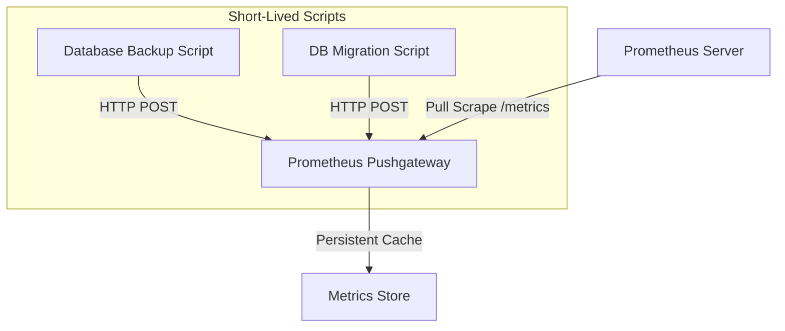

# Pushing to Pushgateway: Monitoring Ephemeral and Batch Jobs

Prometheus uses a pull-based model, scraping metrics from running web servers. However, short-lived tasks—such as daily backup scripts, database migrations, security audits, or CI/CD pipelines—run for a few seconds or minutes and then exit. 

Because they exit, they cannot run an HTTP server for Prometheus to scrape.

To monitor these ephemeral jobs, Prometheus provides the **Pushgateway**. Ephemeral tasks push their metrics to the Pushgateway service, which acts as a cache, and Prometheus scrapes the Pushgateway as a standard target.

In this guide, we will examine the Pushgateway architecture, configure a dedicated registry to filter out default process metrics, write a backup script that pushes metrics with grouping keys, and cover how to delete obsolete metrics.

---

## Pushgateway Architecture



---

## 1. Pushing Metrics with `push_to_gateway`

The `prometheus-client` library provides the `push_to_gateway` function to upload metrics.

### Best Practice: Use a Custom `CollectorRegistry`
By default, the client library collects default system metrics (like Python garbage collection stats, memory usage, and thread counts). For short-lived scripts, these default metrics pollute your database.

Always create a dedicated `CollectorRegistry` to ensure you only push the specific metrics you define.

```python
import time
from prometheus_client import CollectorRegistry, Gauge, push_to_gateway

def run_batch_job():
    # 1. Create a dedicated collector registry
    registry = CollectorRegistry()
    
    # 2. Define metrics on the custom registry
    # Note: Pass 'registry=registry' to the constructor
    EXECUTION_STATUS = Gauge(
        "job_execution_success_status",
        "Success indicator of the batch job (1 = success, 0 = failure)",
        registry=registry
    )
    
    # 3. Simulate processing work
    try:
        print("Executing batch job...")
        time.sleep(2)
        EXECUTION_STATUS.set(1.0) # Mark success
    except Exception as e:
        print(f"Job failed: {e}")
        EXECUTION_STATUS.set(0.0) # Mark failure

    # 4. Push metrics to the Pushgateway
    # job: The label that identifies this batch job in Prometheus
    # gateway: The host and port of the Pushgateway server
    gateway_url = "localhost:9091"
    job_name = "data_sync_worker"
    
    try:
        print(f"Pushing metrics to Pushgateway at {gateway_url}...")
        push_to_gateway(gateway_url, job=job_name, registry=registry)
        print("✅ Metrics successfully pushed.")
    except Exception as e:
        print(f"❌ Failed to push metrics: {e}")

if __name__ == "__main__":
    run_batch_job()
```

---

## 2. Using Grouping Keys to Prevent Collisions

If you run the same backup script across multiple servers, they will overwrite each other's metrics in the Pushgateway if they use the same job name.

To prevent this, use **grouping keys** (like server hostname) to create unique time-series metrics.

```python
import os
import socket
from prometheus_client import CollectorRegistry, Gauge, push_to_gateway

def backup_with_grouping_keys():
    registry = CollectorRegistry()
    
    BACKUP_SIZE = Gauge(
        "database_backup_bytes",
        "Size of database backup file in bytes",
        registry=registry
    )
    
    # Set backup size (simulated)
    BACKUP_SIZE.set(8589934592) # 8 GB
    
    # Define unique grouping keys
    # Typically, use the local hostname or container ID
    hostname = socket.gethostname()
    grouping_keys = {"instance": hostname, "env": "production"}
    
    # Push with grouping keys
    push_to_gateway(
        "localhost:9091",
        job="postgres_backup",
        registry=registry,
        grouping_key=grouping_keys
    )
    print(f"✅ Metrics pushed for instance '{hostname}'")
```

---

## 3. Cleaning Up (Deleting Metrics)

The Pushgateway preserves pushed metrics even after your script exits. If you delete a cron job, its last pushed metrics will remain in the Pushgateway indefinitely unless you delete them using `delete_from_gateway()`.

```python
from prometheus_client import delete_from_gateway

def cleanup_obsolete_metrics():
    gateway_url = "localhost:9091"
    job_name = "postgres_backup"
    
    try:
        # Delete metrics associated with this job
        delete_from_gateway(gateway_url, job=job_name)
        print(f"🗑️ Deleted metrics for job '{job_name}' from Pushgateway.")
    except Exception as e:
        print(f"Failed to delete metrics: {e}")
```

---

## Summary

The Pushgateway allows short-lived tasks to participate in pull-based monitoring. By creating custom registries, applying grouping keys, and clearing obsolete records, you can monitor batch scripts securely. This completes **Chapter 39 - Metrics with Python**. In the next chapter, we will cover **Alerting and Notifications**.
