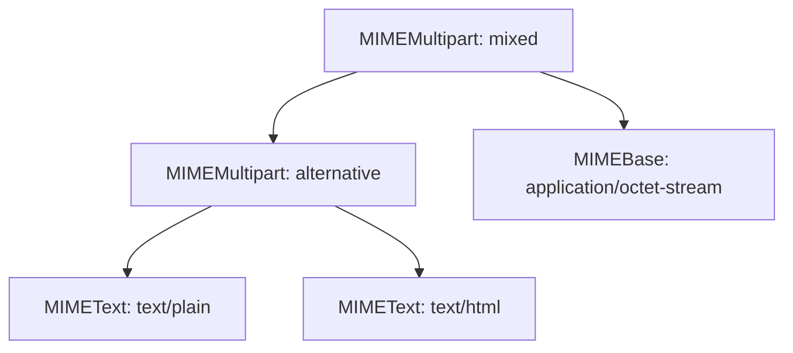

# Sending Email Alerts: SMTP Protocol and Log Attachments

While instant messaging tools (like Slack) are great for real-time notifications, **email** remains the preferred channel for detailed summaries, log snapshots, daily audit checks, and alerts that require persistent tracking.

In this guide, we will connect to mail servers using Python's built-in **`smtplib`** library, configure secure encryption protocols (SSL vs. STARTTLS), construct multipart HTML messages, encode and attach log files, and handle authentication errors gracefully.

---

## SMTP Security: SSL vs. STARTTLS

When connecting to an SMTP server, you must encrypt the connection to prevent credentials from being exposed over the network. There are two standard approaches:

1. **SMTP over SSL (Port 465)**: Establishes a secure connection immediately upon opening the socket. Uses the `smtplib.SMTP_SSL()` class.
2. **SMTP with STARTTLS (Port 587)**: Starts as an unencrypted connection, then upgrades to an encrypted TLS connection using the `.starttls()` command. Uses the standard `smtplib.SMTP()` class.

*Note: Port 587 (STARTTLS) is the modern standard for outgoing email clients.*

---

## The Multipart Message Architecture

An email containing both text and attachments is structured as a tree of MIME (Multipurpose Internet Mail Extensions) objects:



---

## 1. Sending HTML Emails with Attachments

Here is a complete script that connects to an SMTP server using TLS, constructs a multipart email, attaches a log file, and handles authentication exceptions.

```python
import os
import smtplib
from email import encoders
from email.mime.base import MIMEBase
from email.mime.text import MIMEText
from email.mime.multipart import MIMEMultipart

def send_secure_email_alert(subject, html_body, attachment_path=None):
    # 1. Fetch credentials from environment variables
    smtp_server = os.environ.get("SMTP_SERVER", "smtp.gmail.com")
    smtp_port = int(os.environ.get("SMTP_PORT", 587))
    sender_email = os.environ.get("SENDER_EMAIL")
    sender_password = os.environ.get("SENDER_PASSWORD")
    recipient_email = os.environ.get("RECIPIENT_EMAIL")

    if not all([sender_email, sender_password, recipient_email]):
        print("Error: SMTP configurations are not fully set in environment variables.")
        return False

    # 2. Initialize the root container
    # 'mixed' subtype allows both alternative bodies and file attachments
    msg = MIMEMultipart("mixed")
    msg["Subject"] = subject
    msg["From"] = sender_email
    msg["To"] = recipient_email

    # 3. Create the text container (HTML body)
    body_container = MIMEMultipart("alternative")
    body_container.attach(MIMEText(html_body, "html"))
    msg.attach(body_container)

    # 4. Attach log file if path is provided
    if attachment_path:
        if os.path.exists(attachment_path):
            try:
                print(f"Attaching log file: {attachment_path}...")
                with open(attachment_path, "rb") as f:
                    part = MIMEBase("application", "octet-stream")
                    part.set_payload(f.read())
                
                # Base64 encode the payload for transmission
                encoders.encode_base64(part)
                
                # Add attachment headers
                part.add_header(
                    "Content-Disposition",
                    f"attachment; filename={os.path.basename(attachment_path)}"
                )
                msg.attach(part)
                
            except Exception as e:
                print(f"Failed to attach file: {e}")
        else:
            print(f"Warning: Attachment file not found at: {attachment_path}")

    # 5. Connect and send email using STARTTLS
    try:
        print(f"Connecting to SMTP server {smtp_server}:{smtp_port}...")
        with smtplib.SMTP(smtp_server, smtp_port, timeout=10) as server:
            server.starttls() # Secure the connection
            server.login(sender_email, sender_password)
            server.send_message(msg)
            print("✅ Email alert sent successfully.")
            return True
            
    except smtplib.SMTPAuthenticationError:
        print("❌ SMTP Authentication Failed: Check username and app password.")
    except smtplib.SMTPConnectError:
        print("❌ SMTP Connection Failed: Unable to reach SMTP server.")
    except Exception as e:
        print(f"❌ Failed to send email: {e}")
        
    return False
```

---

## 2. Dynamic HTML Template Generation

To make emails readable, generate HTML reports containing status details.

```python
def generate_status_report_html(service_name, status, details_text):
    status_style = "color: green;" if status.upper() == "SUCCESS" else "color: red;"
    
    html = f"""
    <html>
      <body style="font-family: sans-serif; color: #333; line-height: 1.5; padding: 20px;">
        <h2 style="color: #2c3e50; border-bottom: 2px solid #ecf0f1; padding-bottom: 10px;">
          System Status Report
        </h2>
        <p><strong>Service:</strong> {service_name}</p>
        <p><strong>Status:</strong> 
          <span style="{status_style} font-weight: bold;">{status.upper()}</span>
        </p>
        <div style="background-color: #f8f9fa; border-left: 4px solid #ccd1d1; padding: 15px; margin-top: 15px;">
          <h4 style="margin-top: 0;">Details:</h4>
          <pre style="font-family: monospace; white-space: pre-wrap; margin: 0;">{details_text}</pre>
        </div>
        <p style="font-size: 0.8em; color: #7f8c8d; margin-top: 20px;">
          This report was generated automatically. Please do not reply.
        </p>
      </body>
    </html>
    """
    return html
```

---

## Summary

Email is a reliable, structured channel for delivering logs, detailed metrics, or pipeline reports directly to your inbox. By constructing multipart HTML emails and securing connections with STARTTLS, you can notify your team safely. In the next section, we will cover **PagerDuty Integration**.
