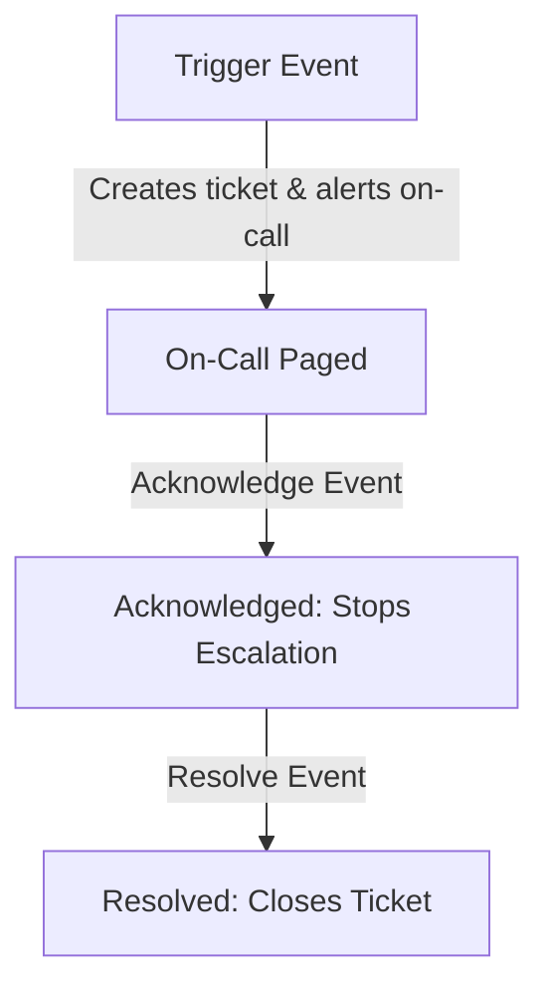

# PagerDuty Integration: On-Call Routing and Auto-Resolution

For critical, business-impacting outages (e.g. your primary database is down, checkout transactions are failing, or production storage is full), standard Slack messages or emails are not enough. If an incident happens at 3 AM, you need a system that will page the on-call engineer via phone call or SMS.

**PagerDuty** is the industry standard for incident management and on-call routing. In this guide, we will cover the PagerDuty Events API v2 lifecycle, implement incident triggers, examine the role of deduplication keys (`dedup_key`), and write an automated script that triggers and resolves incidents based on system resource monitoring.

---

## PagerDuty Events API v2 Lifecycle

PagerDuty allows scripts to transition incidents through three states:



1. **`trigger`**: Creates a new incident. If a `dedup_key` is provided, subsequent duplicate trigger events are grouped under the same open ticket, preventing alert fatigue.
2. **`acknowledge`**: Prevents the incident from escalating while an engineer is investigating.
3. **`resolve`**: Marks the incident as resolved. In automated systems, your script should trigger a resolution as soon as health checks recover.

---

## 2. Implementing PagerDuty API v2 Client

PagerDuty Events API v2 expects a POST request sent to the endpoint `https://events.pagerduty.com/v2/enqueue`. You must provide an **Integration Key** (routing key) generated in your PagerDuty service settings.

Here is the implementation:

```python
import os
import requests

PAGERDUTY_API_URL = "https://events.pagerduty.com/v2/enqueue"

def send_pagerduty_event(action, dedup_key, summary, severity="error", custom_details=None):
    """
    Sends an event to the PagerDuty Events API v2.
    
    action: 'trigger', 'acknowledge', or 'resolve'
    dedup_key: Unique identifier to deduplicate incidents
    summary: Brief text description of the alert
    severity: 'info', 'warning', 'error', or 'critical'
    """
    routing_key = os.environ.get("PAGERDUTY_ROUTING_KEY")
    if not routing_key:
        print("Error: PAGERDUTY_ROUTING_KEY not set.")
        return None

    # Construct the JSON payload matching the PagerDuty v2 schema
    payload = {
        "routing_key": routing_key,
        "event_action": action,
        "dedup_key": dedup_key
    }
    
    # Trigger events require detailed payload contents
    if action == "trigger":
        payload["payload"] = {
            "summary": summary,
            "source": "monitoring-daemon",
            "severity": severity,
            "class": "disk-io",
            "custom_details": custom_details or {}
        }

    try:
        response = requests.post(PAGERDUTY_API_URL, json=payload, timeout=5)
        response_data = response.json()
        
        if response.status_code == 202:
            print(f"✅ PagerDuty event '{action}' processed. Dedup Key: {response_data.get('dedup_key')}")
            return response_data.get("dedup_key")
        else:
            print(f"❌ PagerDuty error: {response.status_code} - {response.text}")
            return None
    except Exception as e:
        print(f"Failed to communicate with PagerDuty: {e}")
        return None
```

---

## 3. Real-World Scenario: Automated Disk Space Monitor and Auto-Resolver

Here is a complete production monitor script. It checks disk space utilization. If utilization exceeds 95%, it triggers a PagerDuty incident. If the space is cleaned up and drops below 90%, it automatically resolves the PagerDuty incident, closing the ticket without human intervention.

```python
import shutil
import time

def check_disk_utilization(path="/"):
    """
    Returns the disk utilization percentage.
    """
    total, used, free = shutil.disk_usage(path)
    percent_used = (used / total) * 100
    return percent_used

def monitor_disk_loop():
    # Use a unique dedup key for this specific check on this host
    # This ensures duplicate warnings are grouped into a single ticket
    DEDUP_KEY = "prod-host-01-disk-space-monitor"
    
    CRITICAL_LIMIT = 95.0
    RECOVERY_LIMIT = 90.0
    
    # Track the active alert state
    alert_active = False
    
    print("Starting disk utilization monitor loop...")
    
    while True:
        usage = check_disk_utilization()
        print(f"Current Disk Usage: {usage:.2f}%")
        
        # 1. Trigger condition: Disk usage is critically high
        if usage > CRITICAL_LIMIT and not alert_active:
            print("🚨 Critical disk space detected! Triggering PagerDuty pager...")
            send_pagerduty_event(
                action="trigger",
                dedup_key=DEDUP_KEY,
                summary=f"CRITICAL: Storage utilization is at {usage:.2f}% on host-01.",
                severity="critical",
                custom_details={"usage_percent": f"{usage:.2f}%", "partition": "/"}
            )
            alert_active = True
            
        # 2. Resolution condition: Disk usage has dropped back below recovery threshold
        elif usage < RECOVERY_LIMIT and alert_active:
            print("✅ Storage levels recovered. Auto-resolving PagerDuty incident...")
            send_pagerduty_event(
                action="resolve",
                dedup_key=DEDUP_KEY,
                summary="Storage levels recovered below threshold limits."
            )
            alert_active = False
            
        time.sleep(10)

# if __name__ == "__main__":
#     monitor_disk_loop()
```

---

## Summary

PagerDuty integration is critical for maintaining system uptime. By assigning unique `dedup_key` values and configuring auto-resolutions when metrics recover, you can page on-call engineers for critical issues while keeping your ticketing board clean. In the next section, we will cover **Microsoft Teams** notifications.
